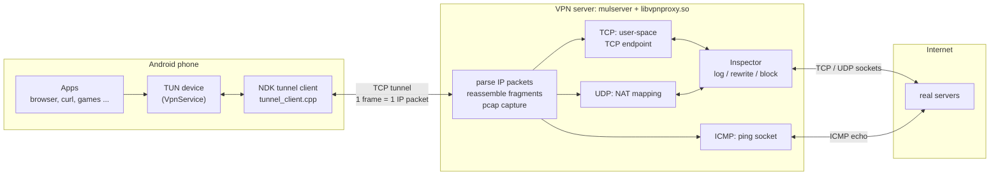
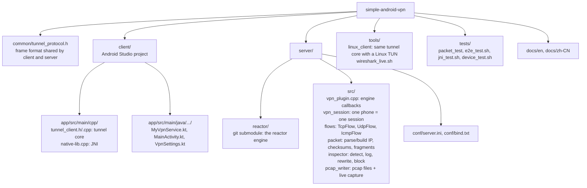
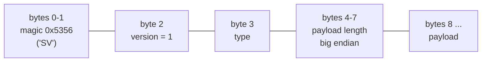

# SimpleVPN

**English** | [简体中文](README.zh-CN.md)

An Android VPN for **learning how to intercept, modify and monitor** network protocols.

The app on the phone does exactly one thing: it sends **every IP packet** the system hands to the VPN,
unchanged, through one TCP tunnel to your own server, and writes the IP packets the server sends back
into the system. All the "smart" work happens on the server: it terminates the TCP / UDP / ICMP
connections contained in those packets in user space, logs them (HTTP requests, TLS SNI, DNS queries
…), rewrites or blocks them by rule, and forwards them with ordinary sockets to the real destination.
Replies travel the same way back to the phone.



Why does the server terminate TCP in user space instead of dropping the IP packets into a server-side
TUN and doing NAT? Because after termination the server sees the **application byte stream**: it can
print HTTP requests, parse the TLS ClientHello and rewrite response content (even with a different
length — the two sides are two independent TCP connections with unrelated sequence numbers), and it
needs neither root nor iptables.

The server is built on
[simple-cplusplus-multithread-reactor-server](https://github.com/kingo132/simple-cplusplus-multithread-reactor-server)
(a git submodule in `server/reactor`); the VPN logic is a plugin for it.

## Documentation

Everything is explained in detail, with diagrams. Every source file is also commented line by line
(what each function does, why, parameters and return values).

| Document | What you learn |
|---|---|
| [Architecture](docs/en/architecture.md) | The whole system: phone, tunnel, server, sessions, flows, the user-space TCP state machine, UDP NAT, ICMP, fragmentation, flow control |
| [Tunnel protocol](docs/en/tunnel-protocol.md) | Frame format, handshake, keepalive, reconnect state machine |
| [Android client](docs/en/android-client.md) | VpnService, TUN, JNI threads, `protect()`, network changes, debug automation |
| [Inspector and capture](docs/en/inspector-and-capture.md) | Protocol detection (HTTP, TLS SNI, DNS, SSH), blocking, rewriting, QUIC, pcap and live Wireshark |
| [Learning guide](docs/en/learning-guide.md) | Hands-on experiments step by step, and how to write your own interception code |
| [Configuration](docs/en/configuration.md) | Every server key and app setting |
| [Testing](docs/en/testing.md) | Unit, end-to-end (network namespaces), JNI and device tests |
| [Source code tour](docs/en/source-tour.md) | Which file does what, recommended reading order |

The reactor engine has its own documentation: [architecture](https://github.com/kingo132/simple-cplusplus-multithread-reactor-server/blob/main/docs/en/architecture.md), [plugin guide](https://github.com/kingo132/simple-cplusplus-multithread-reactor-server/blob/main/docs/en/plugin-guide.md) (also in `server/reactor/docs/`).

## Features

* **TCP**: a complete user-space TCP endpoint — handshake (connect to the real server first, then answer
  SYN-ACK; RST if the server cannot be reached), MSS / window scale options, acknowledgements,
  retransmission (RTT estimation + exponential back-off + fast retransmit), zero window probing, flow
  control (advertise a zero window to the phone when the server cannot take more; pause reading the
  server when the phone cannot take more), half close, RST; IPv4 and IPv6
* **UDP**: one socket per (source, destination); ICMP unreachable back to the phone when the port is
  unreachable; a separate idle timeout for DNS
* **ICMP echo** (ping): unprivileged ping sockets first, raw sockets (root) as a fallback
* IP fragmentation: fragments from the phone are reassembled, packets to the phone larger than the MTU
  are fragmented
* **Inspector** (`server/src/inspector.cpp`):
  * logging: HTTP request line / Host / User-Agent, HTTP status line, TLS ClientHello (version, SNI,
    ALPN), DNS queries and answers, SSH banners, the first bytes of unknown protocols; optional one line
    per packet; optional hex dumps
  * blocking: domains in `vpn_block_domains` — DNS gets NXDOMAIN, matching TLS SNI / HTTP Host gets a
    RST
  * rewriting: `vpn_rewrite_N` rules replace strings in plaintext TCP streams (up / down)
  * `vpn_block_quic`: reject UDP 443 so browsers fall back to TCP + TLS (where the SNI is visible)
* **pcap capture**: one pcap file per session, opens directly in Wireshark; plus a **live** pcap stream
  for Wireshark (`tools/wireshark_live.sh`)
* Tunnel: token authentication, keepalive, automatic reconnect with exponential back-off, immediate
  reconnect when the phone switches between Wi-Fi and mobile data
* Android app: server / port / token / DNS / MTU settings, per-app VPN, IPv6 switch, live status and
  traffic counters, always-on VPN

## Repository layout



## Quick start

### 1. Build and run the server (Linux; macOS builds too)

```bash
git clone --recursive https://github.com/kingo132/simple-android-vpn.git
cd simple-android-vpn            # already cloned: git submodule update --init
cmake -B build && cmake --build build -j

cd server
vi conf/server.ini               # at least change vpn_token
../build/server/reactor/mulserver conf/server.ini ../build/server/libvpnproxy.so
```

* The listening address is in `conf/bind.txt` (default `0.0.0.0:9443`); on a cloud server open this TCP
  port in the security group / firewall.
* Logs are in `server/log/server.log`, pcap files in `server/pcap/`.
* For ping support run as root or allow unprivileged ping sockets:
  `sudo sysctl -w net.ipv4.ping_group_range="0 2147483647"`.
* The server needs IPv6 connectivity to proxy the phone's IPv6 traffic; without it, apps fall back to
  IPv4 after the IPv6 attempt fails.

### 2. Build and install the Android app

Open `client/` in Android Studio (it offers to install the NDK and CMake 3.22.1) and run it on a phone;
from the command line: `cd client && ./gradlew assembleDebug`.

In the app enter the server address, port and token (the same as `vpn_token` on the server) and tap
**Start VPN**; the first time Android shows its VPN consent dialog. "Only these apps" takes package
names (comma separated) to proxy only those apps; empty means all apps except SimpleVPN itself.

### 3. Without a phone: the Linux client

```bash
sudo ./build/tools/simplevpn-client -s <server ip> -p 9443 -t <token> -d tun0 --ipv4 172.19.0.2/24
# in another terminal: route the traffic to test into tun0 (never the route to the server itself)
sudo ip route add 93.184.0.0/16 dev tun0
curl http://93.184.215.14/
```

## What you see

The server log (`log_level = 6`) looks like this:

```text
S2 tunnel connection from 172.30.0.2:59956
S2 authenticated: client=android mtu=1500 tun_ipv4=172.19.0.2 tun_ipv6=fd00:5356::2
S2 TCP#1 172.19.0.2:56154 -> 198.51.100.10:8080 connected (server side local address 198.51.100.1:47288)
S2 TCP#1 172.19.0.2:56154 -> 198.51.100.10:8080 C->S HTTP GET /index.html HTTP/1.1 Host=198.51.100.10:8080 UA=curl/8.5.0
S2 TCP#1 172.19.0.2:56154 -> 198.51.100.10:8080 S->C HTTP/1.0 200 OK
S2 TCP#1 172.19.0.2:56154 -> 198.51.100.10:8080 rewrote 1 occurrence(s) of "Hello SimpleVPN" (downstream)
S2 TCP#1 172.19.0.2:56154 -> 198.51.100.10:8080 closed (up 91 bytes, down 202 bytes, 9 ms, 0 retransmits, HTTP 198.51.100.10:8080)
S2 UDP#24 172.19.0.2:47385 -> 198.51.100.10:53 C->S DNS query id=0xeffd q=A www.example.test
S2 UDP#24 172.19.0.2:47385 -> 198.51.100.10:53 S->C DNS response id=0xeffd q=A www.example.test | www.example.test A 1.2.3.4 ttl=60
S2 UDP#26 172.19.0.2:54401 -> 198.51.100.10:53 BLOCKED DNS query ads.blocked.test
S2 TCP#36 172.19.0.2:39336 -> 198.51.100.10:25 S->C first 29 bytes: "220 banner.test ESMTP ready\r\n"
S2 TCP#68 172.19.0.2:45030 -> 198.51.100.10:443 C->S TLS ClientHello TLS1.3 SNI=www.google.com ALPN=h2,http/1.1
```

Watch the phone's traffic live in Wireshark without affecting the phone:

```bash
tools/wireshark_live.sh                  # server on this machine
tools/wireshark_live.sh user@server      # server on a remote machine, via SSH
```

The [learning guide](docs/en/learning-guide.md) walks through experiments: blocking domains, rewriting
HTTP, forcing TLS instead of QUIC, adding your own protocol parser.

## Tunnel protocol in short

`common/tunnel_protocol.h`: frames over one TCP connection, 8-byte header:



| type | direction | payload |
|---|---|---|
| HELLO (1) | client → server | `key=value\n`: token, client, mtu, ipv4, ipv6 |
| HELLO_ACK (2) | server → client | `key=value\n`: server, session |
| PACKET (3) | both | one complete IPv4 / IPv6 packet |
| PING (4) / PONG (5) | both | keepalive, echoed back |
| ERROR (6) | both | reason (e.g. `authentication failed`); the sender then closes |

Details: [docs/en/tunnel-protocol.md](docs/en/tunnel-protocol.md).

## Tests

```bash
cmake -B build && cmake --build build -j
./build/tests/packet_test                 # packet parse/build, checksums, fragments, DNS/TLS/HTTP parsers
sudo tests/e2e_test.sh                    # end to end (root, network namespaces)
sudo tests/jni_test.sh                    # runs the app's JNI code on a Linux JVM
tests/device_test.sh                      # real phone (macOS / Linux, USB debugging)
```

See [docs/en/testing.md](docs/en/testing.md).

## Security notes

* The tunnel itself is **not encrypted**, only authenticated with a token. Use it on trusted networks
  or put port 9443 behind an SSH tunnel / WireGuard / TLS. Always set `vpn_token` on a public server
  and consider `vpn_block_private = 1` (forbid reaching the server's internal network through the proxy).
* HTTPS content stays encrypted: you see the SNI, the handshake before the certificate and traffic
  patterns. Seeing plaintext would need a TLS man-in-the-middle (install your own CA on the phone,
  issue certificates on the fly — many apps pin certificates and refuse), which is not implemented.
* The live capture port shows **all** traffic of all phones; it only accepts loopback clients unless
  `vpn_capture_allow_remote = 1`.

## Limitations / ideas

* Only TCP, UDP and ICMP echo are proxied; other IP protocols (GRE, ESP, SCTP …) are logged and dropped
* No SACK, no congestion control algorithm (sending is limited by the phone's window, 2 MB per flow and
  `vpn_session_inflight` per session)
* TLS man-in-the-middle decryption, tunnel encryption and a UDP tunnel (to avoid TCP over TCP) are not
  implemented yet
