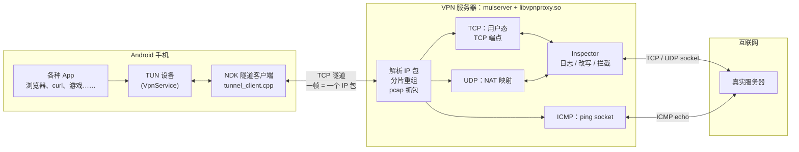
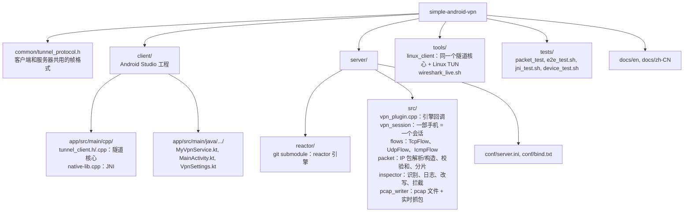
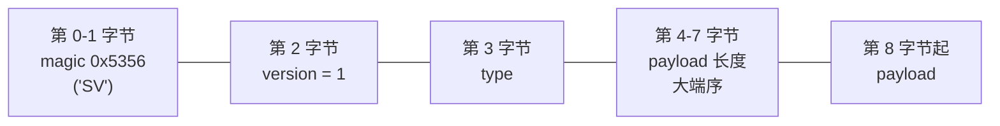

# SimpleVPN

[English](README.md) | **简体中文**

一个用来学习各种网络协议**拦截、修改和监测**的 Android VPN。

手机上的 App 只做一件事：把系统交给 VPN 的**每一个 IP 包**原样通过一条 TCP 隧道发给你自己的服务器，
再把服务器发回来的 IP 包写回系统。所有“聪明”的事情都在服务器上做：服务器把这些 IP 包里的
TCP / UDP / ICMP 连接在用户态终结掉，打印到日志（HTTP 请求、TLS SNI、DNS 查询……），
按规则改写或拦截，然后用普通 socket 转发给真正的目标服务器，回包再原路返回给手机。



为什么服务器要在用户态终结 TCP，而不是直接把 IP 包丢进服务器的 TUN 再做 NAT？
因为终结之后服务器看到的是**应用层字节流**：可以直接打印 HTTP 请求、解析 TLS ClientHello、
改写响应内容（长度变化也没关系，两边是两条独立的 TCP 连接，序号互不相关），而且不需要 root 和 iptables。

服务器基于 [simple-cplusplus-multithread-reactor-server](https://github.com/kingo132/simple-cplusplus-multithread-reactor-server)
（以 git submodule 的形式放在 `server/reactor`），VPN 逻辑是它的一个插件。

## 文档

所有内容都配有图示并做了详细讲解。每个源文件也都有逐行注释
（每个函数做什么、为什么这样做、参数和返回值）。

| 文档 | 你能学到什么 |
|---|---|
| [架构](docs/zh-CN/architecture.md) | 整个系统：手机、隧道、服务器、会话、流、用户态 TCP 状态机、UDP NAT、ICMP、分片、流控 |
| [隧道协议](docs/zh-CN/tunnel-protocol.md) | 帧格式、握手、心跳、重连状态机 |
| [Android 客户端](docs/zh-CN/android-client.md) | VpnService、TUN、JNI 线程、`protect()`、网络切换、调试自动化 |
| [Inspector 与抓包](docs/zh-CN/inspector-and-capture.md) | 协议识别（HTTP、TLS SNI、DNS、SSH）、拦截、改写、QUIC、pcap 和 Wireshark 实时抓包 |
| [学习指南](docs/zh-CN/learning-guide.md) | 一步一步的动手实验，以及如何编写自己的拦截代码 |
| [配置](docs/zh-CN/configuration.md) | 服务器的每个配置项和 App 的每个设置 |
| [测试](docs/zh-CN/testing.md) | 单元测试、端到端测试（network namespace）、JNI 测试和真机测试 |
| [源码导读](docs/zh-CN/source-tour.md) | 每个文件负责什么，推荐的阅读顺序 |

reactor 引擎有自己的文档：[架构](https://github.com/kingo132/simple-cplusplus-multithread-reactor-server/blob/main/docs/zh-CN/architecture.md)、[插件指南](https://github.com/kingo132/simple-cplusplus-multithread-reactor-server/blob/main/docs/zh-CN/plugin-guide.md)（也在 `server/reactor/docs/` 中）。

## 功能

* **TCP**：完整的用户态 TCP 端点——握手（先连上真实服务器再回 SYN-ACK，连不上就回 RST）、MSS / 窗口扩大选项、
  确认、重传（RTT 估计 + 指数退避 + 快速重传）、零窗口探测、流控（服务器写不动时向手机通告零窗口；
  手机收不动时暂停读服务器）、半关闭、RST；IPv4 和 IPv6
* **UDP**：每个 (源, 目的) 一个 socket；端口不可达时给手机回 ICMP unreachable；DNS 流单独的空闲超时
* **ICMP echo**（ping）：优先使用免 root 的 ping socket，失败时用 raw socket（root）
* IP 分片：手机发来的分片会重组，发给手机的超过 MTU 的包会分片
* **Inspector**（`server/src/inspector.cpp`）：
  * 日志：HTTP 请求行 / Host / User-Agent、HTTP 响应行、TLS ClientHello（版本、SNI、ALPN）、DNS 查询和应答、
    SSH banner、未知协议的前若干字节；可选每个包一行摘要、可选十六进制 dump
  * 拦截：`vpn_block_domains` 里的域名，DNS 回 NXDOMAIN，TLS SNI / HTTP Host 命中则 RST
  * 改写：`vpn_rewrite_N` 规则对明文 TCP 流做字符串替换（上行 / 下行）
  * `vpn_block_quic`：拒绝 UDP 443，让浏览器回退到 TCP + TLS（这样能看到 SNI）
* **pcap 抓包**：每个会话写一个 pcap 文件，直接用 Wireshark 打开；另外还有供 Wireshark 使用的**实时** pcap 流
  （`tools/wireshark_live.sh`）
* 隧道：token 认证、心跳、断线自动重连（指数退避），手机切换 Wi-Fi / 移动数据时立即重连
* Android App：服务器/端口/token/DNS/MTU 设置、只代理指定 App、IPv6 开关、实时状态和流量统计、always-on VPN

## 目录结构



## 快速开始

### 1. 编译和运行服务器（Linux，macOS 也可以编译）

```bash
git clone --recursive https://github.com/kingo132/simple-android-vpn.git
cd simple-android-vpn            # 已经 clone 过的: git submodule update --init
cmake -B build && cmake --build build -j

cd server
vi conf/server.ini               # 至少把 vpn_token 改掉
../build/server/reactor/mulserver conf/server.ini ../build/server/libvpnproxy.so
```

* 监听地址在 `conf/bind.txt`（默认 `0.0.0.0:9443`），云服务器记得在安全组 / 防火墙放行这个 TCP 端口。
* 日志在 `server/log/server.log`，pcap 在 `server/pcap/`。
* 要支持 ping：用 root 运行，或者允许免 root 的 ping socket：
  `sudo sysctl -w net.ipv4.ping_group_range="0 2147483647"`。
* 服务器要能访问 IPv6 才能代理手机的 IPv6 流量；没有 IPv6 也没关系，App 连接 IPv6 失败后会自动回退到 IPv4。

### 2. 编译和安装 Android App

用 Android Studio 打开 `client/` 目录（需要 NDK 和 CMake 3.22.1，Android Studio 会提示安装），
运行到手机上即可；命令行：`cd client && ./gradlew assembleDebug`。

在 App 里填写服务器地址、端口、token（和服务器 `vpn_token` 一致），点 **Start VPN**，
第一次会弹出系统的 VPN 授权对话框。“Only these apps” 填包名（逗号分隔）就只代理这些 App，
留空则代理除 SimpleVPN 自身以外的所有 App。

### 3. 不用手机：Linux 客户端

```bash
sudo ./build/tools/simplevpn-client -s <服务器IP> -p 9443 -t <token> -d tun0 --ipv4 172.19.0.2/24
# 另一个终端：把要测试的流量路由进 tun0（不要把到服务器本身的路由也指进去）
sudo ip route add 93.184.0.0/16 dev tun0
curl http://93.184.215.14/
```

## 你会看到什么

服务器日志（`log_level = 6`）大概是这样的：

```text
S2 tunnel connection from 172.30.0.2:59956
S2 authenticated: client=android mtu=1500 tun_ipv4=172.19.0.2 tun_ipv6=fd00:5356::2
S2 TCP#1 172.19.0.2:56154 -> 198.51.100.10:8080 connected (server side local address 198.51.100.1:47288)
S2 TCP#1 172.19.0.2:56154 -> 198.51.100.10:8080 C->S HTTP GET /index.html HTTP/1.1 Host=198.51.100.10:8080 UA=curl/8.5.0
S2 TCP#1 172.19.0.2:56154 -> 198.51.100.10:8080 S->C HTTP/1.0 200 OK
S2 TCP#1 172.19.0.2:56154 -> 198.51.100.10:8080 rewrote 1 occurrence(s) of "Hello SimpleVPN" (downstream)
S2 TCP#1 172.19.0.2:56154 -> 198.51.100.10:8080 closed (up 91 bytes, down 202 bytes, 9 ms, 0 retransmits, HTTP 198.51.100.10:8080)
S2 UDP#24 172.19.0.2:47385 -> 198.51.100.10:53 C->S DNS query id=0xeffd q=A www.example.test
S2 UDP#24 172.19.0.2:47385 -> 198.51.100.10:53 S->C DNS response id=0xeffd q=A www.example.test | www.example.test A 1.2.3.4 ttl=60
S2 UDP#26 172.19.0.2:54401 -> 198.51.100.10:53 BLOCKED DNS query ads.blocked.test
S2 TCP#36 172.19.0.2:39336 -> 198.51.100.10:25 S->C first 29 bytes: "220 banner.test ESMTP ready\r\n"
S2 TCP#68 172.19.0.2:45030 -> 198.51.100.10:443 C->S TLS ClientHello TLS1.3 SNI=www.google.com ALPN=h2,http/1.1
```

在 Wireshark 里实时查看手机的流量，不会影响手机上网：

```bash
tools/wireshark_live.sh                  # 服务端在本机
tools/wireshark_live.sh user@server      # 服务端在远程服务器，通过 SSH
```

[学习指南](docs/zh-CN/learning-guide.md)会带你一步步做实验：屏蔽域名、改写 HTTP、
强制使用 TLS 而不是 QUIC、添加自己的协议解析器。

## 隧道协议简介

`common/tunnel_protocol.h`：一条 TCP 连接上传输帧，帧头 8 字节：



| type | 方向 | payload |
|---|---|---|
| HELLO (1) | 客户端 → 服务器 | `key=value\n`：token, client, mtu, ipv4, ipv6 |
| HELLO_ACK (2) | 服务器 → 客户端 | `key=value\n`：server, session |
| PACKET (3) | 双向 | 一个完整的 IPv4 / IPv6 包 |
| PING (4) / PONG (5) | 双向 | 心跳，原样返回 |
| ERROR (6) | 双向 | 错误原因（如 `authentication failed`），发送方随后关闭连接 |

详见：[docs/zh-CN/tunnel-protocol.md](docs/zh-CN/tunnel-protocol.md)。

## 测试

```bash
cmake -B build && cmake --build build -j
./build/tests/packet_test                 # 包解析/构造、校验和、分片重组、DNS/TLS/HTTP 解析
sudo tests/e2e_test.sh                    # 端到端（需要 root，使用 network namespace）
sudo tests/jni_test.sh                    # 在 Linux JVM 上运行 App 的 JNI 代码
tests/device_test.sh                      # 真机测试（macOS / Linux，手机 USB 调试连接）
```

参见 [docs/zh-CN/testing.md](docs/zh-CN/testing.md)。

## 安全注意事项

* 隧道本身**没有加密**，只有 token 认证。请在可信网络里使用，或者把 9443 端口放到 SSH 隧道 / WireGuard / TLS 后面。
  服务器暴露在公网时一定要设置 `vpn_token`，并考虑 `vpn_block_private = 1`（禁止通过代理访问服务器所在内网）。
* HTTPS 的内容是加密的：只能看到 SNI、证书之前的握手信息和流量特征。要看明文需要做 TLS 中间人
  （给手机装自己的 CA 证书，服务器动态签发证书——很多 App 会做证书锁定而拒绝），这个还没有实现。
* 实时抓包端口能看到**所有**手机的全部流量；除非设置 `vpn_capture_allow_remote = 1`，否则只接受本机（loopback）连接。

## 限制 / 以后可以做的

* 只代理 TCP、UDP 和 ICMP echo；其它 IP 协议（GRE、ESP、SCTP……）会被记录日志后丢弃
* 没有 SACK、没有拥塞控制算法（发送量受手机窗口、单流 2 MB 和每个会话 `vpn_session_inflight` 限制）
* TLS 中间人解密、隧道加密、UDP 隧道（避免 TCP over TCP）都还没有做
