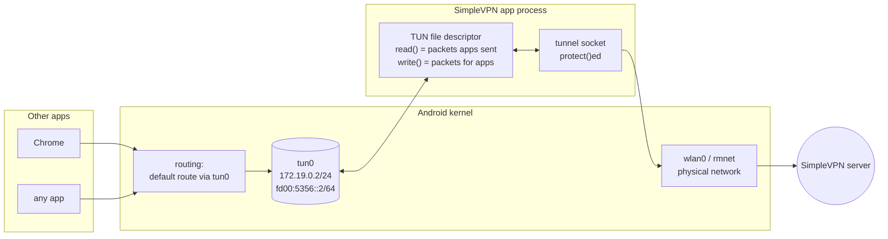
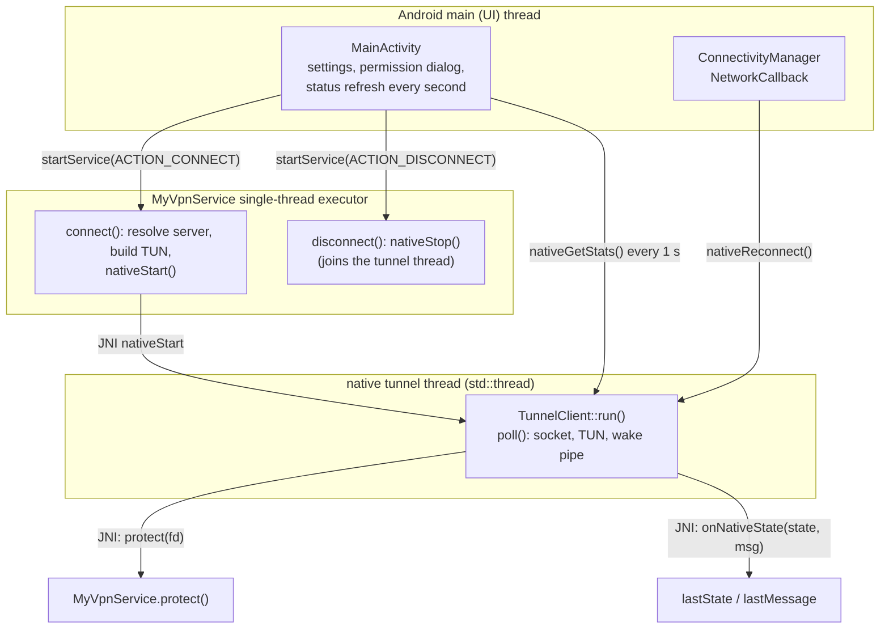
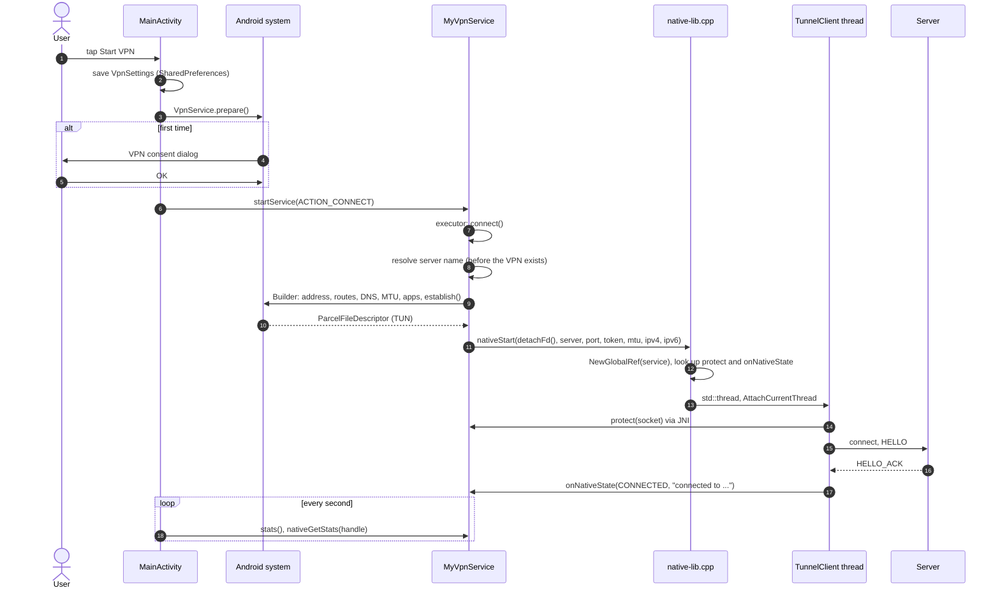
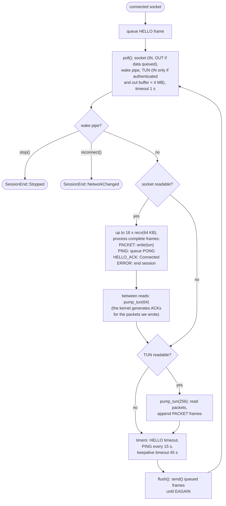
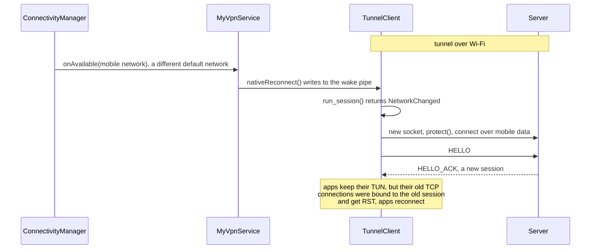

# Android client

**English** | [简体中文](../zh-CN/android-client.md) · [README](../../README.md) · [Architecture](architecture.md) · [Tunnel protocol](tunnel-protocol.md) · [Inspector and capture](inspector-and-capture.md) · [Learning guide](learning-guide.md) · [Configuration](configuration.md) · [Testing](testing.md) · [Source tour](source-tour.md)

The app is deliberately thin: Kotlin sets up the VPN with Android's `VpnService` API, and a small C++
core (shared with the Linux test client) pumps IP packets between the TUN device and the server.

## 1. How Android VPNs work



* `VpnService.Builder.establish()` creates a TUN interface and returns its file descriptor. The routes
  we add (`0.0.0.0/0`, `::/0`) make the system send apps' traffic into it.
* Reading the fd returns one complete IP packet per `read()`; writing a packet injects it into the
  kernel as if it arrived from a network.
* Our own tunnel socket must **not** be routed into the TUN — that would be an endless loop. Two
  mechanisms prevent it: the app excludes itself (`addDisallowedApplication(packageName)`) and every
  tunnel socket is passed to `VpnService.protect(fd)` before `connect()`, which binds it to the
  physical network.

## 2. Classes and threads



| Thread | Why it exists |
|---|---|
| UI thread | Android requires UI work there; it must never block |
| service executor | connect/disconnect can block (DNS lookup, joining the native thread); one thread also serializes them so two connects never overlap |
| native tunnel thread | runs the blocking `poll()` loop of `TunnelClient` for the whole VPN lifetime |

## 3. Starting the VPN



Details worth knowing:

* **The server name is resolved before `establish()`**. Once the VPN is up, DNS goes into the tunnel,
  which is not connected yet.
* **`detachFd()`** transfers ownership of the TUN fd to native code; `TunnelClient::run()` closes it
  when it ends, which tears the VPN interface down.
* **JNI threads**: a native thread must `AttachCurrentThread()` before calling Java and
  `DetachCurrentThread()` before it ends. The service object is kept as a **global reference** because
  local references are only valid during one JNI call.
* `onNativeState` is called on the tunnel thread, so it only stores two volatile fields; the UI reads
  them once per second.

## 4. Inside TunnelClient::run_session()



Why work in small batches and alternate between directions? Writing many packets into the TUN makes
the phone's kernel produce ACKs right away. If we did not read them out of the TUN in between, its
transmit queue (500 packets on Linux/Android) would overflow and packets would be lost, which TCP
would interpret as congestion.

## 5. Network changes



Without this callback the client would only notice the dead Wi-Fi connection after the 45 s keepalive
timeout.

## 6. VpnService.Builder settings

| Builder call | Value | Why |
|---|---|---|
| `addAddress` | `172.19.0.2/24`, `fd00:5356::2/64` | the phone's addresses inside the VPN (private ranges) |
| `addRoute` | `0.0.0.0/0`, `::/0` | send all traffic into the VPN |
| `addDnsServer` | setting (default `8.8.8.8`) | DNS queries go through the tunnel to this server |
| `setMtu` | setting (default 1500) | largest packet the TUN delivers; also sent in HELLO |
| `setBlocking(false)` | | the native loop uses `poll()` and non-blocking reads |
| `addDisallowedApplication` / `addAllowedApplication` | own package / "Only these apps" | avoid the routing loop; per-app VPN |
| `setMetered(false)` | Android 10+ | do not make apps think they are on a metered network |
| `setConfigureIntent` | MainActivity | opens the app from the system VPN notification |

Always-on VPN works too: the system starts the service with the `android.net.VpnService` action, which
`onStartCommand` treats like `ACTION_CONNECT`. `onRevoke()` is called when another VPN takes over or
the user disconnects in the system settings.

## 7. Debug automation hook

Debug builds accept commands through an activity intent, which `tests/device_test.sh` uses:

```bash
adb shell am start -n com.kingo132.simplevpn/.MainActivity --es vpn_action connect \
    --es server 192.168.1.10 --ei port 9443 --es token secret [--es dns 8.8.8.8] [--ez ipv6 false]
adb shell am start -n com.kingo132.simplevpn/.MainActivity --es vpn_action disconnect
```

Release builds ignore it (`FLAG_DEBUGGABLE` check), so another app cannot redirect the VPN to its own
server.

## 8. Native build notes

* `client/app/src/main/cpp/CMakeLists.txt` builds `libsimplevpn.so` from `native-lib.cpp`,
  `tunnel_client.cpp` and the shared `common/tunnel_protocol.h`.
* `-Wl,-z,max-page-size=16384` aligns the ELF segments to 16 KB, required for devices with 16 KB memory
  pages (Android 15+); such a library still works on 4 KB devices.
* The same `tunnel_client.cpp` is compiled into `tools/linux_client` (with a Linux TUN device) and into
  the host JNI test (`tests/jni_test.sh`), so most client logic can be tested without a phone.
