# Architecture

**English** | [简体中文](../zh-CN/architecture.md) · [README](../../README.md) · [Tunnel protocol](tunnel-protocol.md) · [Android client](android-client.md) · [Inspector and capture](inspector-and-capture.md) · [Learning guide](learning-guide.md) · [Configuration](configuration.md) · [Testing](testing.md) · [Source tour](source-tour.md)

This document follows an IP packet from an app on the phone to a server on the internet and back, and
explains every component it passes, what that component does and why it is built that way.

## Contents

1. [The idea in one picture](#1-the-idea-in-one-picture)
2. [Components](#2-components)
3. [The journey of one HTTP request](#3-the-journey-of-one-http-request)
4. [The server plugin on the reactor engine](#4-the-server-plugin-on-the-reactor-engine)
5. [Sessions: one phone, one tunnel](#5-sessions-one-phone-one-tunnel)
6. [From IP packet to flow](#6-from-ip-packet-to-flow)
7. [TCP: a user-space TCP endpoint](#7-tcp-a-user-space-tcp-endpoint)
8. [UDP: NAT with connected sockets](#8-udp-nat-with-connected-sockets)
9. [ICMP echo (ping)](#9-icmp-echo-ping)
10. [IP fragmentation](#10-ip-fragmentation)
11. [Flow control and back pressure end to end](#11-flow-control-and-back-pressure-end-to-end)
12. [Timers and timeouts](#12-timers-and-timeouts)
13. [IPv6](#13-ipv6)

---

## 1. The idea in one picture

A normal VPN encrypts packets and a server routes them with NAT. SimpleVPN instead **terminates**
every connection on the server and opens a new one to the real destination. This is called a
*split TCP* or *transparent proxy* design:

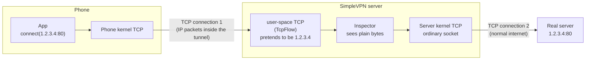

* Connection 1 runs between the phone's kernel and our **user-space TCP implementation** (`TcpFlow`).
  The phone believes it talks to 1.2.3.4.
* Connection 2 is an ordinary socket from the server to 1.2.3.4.
* Between them the server has the **plain byte stream**. It can log, modify or drop it. Because the two
  connections have independent sequence numbers, changing the length of the data is no problem.
* No root and no iptables are needed on the server (except for raw ICMP).

## 2. Components

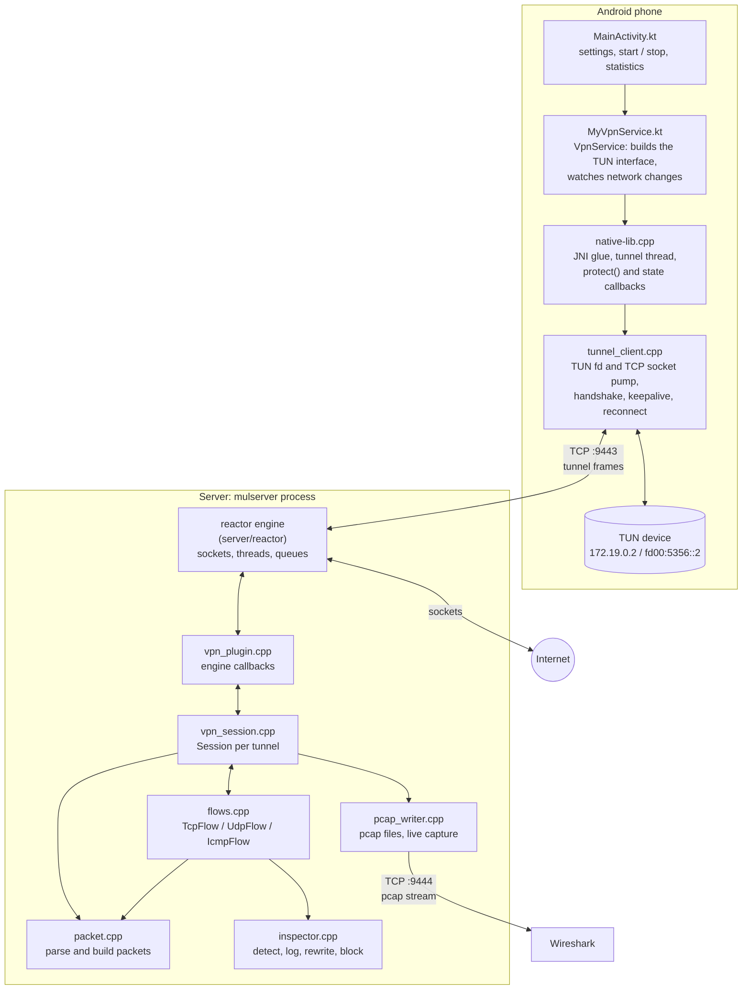

| Component | Language | Responsibility |
|---|---|---|
| `MainActivity` | Kotlin | UI, asks for VPN permission, shows state and counters |
| `MyVpnService` | Kotlin | creates the TUN interface with `VpnService.Builder`, starts/stops the native tunnel |
| `native-lib.cpp` | C++ / JNI | runs `TunnelClient` on its own thread, bridges `protect()` and state callbacks to Java |
| `TunnelClient` | C++ | moves IP packets between the TUN fd and the server connection; also used by the Linux client |
| reactor engine | C++ | all socket I/O and threading on the server |
| `vpn_plugin.cpp` | C++ | maps engine callbacks to sessions and flows |
| `Session` | C++ | one per tunnel: authentication, frames, flow table, statistics, pcap |
| `TcpFlow` / `UdpFlow` / `IcmpFlow` | C++ | one per connection / conversation: protocol logic and the outbound socket |
| `packet.cpp` | C++ | IPv4/IPv6/TCP/UDP/ICMP parsing and building, checksums, fragmentation |
| `Inspector` | C++ | protocol detection, logging, rewriting, blocking — **the place for experiments** |
| `PcapWriter` / `LiveCapture` | C++ | capture to files and to live Wireshark clients |

## 3. The journey of one HTTP request

What happens when the browser on the phone loads `http://example.com/`:

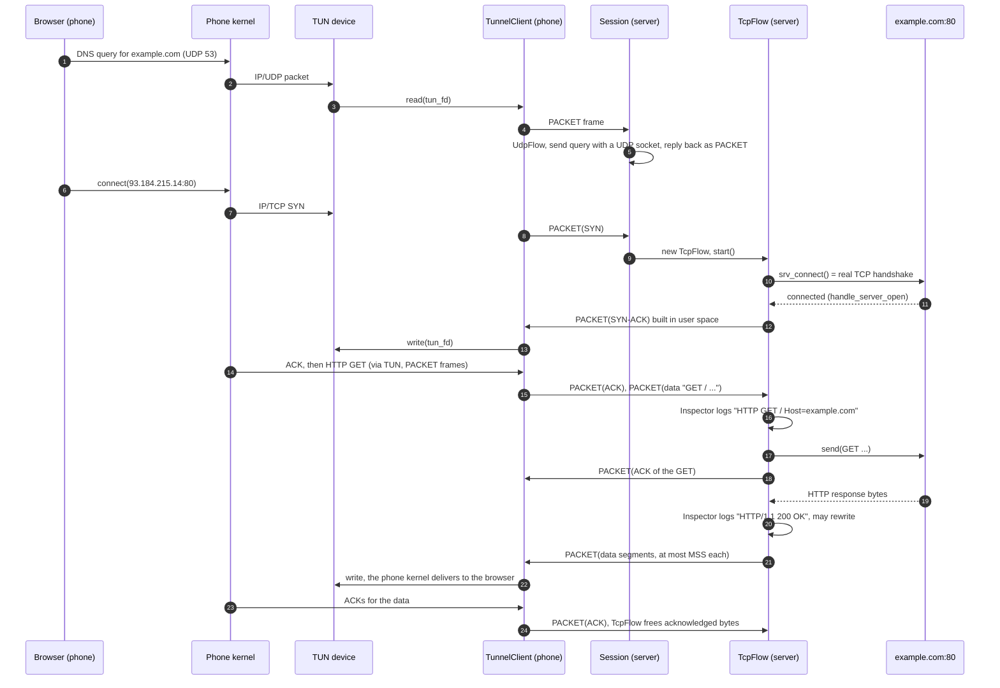

Two things are worth noticing:

* The SYN-ACK is sent **only after** the real server accepted the connection. If the server refuses,
  the phone gets a RST — exactly what it would see without a VPN.
* Every packet in both directions is also written to the session's pcap file and to live Wireshark
  clients, so you can compare what the phone sees with what the server logs.

## 4. The server plugin on the reactor engine

The VPN server is a plugin (`libvpnproxy.so`) of the reactor engine. The engine owns the sockets and
threads; the plugin only reacts to callbacks.

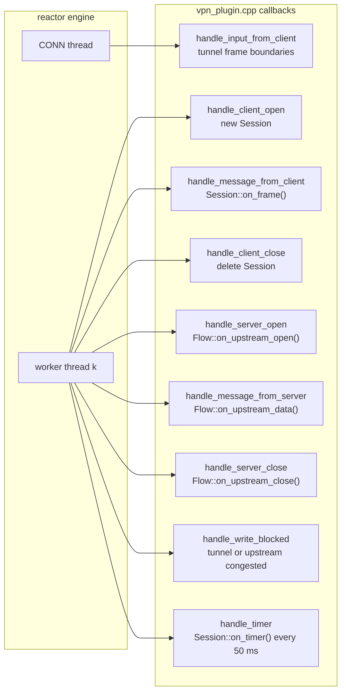

| Engine callback | Who | Plugin action |
|---|---|---|
| `handle_input_from_client` | CONN thread | `tunnel::parse_header()` → length of one frame (or the whole chunk for capture clients) |
| `handle_client_open` | worker | capture port: add a live capture subscriber; tunnel port: `new Session` |
| `handle_message_from_client` | worker | `Session::on_frame(type, payload)` then `reap()` |
| `handle_client_close` | worker | delete the Session; its destructor aborts every outbound socket |
| `handle_server_open/…_from_server/…_close` | worker | find the Flow by `si->user_tag` (= flow id) and forward the event |
| `handle_write_blocked` | worker | tunnel → `Session::on_tunnel_write_blocked`; upstream → `Flow::on_upstream_write_blocked` |
| `handle_timer` | worker | `Session::on_timer()` for every session of this worker |

### Why no locks are needed

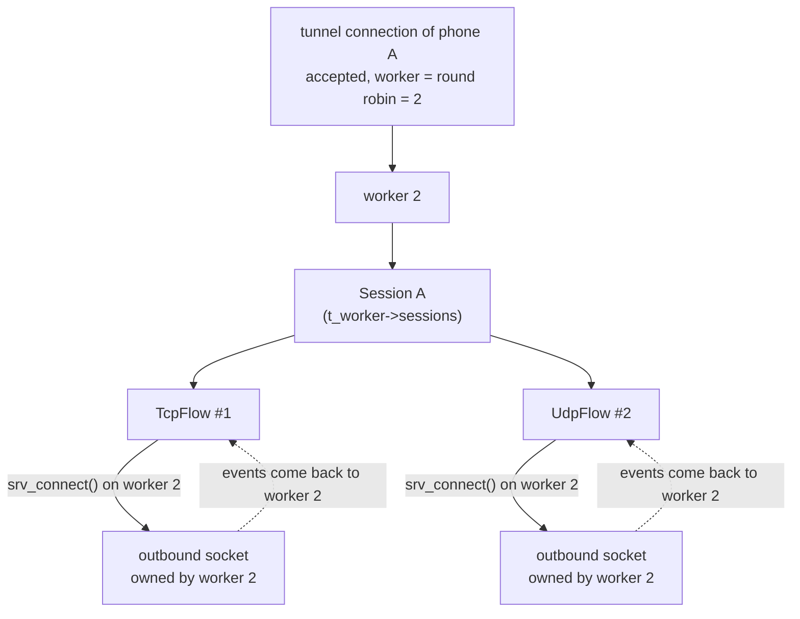

The engine pins every connection to one worker, and `srv_connect()` sockets belong to the worker
that created them. So the tunnel, its session, all its flows and all their outbound sockets live on
**one** thread. All state is kept in the `thread_local WorkerState` (`sessions` by tunnel `conn_id`,
`flows` by flow id) and no mutex is needed. Different phones are spread over the workers.

The only process-wide objects are read-only after start (`g_vpn_config`, `g_inspector`) or protected
by their own mutex (`g_live_capture`).

## 5. Sessions: one phone, one tunnel

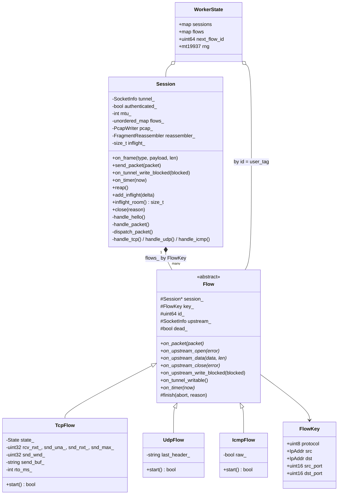

### Session life cycle

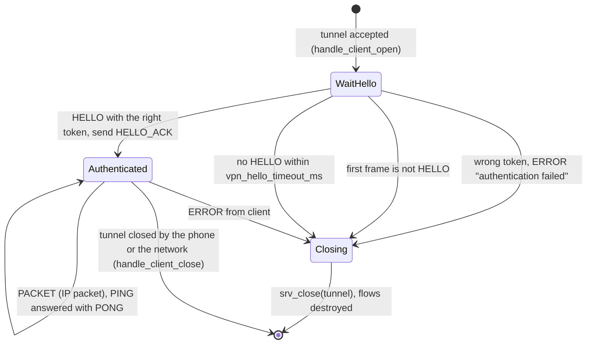

### Flow deletion: finish() and reap()

A flow can decide to die in the middle of its own callback (for example while processing a RST).
Deleting `this` there would be a use-after-free. Therefore:

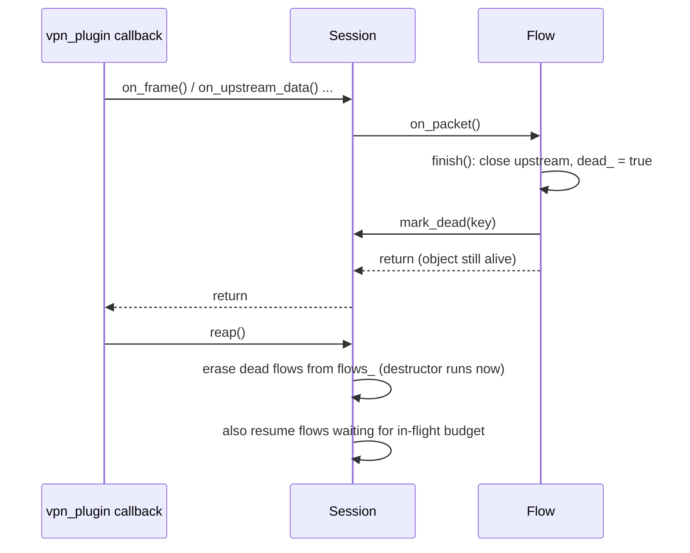

## 6. From IP packet to flow

`Session::handle_packet()` and `dispatch_packet()`:

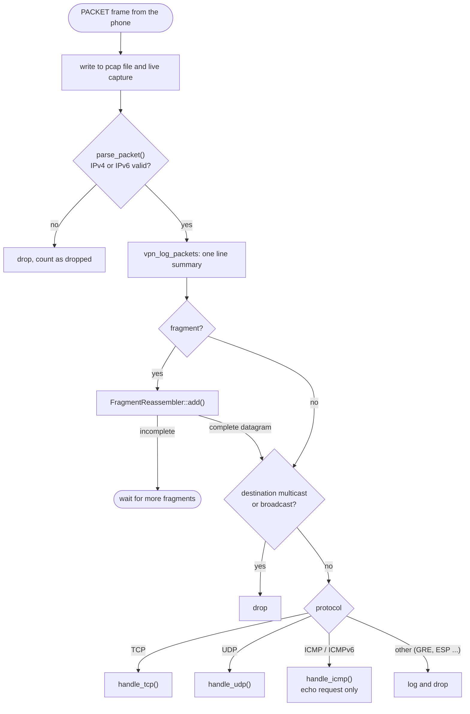

Flows are looked up by a **5-tuple key**: protocol, phone address and port, destination address and
port (for ICMP the port is the echo identifier).

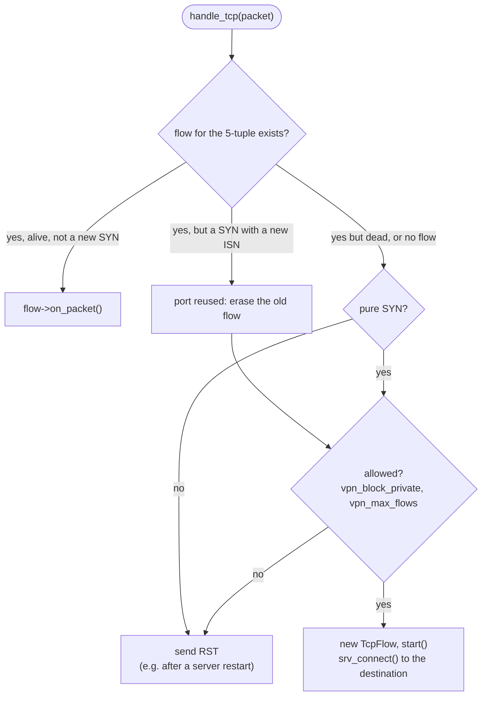

## 7. TCP: a user-space TCP endpoint

`TcpFlow` (`flows.cpp`) implements the server side of TCP (RFC 9293) towards the phone, simplified
where the situation allows it. It does **not** implement congestion control: the phone and the server
are connected by the tunnel, which is itself a TCP connection with its own congestion control.

### 7.1 State machine

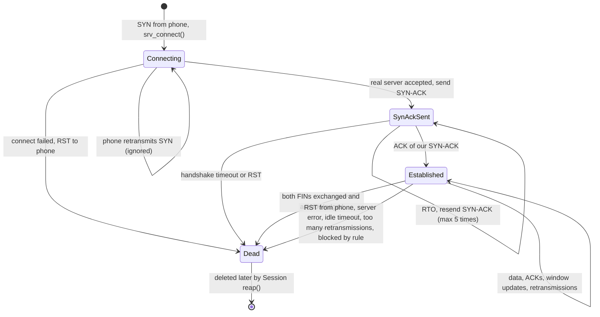

There is no explicit FIN_WAIT/CLOSE_WAIT/TIME_WAIT: the closing state is described by four flags
(`phone_fin_`, `upstream_eof_`, `fin_sent_`, `fin_acked_`). TIME_WAIT is unnecessary because the flow
key is removed and a new SYN with a different ISN creates a fresh flow.

### 7.2 Handshake and options

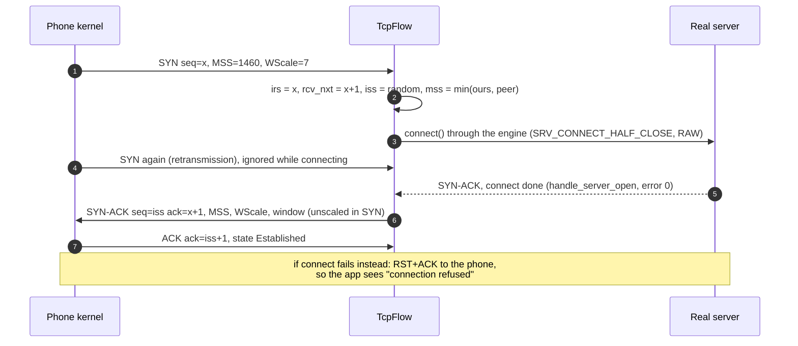

* **MSS** (maximum segment size): `min(our MTU - 40 (IPv4) / 60 (IPv6), phone's MSS)`; defaults 536 /
  1220 when the phone sends none.
* **Window scale**: only if the phone offered it. We pick the smallest shift so that `vpn_tcp_window`
  (512 KB) fits into 16 bits. The window field of a SYN is never scaled.

### 7.3 Sequence space bookkeeping

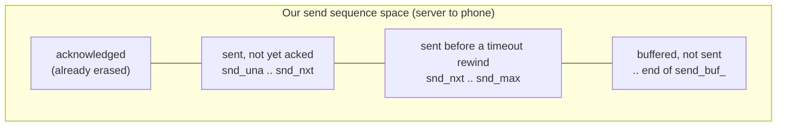

| Variable | Meaning |
|---|---|
| `snd_una_` | oldest byte not acknowledged by the phone; `send_buf_` starts here |
| `snd_nxt_` | next byte to send; rewound to `snd_una_` on a retransmission timeout (go-back-N) |
| `snd_max_` | highest byte ever sent + 1; ACKs up to here are valid even after a rewind |
| `snd_wnd_` | phone's receive window (scaled) |
| `rcv_nxt_` | next byte expected from the phone (what we acknowledge) |

### 7.4 Download: server → phone

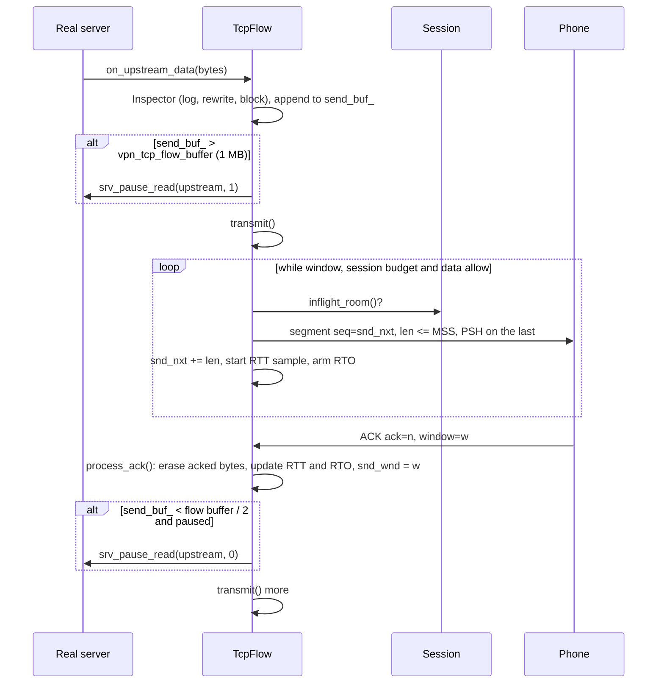

`transmit()` sends as much as the smallest of these limits allows:

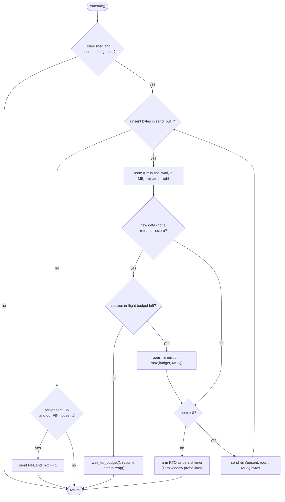

### 7.5 Upload: phone → server

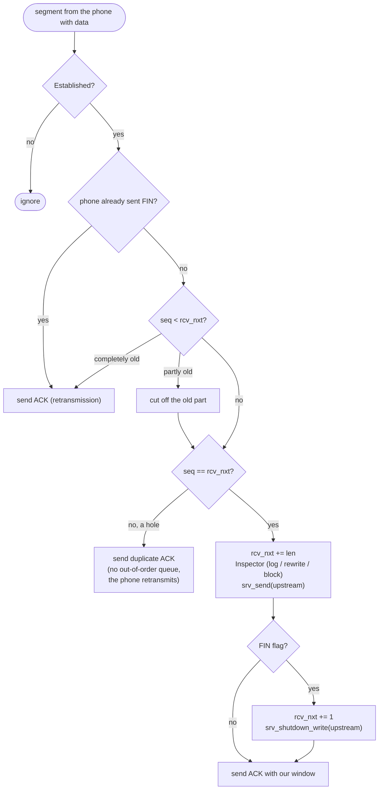

If the outbound socket cannot take more data, the engine reports `handle_write_blocked(1)`; the flow
then advertises a **zero window** to the phone, which stops sending. When the socket drains, an ACK
with the reopened window is sent right away (`on_upstream_write_blocked`).

### 7.6 Retransmission

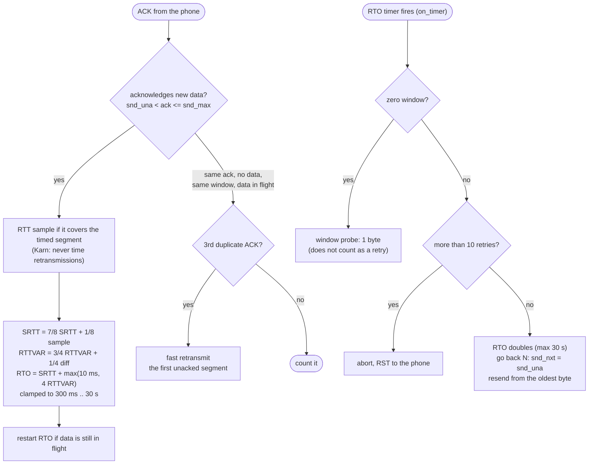

The RTO estimator follows RFC 6298; fast retransmit uses the RFC 5681 definition of a duplicate ACK.

### 7.7 Closing

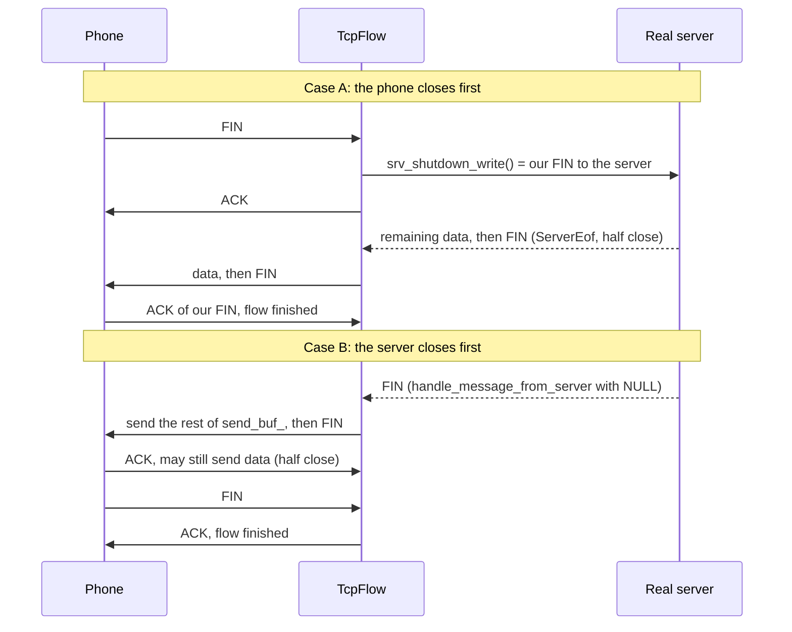

`SRV_CONNECT_HALF_CLOSE` is what makes this possible: without it the engine would close the outbound
socket on the server's FIN, and half-closed protocols (for example `nc` with shutdown) would break.

RSTs are generated when: the phone sends a non-SYN segment for an unknown connection (e.g. after a
server restart), the destination refuses or cannot be reached, a block rule matches, too many
retransmissions happen, or a flow idles longer than `vpn_tcp_idle_timeout`.

## 8. UDP: NAT with connected sockets

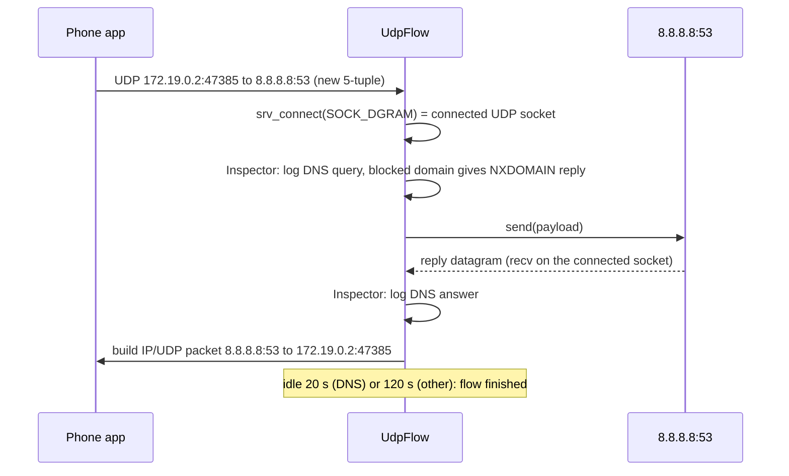

* One socket per (phone address:port, destination address:port), i.e. a full-cone-like NAT with the
  server's address.
* The socket is **connected**, so the kernel only delivers datagrams from that destination — the same
  filtering a stateful firewall does.
* If the destination port is closed the kernel reports `ECONNREFUSED`; the flow sends an **ICMP
  destination unreachable** back to the phone, as a router would.
* `vpn_block_quic = 1` answers new UDP flows to port 443 with ICMP port unreachable, so browsers fall
  back to TCP + TLS (see [Inspector and capture](inspector-and-capture.md)).
* When the tunnel is congested, downstream datagrams are dropped: UDP protocols cope with loss, and
  buffering them would only add latency.
* Empty datagrams (zero bytes of payload) are real UDP messages and are forwarded in both
  directions; the engine never confuses them with an end-of-stream signal.

## 9. ICMP echo (ping)

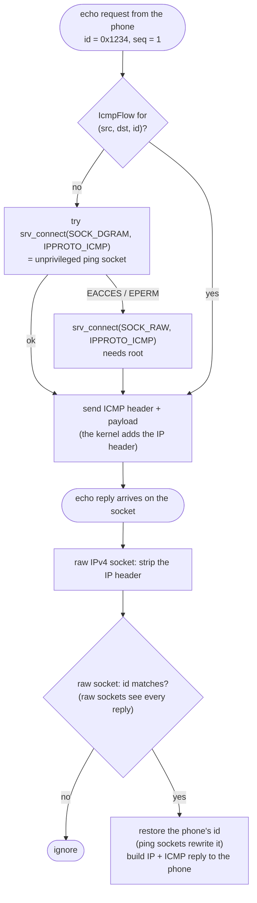

Linux ping sockets are enabled with `sysctl net.ipv4.ping_group_range`. On macOS ICMP datagram sockets
behave like raw sockets (IP header included, identifier not rewritten), which the code handles.

## 10. IP fragmentation

```mermaid
flowchart LR
    subgraph UP["Phone to server"]
        F1["fragment 1<br/>offset 0, MF=1"] --> RA["FragmentReassembler<br/>key: src, dst, protocol, id<br/>expires after 30 s"]
        F2["fragment 2<br/>offset 1480, MF=1"] --> RA
        F3["fragment 3<br/>offset 2960, MF=0"] --> RA
        RA --> WHOLE["complete datagram<br/>parsed again, dispatched"]
    end
    subgraph DOWN["Server to phone"]
        BIG["packet larger than the phone MTU<br/>(e.g. 6000 byte ping reply,<br/>big UDP datagram)"] --> FP["fragment_packet(packet, mtu)"]
        FP --> P1["fragments, each <= MTU,<br/>offsets in units of 8 bytes"]
    end
```

TCP never needs fragmentation here because segments are built with the negotiated MSS. UDP and ICMP
can be larger than the MTU, so the session fragments them like a router (IPv4) or a sending host
(IPv6 fragment header) would.

## 11. Flow control and back pressure end to end

Every buffer between the real server and the phone app is bounded, and every full buffer slows down
the producer before it:

```mermaid
flowchart RL
    subgraph PH["Phone"]
        APPR["app reads slowly"] --> RWIN["phone advertises<br/>a small window"]
    end
    subgraph SV["Server"]
        RWIN --> SNDWND["TcpFlow: snd_wnd limits<br/>bytes in flight"]
        SNDWND --> SBUF["send_buf_ grows"]
        SBUF -->|"> vpn_tcp_flow_buffer"| PAUSE["srv_pause_read(upstream)"]
        TUNQ["tunnel send buffer<br/>> send_high_watermark"] -->|"handle_write_blocked(1)"| TB["Session: tunnel_blocked<br/>flows stop transmit(),<br/>UDP downstream dropped"]
        BUDGET["session in-flight budget<br/>vpn_session_inflight (4 MB)"] --> SNDWND
    end
    subgraph RS["Real server"]
        PAUSE --> KWIN["server kernel receive buffer fills,<br/>its TCP window closes,<br/>real server slows down"]
    end
```

| Limit | Where | Why |
|---|---|---|
| phone's TCP window | `TcpFlow::snd_wnd_` | standard TCP flow control |
| 2 MB per flow (`kMaxInFlight`) | `transmit()` | caps a single flow even with huge windows |
| `vpn_session_inflight` (4 MB) | `Session::inflight_room()` | all flows of one tunnel share it, so one download cannot fill the tunnel and delay everything else (latency) |
| `vpn_tcp_flow_buffer` (1 MB) | `on_upstream_data()` | pause reading the real server; resume below half (hysteresis) |
| tunnel watermark | engine `send_high_watermark` | stop all flows of the session while the phone's link is slow |
| upstream watermark | `on_upstream_write_blocked()` | zero window to the phone while the real server reads slowly |
| phone TUN queue | `TunnelClient` | reads at most 4 MB of unsent frames, works in batches |

Flows that were stopped by the session budget are kept in a FIFO (`starved_flows_`) and resumed in
order by `Session::reap()` as soon as ACKs free budget, so every flow gets its turn.

## 12. Timers and timeouts

`handle_timer` runs every `timer_interval_ms` (50 ms in `server.ini`) on each worker and calls
`Session::on_timer()`:

```mermaid
flowchart TD
    T(["Session::on_timer(now)"]) --> AUTH{"authenticated?"}
    AUTH -->|"no"| HT{"older than vpn_hello_timeout_ms?"}
    HT -->|"yes"| CLOSE["close: no HELLO received"]
    AUTH -->|"yes"| FLOWS["every flow: on_timer(now)<br/>TCP: idle and half-close timeouts, RTO, SYN-ACK retries<br/>UDP: idle 120 s / DNS 20 s<br/>ICMP: idle 30 s"]
    FLOWS --> REAP["reap(): delete finished flows"]
    REAP --> FRAG["reassembler.expire(): drop stale fragments"]
    FRAG --> PCAP["once per second: flush the pcap file"]
    PCAP --> STATS["every vpn_stats_interval: log statistics"]
```

## 13. IPv6

Everything above works for IPv6 as well: the TUN interface gets `fd00:5356::2/64` and a default route
`::/0` (switch in the app), `packet.cpp` parses IPv6 headers and walks extension headers (including
the fragment header), checksums use the IPv6 pseudo header, ICMPv6 echo uses type 128/129 and the
server connects to IPv6 destinations with IPv6 sockets. If the server itself has no IPv6
connectivity, the connect fails, the phone gets a RST / unreachable, and apps fall back to IPv4
(Happy Eyeballs).
