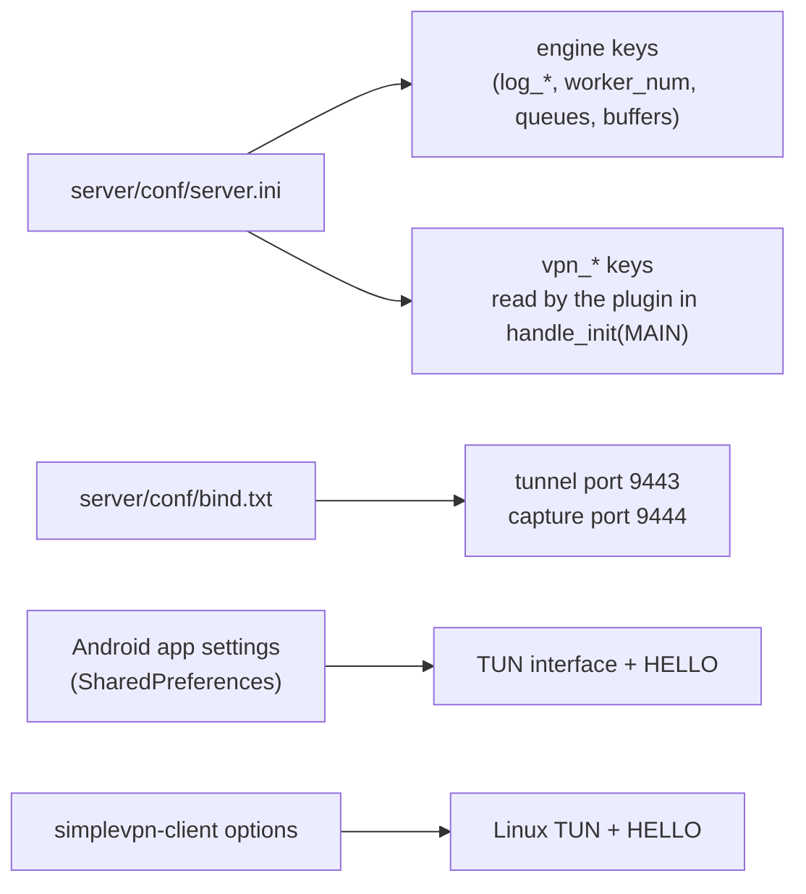
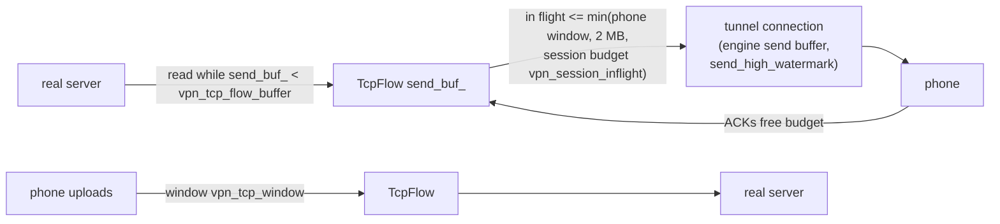

# Configuration

**English** | [简体中文](../zh-CN/configuration.md) · [README](../../README.md) · [Architecture](architecture.md) · [Tunnel protocol](tunnel-protocol.md) · [Android client](android-client.md) · [Inspector and capture](inspector-and-capture.md) · [Learning guide](learning-guide.md) · [Testing](testing.md) · [Source tour](source-tour.md)



Start the server with `mulserver conf/server.ini [path/to/libvpnproxy.so]` from the `server/`
directory (paths in the config are relative to the current directory).

## 1. Engine keys (as set in server.ini)

All engine keys are documented in the reactor's
[configuration reference](https://github.com/kingo132/simple-cplusplus-multithread-reactor-server/blob/main/docs/en/configuration.md). The VPN uses these values:

| Key | server.ini | Why this value |
|---|---|---|
| `worker_num` | 4 | phones are spread over 4 workers |
| `max_packet_size` | 131072 | one tunnel frame = one IP packet (up to 64 KB) + header |
| `ringqueue_length` / `send_queue_length` | 16 MB / 32 MB | room for bursts of full-size packets |
| `send_buffer_max` | 32 MB | unsent data per connection before the overflow policy applies |
| `send_overflow_policy` | `drop` | a phone that falls far behind loses frames (TCP inside retransmits) instead of the whole tunnel being closed; also keeps the live capture stream valid |
| `send_high_watermark` | 1 MB | above it the tunnel counts as congested (`handle_write_blocked`) |
| `timer_interval_ms` | 50 | resolution of TCP retransmission timers |
| `connect_timeout_ms` | 10000 | connect timeout towards real servers |

## 2. VPN plugin keys

| Key | Default (code) | Meaning |
|---|---|---|
| `vpn_token` | empty | shared secret; must match the app's token. Empty = no authentication (do not use on public servers) |
| `vpn_hello_timeout_ms` | 10000 | close tunnels that do not send HELLO in time |
| `vpn_log_packets` | 0 | 1 = one log line per IP packet in both directions |
| `vpn_log_payload_bytes` | 0 | hex dump the first N bytes of every TCP chunk / UDP datagram |
| `vpn_pcap_dir` | empty (server.ini: `./pcap`) | write `session-<id>-<time>.pcap` per session |
| `vpn_pcap_max_mb` | 100 | size limit of one pcap file |
| `vpn_capture_port` | 0 (server.ini: 9444) | live pcap stream port; must also be in `bind.txt` |
| `vpn_capture_allow_remote` | 0 | 1 = accept capture clients that are not on loopback (they see everything!) |
| `vpn_block_domains` | empty | comma separated; DNS → NXDOMAIN, TLS SNI / HTTP Host → RST; sub-domains included |
| `vpn_rewrite_1` … `vpn_rewrite_16` | empty | `up\|from\|to` or `down\|from\|to`; escapes `\r \n \t \| \\` |
| `vpn_rewrite_ports` | 80 | comma separated server ports where rewrite rules apply |
| `vpn_block_private` | 0 | 1 = refuse loopback / private / link-local / CGNAT destinations |
| `vpn_block_quic` | 0 | 1 = answer UDP 443 with ICMP port unreachable (browsers fall back to TCP + TLS) |
| `vpn_tcp_idle_timeout` | 3600 | seconds without activity before a TCP flow is reset |
| `vpn_tcp_half_close_timeout` | 120 | same, once one side has sent FIN |
| `vpn_udp_idle_timeout` | 120 | UDP flow idle timeout |
| `vpn_dns_idle_timeout` | 20 | idle timeout of UDP flows to port 53 |
| `vpn_icmp_idle_timeout` | 30 | ICMP echo flow idle timeout |
| `vpn_max_flows` | 4096 | flows per session; new connections beyond it are refused |
| `vpn_tcp_window` | 524288 | receive window advertised to the phone (4 KB … 16 MB) |
| `vpn_tcp_flow_buffer` | 1048576 | per flow download buffer; reading the real server pauses above it (min 64 KB) |
| `vpn_session_inflight` | 4194304 | bytes sent to the phone but not yet acknowledged, for all flows of a tunnel (min 64 KB) |
| `vpn_stats_interval` | 60 | seconds between statistics log lines (0 = off) |

### How the buffer settings relate



Smaller values → lower latency for interactive traffic while something downloads; larger values →
higher throughput on links with a large bandwidth-delay product.

## 3. Bind file

```text
#ip          #port    #type    #idle timeout (seconds, 0 = never)
0.0.0.0      9443     tcp      300      # tunnel port for phones (add "::" for IPv6)
127.0.0.1    9444     tcp      0        # live capture, loopback only
```

The idle timeout of the tunnel port closes tunnels that send nothing for 300 s; the client's PING
every 15 s keeps healthy tunnels open.

## 4. Android app settings

| Setting | Default | Used for |
|---|---|---|
| Server | empty | host name or IP of the server (resolved before the VPN starts) |
| Port | 9443 | tunnel port |
| Token | `change-me` | sent in HELLO, must equal `vpn_token` |
| DNS | `8.8.8.8` | DNS server configured on the VPN interface |
| MTU | 1500 (576 … 9000) | TUN MTU, also sent in HELLO |
| IPv6 | on | add `fd00:5356::2/64` and the `::/0` route |
| Only these apps | empty | comma separated package names; empty = every app except SimpleVPN |

## 5. Linux test client

```text
simplevpn-client -s SERVER [-p PORT] [-t TOKEN] [-d DEVICE] [-m MTU]
                 [--ipv4 ADDR/PREFIX] [--ipv6 ADDR/PREFIX] [-v]
```

It creates the TUN device (root required), assigns the addresses and runs the same `TunnelClient` as
the app. Add routes for the traffic you want to send through it, but never the route to the server
itself.

## 6. Server host settings

| Setting | Command | Why |
|---|---|---|
| unprivileged ping | `sysctl -w net.ipv4.ping_group_range="0 2147483647"` | ICMP echo without root |
| firewall | allow TCP 9443 inbound | phones must reach the tunnel port |
| file descriptors | `ulimit -n 65535` | every flow uses one socket |
