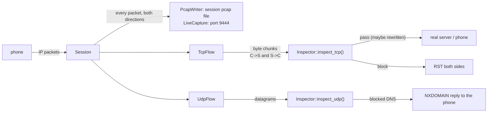
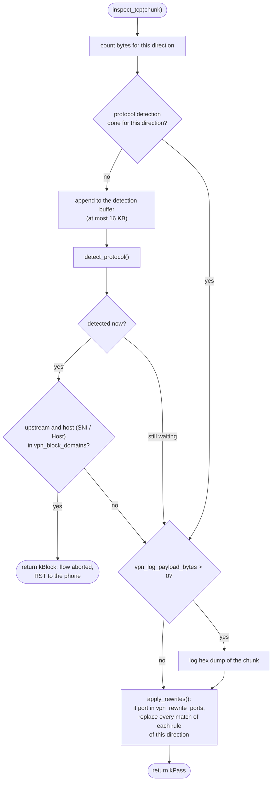
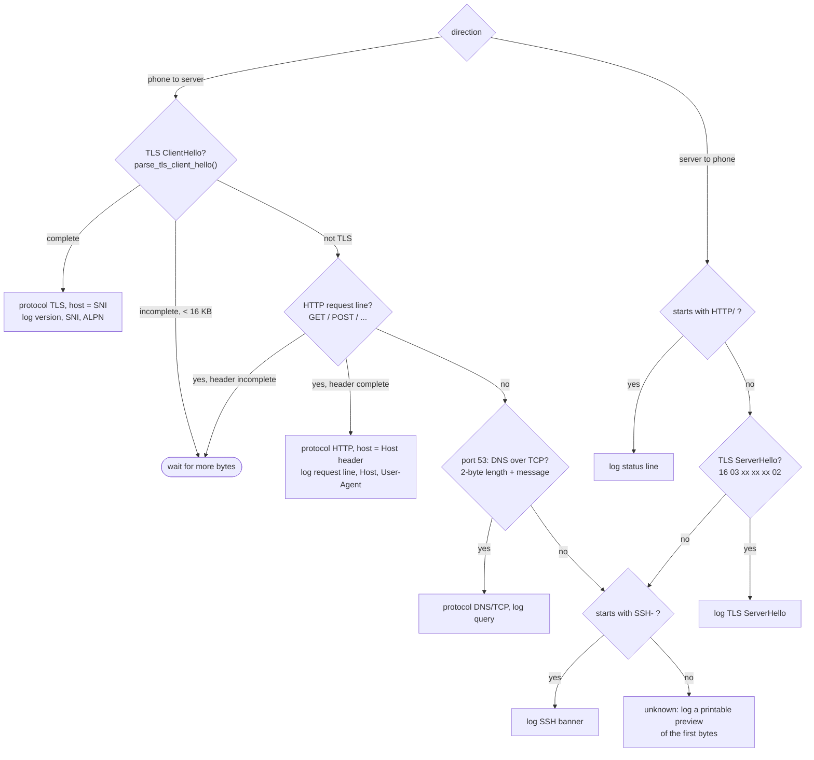
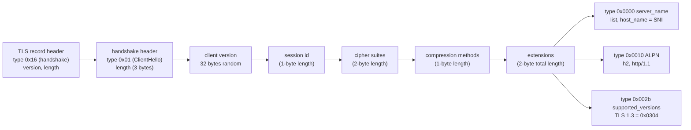
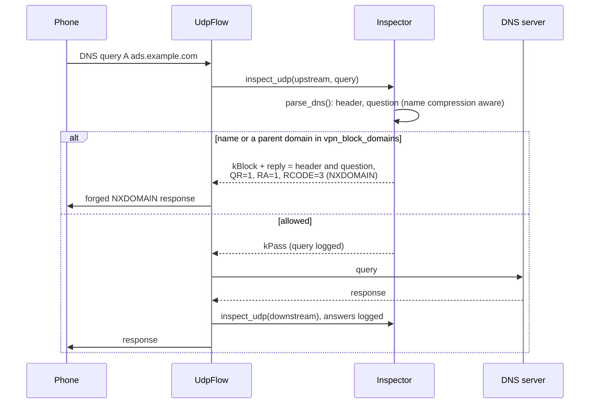
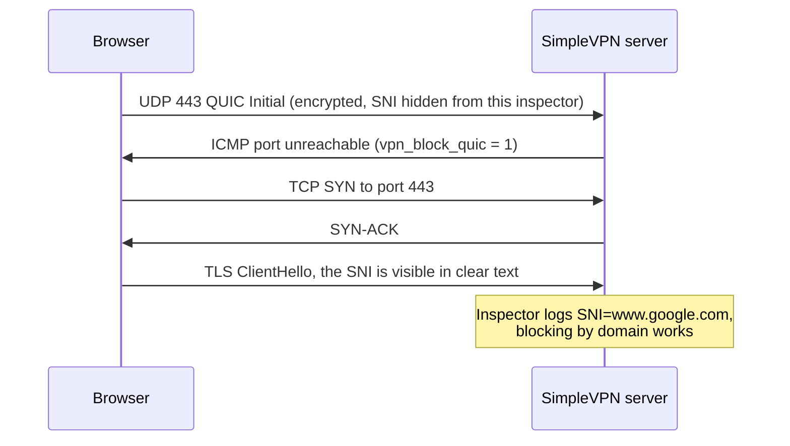
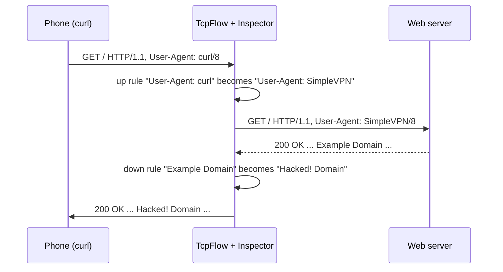
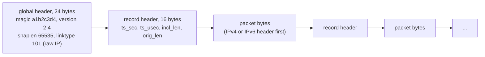
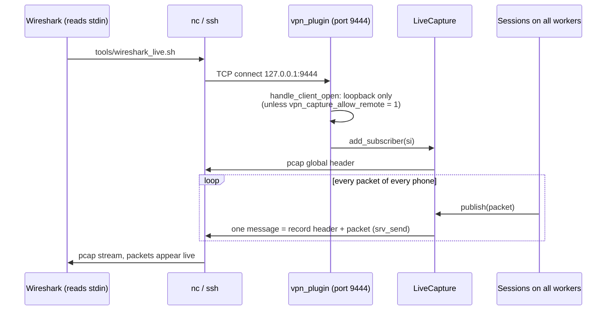

# Inspector and capture

**English** | [简体中文](../zh-CN/inspector-and-capture.md) · [README](../../README.md) · [Architecture](architecture.md) · [Tunnel protocol](tunnel-protocol.md) · [Android client](android-client.md) · [Learning guide](learning-guide.md) · [Configuration](configuration.md) · [Testing](testing.md) · [Source tour](source-tour.md)

Two places let you look at the traffic:

* the **Inspector** (`server/src/inspector.cpp`) sees the *application data* of every TCP connection
  and UDP datagram, and can log, rewrite or block it;
* the **capture** (`server/src/pcap_writer.cpp`) records the raw *IP packets* exactly as the phone sent
  and received them, for Wireshark.



## 1. Where the Inspector is called

| Call | Direction | Called from |
|---|---|---|
| `inspect_tcp(name, port, upstream=true, state, data)` | phone → server | `TcpFlow::deliver_upstream()` for every in-order data segment |
| `inspect_tcp(name, port, upstream=false, state, data)` | server → phone | `TcpFlow::on_upstream_data()` for every chunk read from the real server |
| `inspect_udp(name, port, upstream=true, data, len, &reply)` | phone → server | `UdpFlow::on_packet()` |
| `inspect_udp(name, port, upstream=false, data, len, nullptr)` | server → phone | `UdpFlow::on_upstream_data()` |

`data` in `inspect_tcp` is a `std::string&`: **you may change it in place, including its length**.
This works because the two TCP connections are independent (see
[Architecture § 1](architecture.md#1-the-idea-in-one-picture)): `TcpFlow` keeps its own sequence numbers
towards the phone, and the server kernel numbers the bytes towards the real server.

## 2. TCP inspection pipeline



### Protocol detection



### How the TLS SNI is found

The ClientHello is the first message of a TLS connection and is sent **in clear text** (except with
Encrypted ClientHello). The server name the client wants is in the `server_name` extension:



`parse_tls_client_hello()` walks these length-prefixed fields with bounds checks and returns 1
(complete), 0 (need more data) or -1 (not a ClientHello).

## 3. UDP and DNS inspection



A domain matches when it equals a blocked entry or is a sub-domain of it (`ads.example.com` matches
`example.com`).

## 4. Blocking summary

| Traffic | Detected by | Result |
|---|---|---|
| DNS query for a blocked name | `inspect_udp`, port 53 / 5353 | NXDOMAIN answered by the server |
| TLS to a blocked SNI | ClientHello in `inspect_tcp` | flow aborted, RST to the phone |
| HTTP to a blocked Host | request header in `inspect_tcp` | flow aborted, RST to the phone |
| QUIC (UDP 443) with `vpn_block_quic = 1` | `Session::handle_udp` | ICMP port unreachable to the phone |
| private destinations with `vpn_block_private = 1` | `Session::target_allowed` | RST (TCP) / drop (UDP, ICMP) |

### Why block QUIC?



QUIC (HTTP/3) runs over UDP and encrypts its Initial packet with keys derived from the connection id,
so this inspector does not parse it. Browsers fall back to TCP when QUIC fails, which makes the
traffic visible again.

## 5. Rewriting

Rules come from the config: `vpn_rewrite_N = up|from|to` or `down|from|to`, only applied on the ports
in `vpn_rewrite_ports` (default 80). Escapes `\r \n \t \| \\` are supported.



Limitations to keep in mind:

* Rules are applied **per chunk**. A string split across two TCP segments / reads is not found.
* If the length of an HTTP body changes, `Content-Length` must change too, or the client waits for
  missing bytes / ignores extra bytes. Equal-length replacements are the easy way.
* Compressed (`Content-Encoding: gzip`) or TLS-encrypted content cannot be rewritten as text. For
  experiments use plain HTTP, or a rewrite rule that removes `Accept-Encoding` upstream.

## 6. pcap capture

### File format



Link type 101 (`LINKTYPE_RAW`) means "the packet starts directly with an IP header", which is exactly
what the TUN device delivers — no fake Ethernet header is needed.

### Per-session files

With `vpn_pcap_dir = ./pcap` every authenticated session writes
`pcap/session-<id>-<YYYYmmdd-HHMMSS>.pcap`, both directions, up to `vpn_pcap_max_mb`. The file is
flushed once per second, so `tail -f` / Wireshark reloads show recent packets.

### Live capture



* `LiveCapture` is shared by all workers and protected by a mutex — the only shared mutable plugin
  state.
* Each record is sent as **one** `srv_send()` message. If Wireshark reads too slowly, the engine drops
  whole messages (`send_overflow_policy = drop`), so the stream never contains half a record and
  stays parseable; the phone's traffic is never slowed down by a viewer.
* Port 9444 must also be listed in `conf/bind.txt`; keep it bound to `127.0.0.1` and use SSH from other
  machines (`tools/wireshark_live.sh user@server`).

## 7. Adding your own analysis

```cpp
// inspector.cpp, inside Inspector::inspect_tcp(), before apply_rewrites():
if (upstream && server_port == 6379 && data.compare(0, 1, "*") == 0) {
    LOG_INFO("%s Redis command: %s", flow_name.c_str(),
             printable_preview(reinterpret_cast<const uint8_t*>(data.data()), data.size(), 120).c_str());
}
```

Rebuild with `cmake --build build`, restart `mulserver`, and every Redis command the phone sends shows
up in the log. The [learning guide](learning-guide.md) has more ideas.
