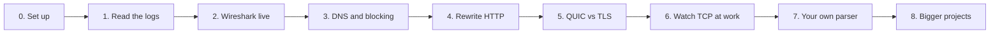
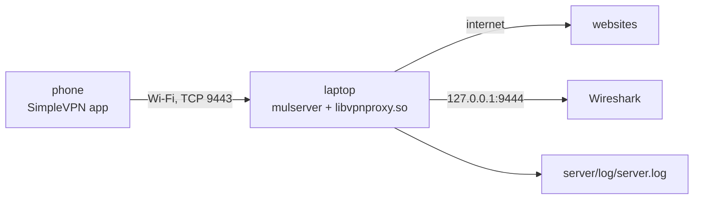
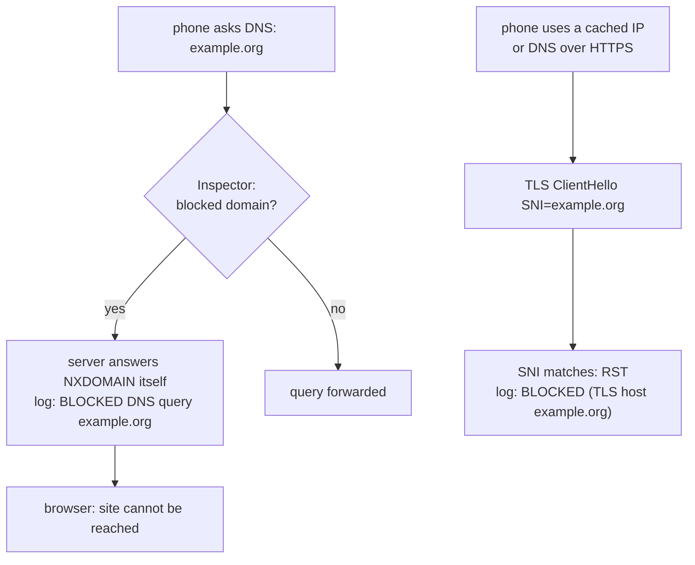
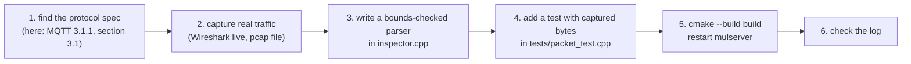

# Learning guide

**English** | [简体中文](../zh-CN/learning-guide.md) · [README](../../README.md) · [Architecture](architecture.md) · [Tunnel protocol](tunnel-protocol.md) · [Android client](android-client.md) · [Inspector and capture](inspector-and-capture.md) · [Configuration](configuration.md) · [Testing](testing.md) · [Source tour](source-tour.md)

A set of hands-on experiments, from "watch my phone's traffic" to "write my own protocol parser".
Each experiment says what to change, what to do on the phone and what you should see.



## 0. Set up

1. Build and start the server (README *Quick start*). On a laptop in the same Wi-Fi as the phone is
   fine; `tests/device_test.sh` automates everything if the phone is connected by USB.
2. Install the app, enter the laptop's IP, port 9443 and the token, tap **Start VPN**.
3. Keep a terminal with `tail -f server/log/server.log` open.



## 1. Read the logs

Open any website on the phone. Each line starts with the session tag (`S2`) and the flow name
(`TCP#12 172.19.0.2:40312 -> 142.250.74.36:443`):

| Log line | Meaning | Code |
|---|---|---|
| `tunnel connection from ...`, `authenticated: ...` | the phone connected and sent a valid HELLO | `Session::Session`, `handle_hello` |
| `TCP#n ... connected (server side local address ...)` | the real server accepted, SYN-ACK sent to the phone | `TcpFlow::on_upstream_open` |
| `C->S TLS ClientHello TLS1.3 SNI=... ALPN=...` | first bytes from the phone were a TLS ClientHello | `Inspector::detect_protocol` |
| `C->S HTTP GET /path Host=... UA=...` | plain HTTP request | same |
| `S->C HTTP/1.1 200 OK` | plain HTTP response | same |
| `UDP#n ... C->S DNS query id=... q=A name` | DNS question | `Inspector::inspect_udp` |
| `closed (up X bytes, down Y bytes, N ms, R retransmits, TLS host)` | normal end of a TCP flow | `TcpFlow::maybe_finish` |
| `stats: ... packets / bytes, dropped, flows` | periodic session statistics | `Session::log_stats` |

**Try:** set `log_level = 7` and restart: you also see SYNs, FINs, window changes and retransmission
timeouts. Set `vpn_log_packets = 1` to get one line per IP packet (`>` from the phone, `<` to the phone).

## 2. Wireshark live

```bash
tools/wireshark_live.sh            # server on this machine
tools/wireshark_live.sh me@server  # server elsewhere, via SSH
```

Useful display filters:

| Filter | Shows |
|---|---|
| `dns` | every DNS query and answer of the phone |
| `tls.handshake.extensions_server_name` | TLS ClientHellos with SNI |
| `tcp.flags.syn == 1 && tcp.flags.ack == 0` | every new TCP connection the phone opens |
| `tcp.analysis.retransmission` | retransmissions (by the phone or by our `TcpFlow`) |
| `icmp or icmpv6` | pings and unreachable messages |
| `udp.port == 443` | QUIC |

**Exercise:** compare a handshake in Wireshark with the `TcpFlow` code. The SYN-ACK you see was built
byte by byte by `TcpFlow::send_syn_ack()` → `build_tcp_packet()`; check that its MSS and window scale
options match `TcpFlow`'s constructor.

## 3. DNS and blocking

```ini
# server.ini
vpn_block_domains = doubleclick.net,example.org
```

Restart, then on the phone open `http://example.org` and an app with ads.



**Questions to explore:**

* Why does blocking still work when the phone has the IP address cached? (Hint: SNI / Host check.)
* What happens with *Private DNS* (DNS over TLS, port 853) enabled on the phone? Look for a TLS flow to
  port 853 in the log; the DNS queries are invisible now, but the SNI check still applies to websites.

## 4. Rewrite HTTP

```ini
vpn_rewrite_ports = 80
vpn_rewrite_1 = down|Example Domain|Hacked! Domain
vpn_rewrite_2 = up|Accept-Encoding: gzip|Accept-Encoding: none
```

Open `http://example.com` (plain HTTP!) on the phone: the title now says *Hacked! Domain*. The log shows
`rewrote 1 occurrence(s) of "Example Domain" (downstream)`.

* `Hacked! Domain` has the same length as `Example Domain`, so `Content-Length` stays correct.
* Rule 2 prevents gzip-compressed responses, which could not be rewritten as text.

**Exercise:** write a rule with a *different* length and observe how the browser behaves; then fix it
by also rewriting the `Content-Length` header.

## 5. QUIC versus TLS

1. With `vpn_block_quic = 0` open `https://www.google.com` in Chrome. Filter `udp.port == 443` in
   Wireshark: the page loads over QUIC; the server log shows UDP flows to port 443 but no SNI.
2. Set `vpn_block_quic = 1`, restart, reload the page. The browser gets ICMP port unreachable for QUIC
   and switches to TCP: now `C->S TLS ClientHello ... SNI=www.google.com ALPN=h2,http/1.1` appears.

## 6. Watch TCP at work

The user-space TCP implementation is the most educational part of the server. Ideas:

| Experiment | How | What to observe |
|---|---|---|
| Handshake timing | `log_level = 7`, open a slow site | `SYN ... connecting to server` → `connected` → `established`: the SYN-ACK waits for the real server |
| Refused connection | `curl http://<server-ip>:1/` on the phone (Termux) | the connect fails, the phone gets RST: `connection refused` |
| Flow control | download a big file on a slow phone link | `srv_pause_read` when `send_buf_` exceeds `vpn_tcp_flow_buffer` (add a `LOG_DEBUG` there) |
| Retransmissions | `tc qdisc add dev wlan0 root netem loss 5%` on the server | `retransmission timeout` lines, `closed (... N retransmits)`, RTO values in debug logs |
| Zero window | pause reading in an app (e.g. a stalled video) | `snd_wnd_ == 0`, persist timer probes |
| Half close | `nc -N` style client that shuts down its sending side | `FIN from client`, the server still sends its answer, then `FIN to client` |

Read [Architecture § 7](architecture.md#7-tcp-a-user-space-tcp-endpoint) side by side with `flows.cpp`;
every function there is commented with the RFC it follows.

## 7. Write your own parser

All application data passes through `Inspector::inspect_tcp()` / `inspect_udp()`. A step-by-step
example: log every MQTT CONNECT (port 1883) with its client id.

```cpp
// inspector.cpp, add near the top
static bool parse_mqtt_connect(const std::string& d, std::string* client_id) {
    // fixed header: type 1 (CONNECT) in the high nibble, then a variable length "remaining length"
    if (d.size() < 2 || (static_cast<uint8_t>(d[0]) >> 4) != 1) return false;
    size_t pos = 1, multiplier = 1, remaining = 0;
    while (pos < d.size()) {                       // remaining length: 1-4 bytes, 7 bits each
        uint8_t b = static_cast<uint8_t>(d[pos++]);
        remaining += (b & 0x7f) * multiplier;
        multiplier *= 128;
        if (!(b & 0x80)) break;
    }
    // variable header: protocol name (2-byte length + "MQTT"), level, flags, keep alive
    if (pos + 2 > d.size()) return false;
    size_t name_len = (static_cast<uint8_t>(d[pos]) << 8) | static_cast<uint8_t>(d[pos + 1]);
    pos += 2 + name_len + 1 + 1 + 2;
    if (pos + 2 > d.size()) return false;
    size_t id_len = (static_cast<uint8_t>(d[pos]) << 8) | static_cast<uint8_t>(d[pos + 1]);
    if (pos + 2 + id_len > d.size()) return false;
    client_id->assign(d, pos + 2, id_len);
    return true;
}

// inside Inspector::inspect_tcp(), before apply_rewrites():
std::string id;
if (upstream && server_port == 1883 && parse_mqtt_connect(data, &id)) {
    LOG_INFO("%s MQTT CONNECT client_id=%s", flow_name.c_str(), id.c_str());
}
```



Tips:

* Always check lengths before reading: the data comes from the network and may be truncated or
  malicious. `printable_preview()` and `hexdump()` are safe helpers for logging.
* A chunk is whatever one `recv()` / one TCP segment delivered — a message can be split across chunks.
  For robust parsing keep per-flow state in `FlowInspectState` (it already buffers the first 16 KB of
  each direction for detection).
* To modify instead of log, change `data`; to block, `return kBlock`.

## 8. Bigger project ideas

| Project | Where to start |
|---|---|
| TLS man-in-the-middle with your own CA | terminate TLS in `TcpFlow` with OpenSSL, issue certificates for the SNI, install the CA on the phone |
| Encrypted tunnel | wrap the tunnel socket in TLS on both sides (`tunnel_client.cpp`, the engine plugin) |
| UDP tunnel | replace the TCP tunnel to avoid TCP-over-TCP meltdown on lossy links |
| SACK and congestion control in `TcpFlow` | RFC 2018, RFC 5681 / CUBIC |
| Per-app statistics | the Android `ConnectivityManager.getConnectionOwnerUid()` API on the phone, send the uid in an extra frame |
| Web dashboard | a second plugin port that serves JSON statistics of sessions and flows |
