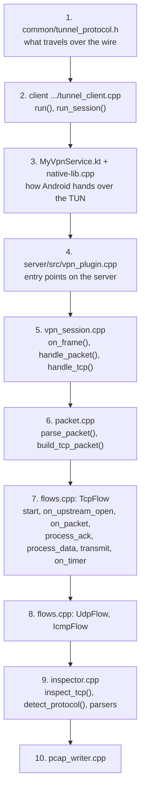
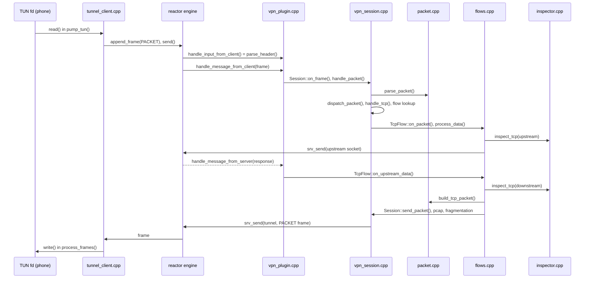

# Source code tour

**English** | [简体中文](../zh-CN/source-tour.md) · [README](../../README.md) · [Architecture](architecture.md) · [Tunnel protocol](tunnel-protocol.md) · [Android client](android-client.md) · [Inspector and capture](inspector-and-capture.md) · [Learning guide](learning-guide.md) · [Configuration](configuration.md) · [Testing](testing.md)

Every source file starts with a header comment (role, overview, reading guide) and every function is
documented: what it does, why, its parameters and its return value. This page is the map.

## Files

| File | Lines of interest |
|---|---|
| `common/tunnel_protocol.h` | frame header, `append_frame()`, `parse_header()`, `key=value` encoding |
| **Server** | |
| `server/src/vpn_plugin.cpp` | the engine callbacks (`handle_*`), config loading, worker state set-up |
| `server/src/vpn_session.h` | `VpnConfig`, `FlowKey`, `Flow` base class, `Session`, `WorkerState` |
| `server/src/vpn_session.cpp` | HELLO, frame dispatch, packet → flow lookup, RST for unknown connections, QUIC rejection, in-flight budget, timers, statistics |
| `server/src/flows.h` / `flows.cpp` | `TcpFlow` (user-space TCP), `UdpFlow` (NAT), `IcmpFlow` (ping) |
| `server/src/packet.h` / `packet.cpp` | IPv4/IPv6/TCP/UDP/ICMP parsing and building, checksums, fragmentation, reassembly |
| `server/src/inspector.h` / `inspector.cpp` | protocol detection, DNS/TLS/HTTP parsers, blocking, rewriting |
| `server/src/pcap_writer.h` / `pcap_writer.cpp` | pcap files and the live capture stream |
| `server/conf/server.ini`, `bind.txt` | example configuration with comments |
| `server/reactor/` | the reactor engine (submodule, documented separately) |
| **Client** | |
| `client/app/src/main/cpp/tunnel_client.h` / `.cpp` | the portable tunnel core: connect, handshake, pump packets, keepalive, reconnect |
| `client/app/src/main/cpp/native-lib.cpp` | JNI: start/stop/reconnect/stats, thread attach, `protect()` and state callbacks |
| `client/app/src/main/java/.../MyVpnService.kt` | `VpnService`: TUN interface, network change handling |
| `client/app/src/main/java/.../MainActivity.kt` | UI, VPN permission, status, debug automation hook |
| `client/app/src/main/java/.../VpnSettings.kt` | settings stored in `SharedPreferences` |
| **Tools and tests** | |
| `tools/linux_client/main.cpp` | Linux command line client (TUN device + the same tunnel core) |
| `tools/wireshark_live.sh` | pipe the live capture into Wireshark, locally or over SSH |
| `tests/packet_test.cpp` | unit tests |
| `tests/e2e_test.sh`, `e2e_services.py`, `e2e_client_tests.py` | end-to-end test in network namespaces |
| `tests/jni_test.sh`, `tests/jni/` | JNI test on a Linux JVM |
| `tests/device_test.sh` | real phone test |

## Recommended reading order

## Following one packet through the code

## Conventions used in the code

| Convention | Meaning |
|---|---|
| `S<n>` / `TCP#<n>` in logs | session id (tunnel `conn_id`) / flow id |
| `C->S`, `S->C` | client (phone) to server direction and back |
| `upstream` | towards the internet; `downstream` towards the phone |
| `t_` prefix | `thread_local` variable (per worker) |
| `g_` prefix | process-wide global, read-only after start unless it has its own mutex |
| `snd_*`, `rcv_*` | TCP sequence variables named as in RFC 9293 |
| `finish()` then `reap()` | deferred deletion of flows |
