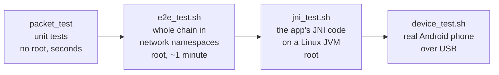
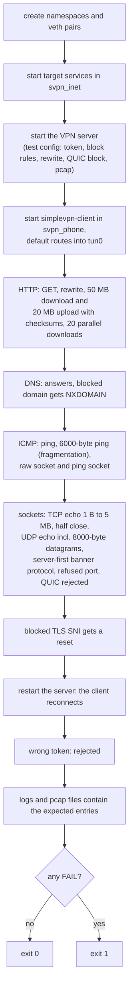
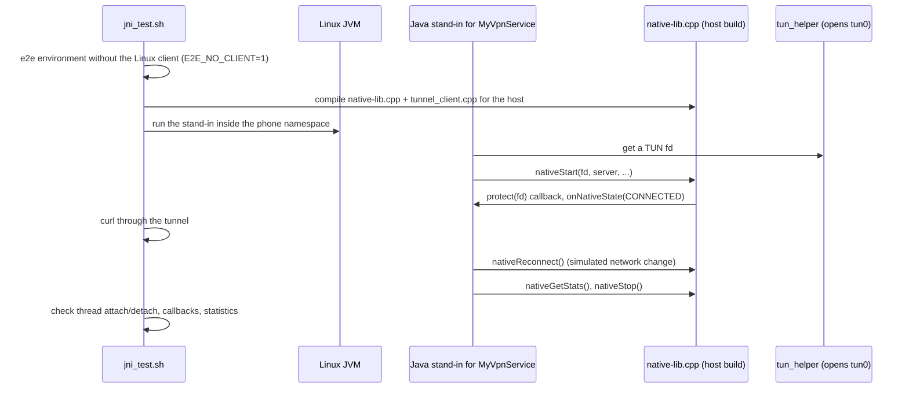
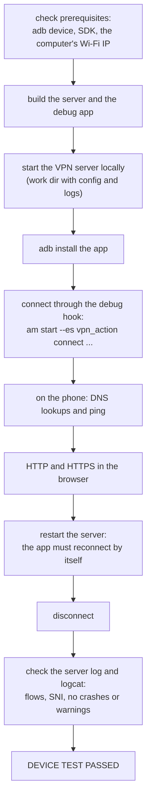

# Testing

**English** | [简体中文](../zh-CN/testing.md) · [README](../../README.md) · [Architecture](architecture.md) · [Tunnel protocol](tunnel-protocol.md) · [Android client](android-client.md) · [Inspector and capture](inspector-and-capture.md) · [Learning guide](learning-guide.md) · [Configuration](configuration.md) · [Source tour](source-tour.md)

Four levels of tests cover the project, from pure functions to a real phone:

| Test | Command | Needs |
|---|---|---|
| unit | `./build/tests/packet_test` | a build |
| end to end | `sudo BUILD_DIR=build tests/e2e_test.sh` | Linux, root, python3, curl, dig, ping |
| JNI | `sudo tests/jni_test.sh` | as e2e, plus a JDK |
| device | `tests/device_test.sh` | macOS or Linux, Android SDK, a phone with USB debugging in the same Wi-Fi |

## 1. Unit tests: `tests/packet_test.cpp`

Checks the pure functions of `packet.cpp`, `inspector.cpp` and `tunnel_protocol.h` with hand-made
packets (one function per topic):

| Test function | What it checks |
|---|---|
| `test_tcp_roundtrip` | build an IPv4 and an IPv6 TCP packet, parse it back: ports, seq/ack, flags, window, MSS and window scale options, payload, IP and TCP checksums |
| `test_udp_icmp` | UDP, ICMP echo (identifier, sequence) and ICMPv6 round trips with checksums |
| `test_malformed` | truncated packets, an unknown IP version and empty input are rejected |
| `test_dns` | DNS query and response parsing, including name compression |
| `test_tls` | TLS ClientHello parsing (SNI, ALPN, TLS 1.3 version), incomplete and invalid input |
| `test_http` | HTTP request line, Host and User-Agent parsing |
| `test_tunnel_frames` | frame header encoding and `parse_header()` checks |
| `test_fragmentation` | fragmenting a large packet and reassembling the fragments |

## 2. End-to-end test: `tests/e2e_test.sh`

The script builds three "machines" on one Linux host with network namespaces:

```mermaid
flowchart LR
    subgraph PHONE["namespace svpn_phone (the phone)"]
        TOOLS["curl, dig, ping,<br/>e2e_client_tests.py"] --> TUN0["tun0<br/>172.19.0.2, fd00:5356::2<br/>default route"]
        TUN0 <--> CL["simplevpn-client<br/>(same TunnelClient as the app)"]
        P0["p0 172.30.0.2"]
        CL --- P0
    end
    subgraph ROOT["root namespace (the VPN server)"]
        S0["s0 172.30.0.1"]
        SRV["mulserver + libvpnproxy.so<br/>:9443 tunnel, :9444 capture"]
        R0["r0 198.51.100.1<br/>2001:db8:100::1"]
        S0 --- SRV --- R0
    end
    subgraph INET["namespace svpn_inet (the internet)"]
        I0["i0 198.51.100.10<br/>2001:db8:100::10"]
        SVC["e2e_services.py<br/>HTTP :8080, echo :7,<br/>DNS :53, banner :25"]
        I0 --- SVC
    end
    P0 <-->|"veth"| S0
    R0 <-->|"veth"| I0
```

The phone namespace has **no route** to the internet namespace except through `tun0`, so every
successful check proves that the traffic went through the tunnel and the server.

Useful environment variables: `BUILD_DIR`, `WORK_DIR` (keeps logs and pcap files), `LOG_LEVEL`,
`E2E_SETUP_ONLY=1` (set everything up and leave it running for manual experiments, for example
`ip netns exec svpn_phone curl http://198.51.100.10:8080/`).

## 3. JNI test: `tests/jni_test.sh`

It exercises exactly the JNI code that runs on the phone — thread attach, the `protect()` callback,
state callbacks, reconnecting, statistics and stopping — without an Android device.

## 4. Device test: `tests/device_test.sh`

One command on a computer with the phone connected over USB:

The phone and the computer must be in the same Wi-Fi; on macOS allow incoming connections for
`mulserver` when the firewall asks.

## 5. Manual checks

| What | How |
|---|---|
| live traffic | `tools/wireshark_live.sh` |
| the tunnel itself | `tcpdump -i any -w tunnel.pcap port 9443` on the server |
| server internals | `log_level = 7` or `8`, `vpn_log_packets = 1` |
| phone side | `adb logcat -s SimpleVPN` |
