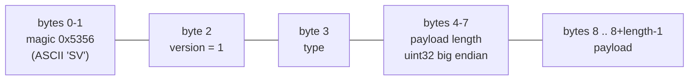
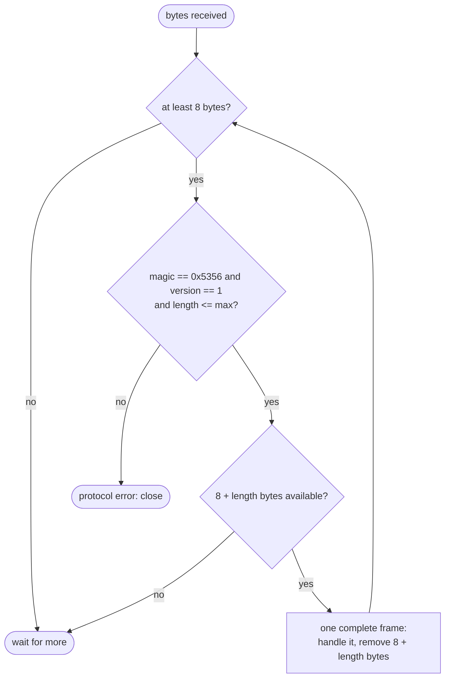
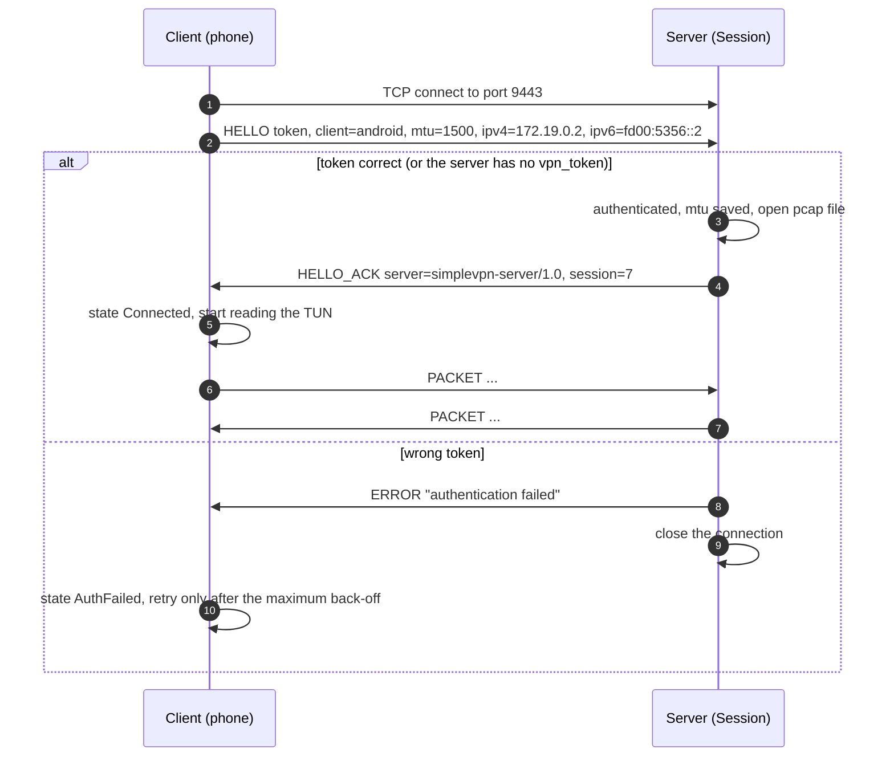
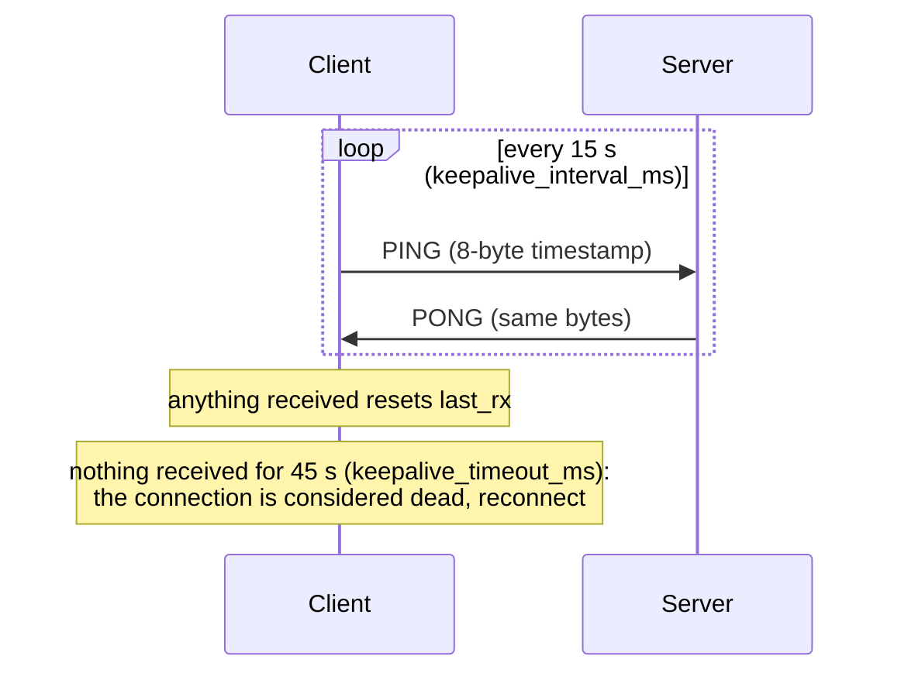
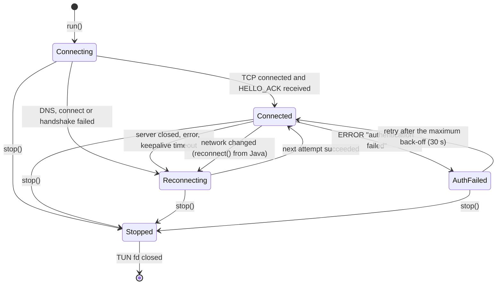
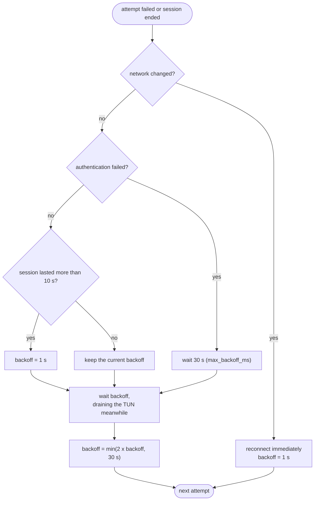

# Tunnel protocol

**English** | [简体中文](../zh-CN/tunnel-protocol.md) · [README](../../README.md) · [Architecture](architecture.md) · [Android client](android-client.md) · [Inspector and capture](inspector-and-capture.md) · [Learning guide](learning-guide.md) · [Configuration](configuration.md) · [Testing](testing.md) · [Source tour](source-tour.md)

The phone and the server talk over **one TCP connection** (default port 9443). The format is defined
in [`common/tunnel_protocol.h`](../../common/tunnel_protocol.h), a header used unchanged by the
Android client, the Linux test client and the server plugin.

## 1. Why TCP and why frames

* TCP gives ordered, reliable delivery and passes almost every firewall and NAT; it is the simplest
  possible transport for learning. (The cost is "TCP over TCP": a lost tunnel segment delays every
  connection inside it. A UDP tunnel would avoid that — see the README's ideas list.)
* TCP is a **byte stream**, but we need to transport separate IP packets. So every IP packet is put
  into a **frame** with a length header; the receiver cuts the stream back into packets.

## 2. Frame format



| Field | Size | Meaning |
|---|---|---|
| magic | 2 | `0x53 0x56`; detects a peer that does not speak this protocol (e.g. a browser hitting the port) |
| version | 1 | `1`; a future incompatible format would use another number |
| type | 1 | frame type (table below) |
| length | 4 | payload length in network byte order, at most 65535 + 1024 |
| payload | length | depends on the type |

| Type | Value | Direction | Payload |
|---|---|---|---|
| HELLO | 1 | client → server | text lines `key=value\n`: `version`, `token`, `client`, `mtu`, `ipv4`, `ipv6` |
| HELLO_ACK | 2 | server → client | text lines: `server` (software name), `session` (id) |
| PACKET | 3 | both | exactly one IPv4 or IPv6 packet, starting with the IP header |
| PING | 4 | both | any bytes (the client sends an 8-byte timestamp) |
| PONG | 5 | both | the PING payload echoed back |
| ERROR | 6 | both | UTF-8 reason text; the sender closes the connection afterwards |

### Cutting a stream into frames



`tunnel::parse_header()` implements the checks. On the server it is called from
`handle_input_from_client` (the reactor engine's framing hook), so the plugin only ever sees complete
frames; on the client `TunnelClient::run_session()` does the same loop itself.

## 3. Handshake



Rules:

* The first frame must be HELLO, otherwise the server closes with `ERROR "expected HELLO"`.
* The server waits at most `vpn_hello_timeout_ms` (10 s) for HELLO; the client waits at most
  `connect_timeout_ms` (10 s) for HELLO_ACK.
* The client does not read the TUN before HELLO_ACK, so no packet is sent unauthenticated.
* The `mtu` value tells the server how large packets towards the phone may be; larger ones are
  fragmented (see [Architecture § 10](architecture.md#10-ip-fragmentation)).

## 4. Keepalive



Why the client needs its own keepalive: when a phone loses its network silently (NAT timeout, moving
out of Wi-Fi range) the TCP connection does not notice for many minutes. Regular PINGs keep NAT
mappings alive and a missing answer detects a dead path within 45 s. The server additionally closes a
tunnel that is idle for the bind file's idle timeout (300 s).

## 5. Client state machine

The states are reported to the app (`TunnelState` in `tunnel_client.h`, the same numbers as the
`STATE_*` constants in `MyVpnService.kt`):



### Reconnect back-off



While disconnected the client keeps **reading and discarding** packets from the TUN. Otherwise the
TUN queue would fill up and apps would hang on full socket buffers instead of failing fast and
retrying.

## 6. Example bytes

A PING with an 8-byte payload:

```text
53 56 01 04 00 00 00 08   e8 03 00 00 00 00 00 00
\___/ \/ \/ \_________/   \_____________________/
magic v  t  length = 8     payload (timestamp, example)
```

A PACKET carrying a 60-byte TCP SYN:

```text
53 56 01 03 00 00 00 3c   45 00 00 3c ...   (IPv4 header starts with 0x45)
```

You can watch these bytes yourself: capture the tunnel port on the server with
`tcpdump -i any -w tunnel.pcap port 9443` and open it in Wireshark (*Follow TCP stream*).

## 7. Security considerations

| Property | Status |
|---|---|
| Authentication | shared token in HELLO (plain text) |
| Confidentiality | **none**: the tunnel is not encrypted |
| Integrity | only TCP checksums |
| Replay protection | none |

For anything beyond a lab, run the tunnel inside SSH port forwarding, WireGuard or a TLS proxy
(stunnel). Implementing a TLS tunnel would be a good exercise.
