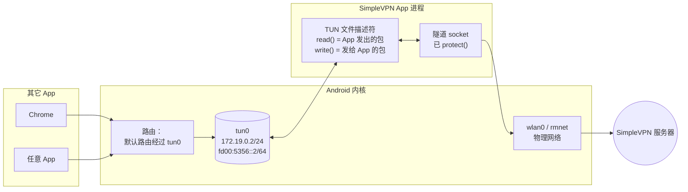
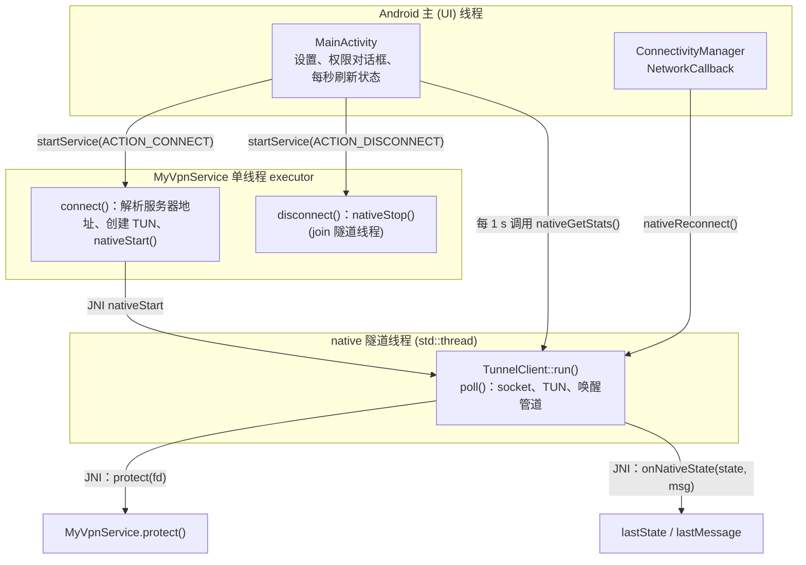
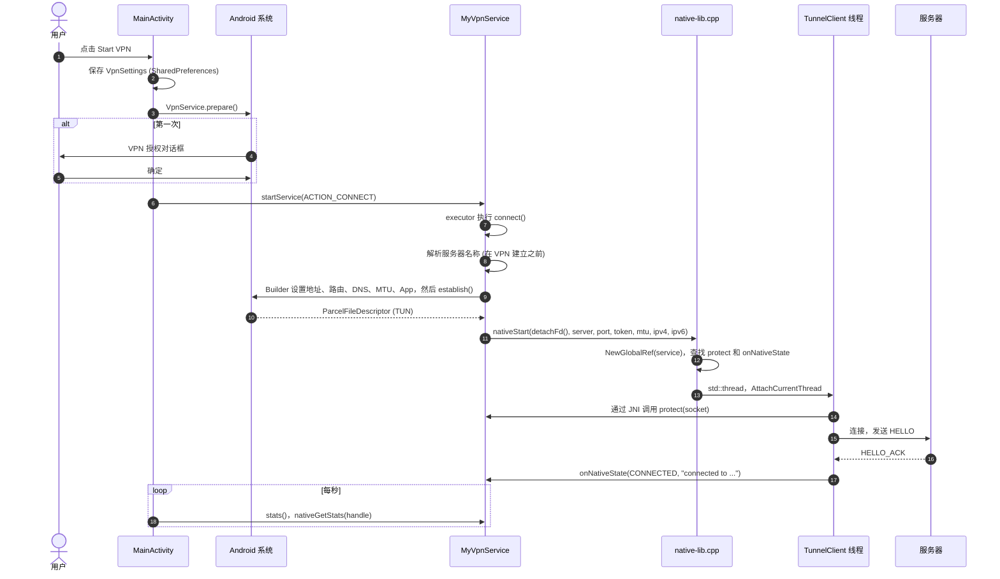
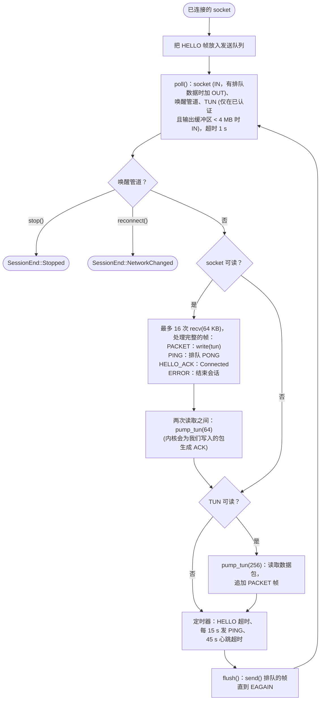
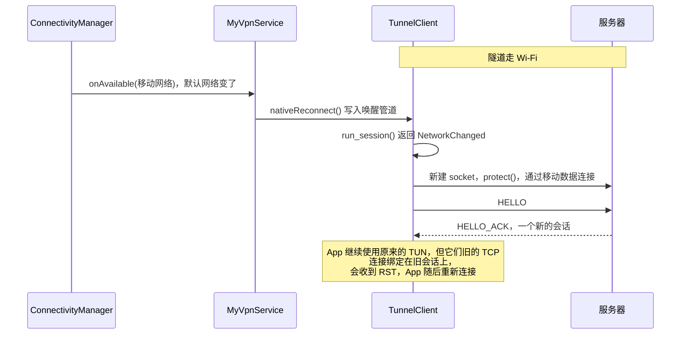

# Android 客户端

[English](../en/android-client.md) | **简体中文** · [README](../../README.zh-CN.md) · [架构](architecture.md) · [隧道协议](tunnel-protocol.md) · [Inspector 与抓包](inspector-and-capture.md) · [学习指南](learning-guide.md) · [配置](configuration.md) · [测试](testing.md) · [源码导读](source-tour.md)

这个 App 被刻意做得很“薄”：Kotlin 用 Android 的 `VpnService` API 建立 VPN，一个小小的 C++ 核心
（与 Linux 测试客户端共用）负责在 TUN 设备和服务器之间搬运 IP 包。

## 1. Android VPN 的工作原理



* `VpnService.Builder.establish()` 创建一个 TUN 接口并返回它的文件描述符。我们添加的路由
  （`0.0.0.0/0`、`::/0`）让系统把各个 App 的流量送进这个接口。
* 每次 `read()` 这个 fd 都会返回一个完整的 IP 包；写入一个包，就相当于把它注入内核，
  如同它是从网络上收到的一样。
* 我们自己的隧道 socket **绝不能**被路由进 TUN——那会形成死循环。有两个机制防止这种情况：
  App 把自己排除在外（`addDisallowedApplication(packageName)`），并且每个隧道 socket 在 `connect()`
  之前都会交给 `VpnService.protect(fd)`，把它绑定到物理网络上。

## 2. 类和线程



| 线程 | 为什么需要它 |
|---|---|
| UI 线程 | Android 要求界面操作在这里进行；它绝不能阻塞 |
| service executor | connect/disconnect 可能阻塞（DNS 解析、join native 线程）；单线程还能让它们串行执行，保证两次 connect 不会重叠 |
| native 隧道线程 | 在整个 VPN 生命周期内运行 `TunnelClient` 的阻塞式 `poll()` 循环 |

## 3. 启动 VPN



值得了解的细节：

* **服务器名称在 `establish()` 之前解析**。VPN 一旦建立，DNS 就会走进隧道，而此时隧道还没有连上。
* **`detachFd()`** 把 TUN fd 的所有权转交给 native 代码；`TunnelClient::run()` 结束时会关闭它，
  VPN 接口随之被拆除。
* **JNI 线程**：native 线程在调用 Java 之前必须先 `AttachCurrentThread()`，结束之前必须
  `DetachCurrentThread()`。service 对象以**全局引用**保存，因为局部引用只在一次 JNI 调用期间有效。
* `onNativeState` 是在隧道线程上被调用的，所以它只保存两个 volatile 字段；UI 每秒读取一次。

## 4. TunnelClient::run_session() 内部



为什么要小批量处理并在两个方向之间交替？向 TUN 写入大量数据包会让手机内核立刻产生 ACK。
如果我们不在中间把这些 ACK 从 TUN 中读出来，它的发送队列（Linux/Android 上是 500 个包）就会溢出，
数据包会丢失，而 TCP 会把这理解为拥塞。

## 5. 网络切换



如果没有这个回调，客户端要等到 45 s 心跳超时后才会发现 Wi-Fi 连接已经失效。

## 6. VpnService.Builder 设置

| Builder 调用 | 值 | 原因 |
|---|---|---|
| `addAddress` | `172.19.0.2/24`、`fd00:5356::2/64` | 手机在 VPN 内的地址（私有地址段） |
| `addRoute` | `0.0.0.0/0`、`::/0` | 把所有流量送进 VPN |
| `addDnsServer` | 设置项（默认 `8.8.8.8`） | DNS 查询经隧道发往这个服务器 |
| `setMtu` | 设置项（默认 1500） | TUN 交付的最大包长；也会在 HELLO 中发送 |
| `setBlocking(false)` | | native 循环使用 `poll()` 和非阻塞读 |
| `addDisallowedApplication` / `addAllowedApplication` | 本 App 的包名 / “Only these apps” | 避免路由死循环；按 App 代理 |
| `setMetered(false)` | Android 10+ | 不要让 App 以为自己处在按流量计费的网络上 |
| `setConfigureIntent` | MainActivity | 从系统 VPN 通知中打开 App |

always-on VPN 同样可用：系统会以 `android.net.VpnService` action 启动服务，
`onStartCommand` 会把它当作 `ACTION_CONNECT` 处理。当另一个 VPN 接管或用户在系统设置中断开时，
会调用 `onRevoke()`。

## 7. 调试自动化钩子

debug 版本可以通过 activity intent 接收命令，`tests/device_test.sh` 就使用了这个功能：

```bash
adb shell am start -n com.kingo132.simplevpn/.MainActivity --es vpn_action connect \
    --es server 192.168.1.10 --ei port 9443 --es token secret [--es dns 8.8.8.8] [--ez ipv6 false]
adb shell am start -n com.kingo132.simplevpn/.MainActivity --es vpn_action disconnect
```

release 版本会忽略它（检查 `FLAG_DEBUGGABLE`），这样其它 App 就无法把 VPN 重定向到它自己的服务器。

## 8. native 构建说明

* `client/app/src/main/cpp/CMakeLists.txt` 用 `native-lib.cpp`、`tunnel_client.cpp` 和共享的
  `common/tunnel_protocol.h` 构建 `libsimplevpn.so`。
* `-Wl,-z,max-page-size=16384` 把 ELF 段按 16 KB 对齐，这是使用 16 KB 内存页的设备（Android 15+）所要求的；
  这样的库在 4 KB 页的设备上依然可以使用。
* 同一个 `tunnel_client.cpp` 也被编译进 `tools/linux_client`（配合 Linux TUN 设备）以及主机上的
  JNI 测试（`tests/jni_test.sh`），所以大部分客户端逻辑不用手机就能测试。
