# 架构

[English](../en/architecture.md) | **简体中文** · [README](../../README.zh-CN.md) · [隧道协议](tunnel-protocol.md) · [Android 客户端](android-client.md) · [Inspector 与抓包](inspector-and-capture.md) · [学习指南](learning-guide.md) · [配置](configuration.md) · [测试](testing.md) · [源码导读](source-tour.md)

本文跟随一个 IP 包，从手机上的 App 出发，到达互联网上的服务器再返回，
逐一讲解它经过的每个组件：这个组件做什么，以及为什么要这样设计。

## 目录

1. [一图看懂整体思路](#1-一图看懂整体思路)
2. [组件](#2-组件)
3. [一个 HTTP 请求的完整旅程](#3-一个-http-请求的完整旅程)
4. [基于 reactor 引擎的服务器插件](#4-基于-reactor-引擎的服务器插件)
5. [会话：一部手机，一条隧道](#5-会话一部手机一条隧道)
6. [从 IP 包到流](#6-从-ip-包到流)
7. [TCP：用户态 TCP 端点](#7-tcp用户态-tcp-端点)
8. [UDP：基于 connected socket 的 NAT](#8-udp基于-connected-socket-的-nat)
9. [ICMP echo（ping）](#9-icmp-echoping)
10. [IP 分片](#10-ip-分片)
11. [端到端的流控与背压](#11-端到端的流控与背压)
12. [定时器与超时](#12-定时器与超时)
13. [IPv6](#13-ipv6)

---

## 1. 一图看懂整体思路

普通的 VPN 会加密数据包，再由服务器通过 NAT 路由出去。SimpleVPN 的做法不同：它在服务器上**终结**
每一条连接，再向真正的目标新开一条连接。这种设计叫做 *split TCP*（分段 TCP）或*透明代理*：

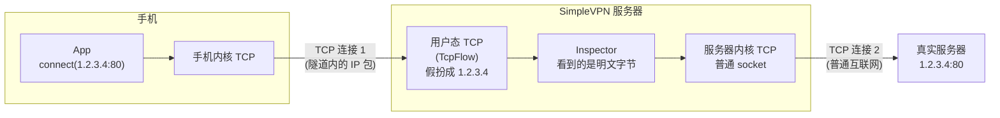

* 连接 1 位于手机内核和我们的**用户态 TCP 实现**（`TcpFlow`）之间。手机以为自己在和 1.2.3.4 通信。
* 连接 2 是服务器到 1.2.3.4 的一条普通 socket 连接。
* 在两者之间，服务器拿到的是**明文字节流**，可以记录、修改或丢弃。由于两条连接的序号相互独立，
  改变数据长度也没有问题。
* 服务器上不需要 root，也不需要 iptables（raw ICMP 除外）。

## 2. 组件

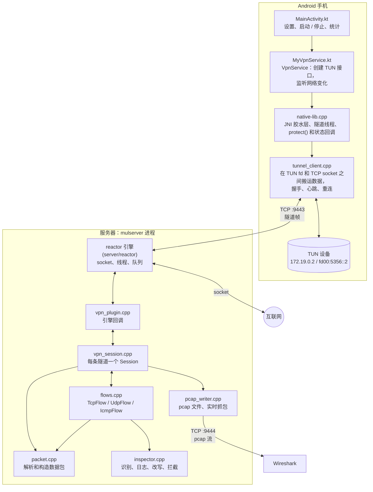

| 组件 | 语言 | 职责 |
|---|---|---|
| `MainActivity` | Kotlin | 界面，申请 VPN 权限，显示状态和计数器 |
| `MyVpnService` | Kotlin | 用 `VpnService.Builder` 创建 TUN 接口，启动/停止 native 隧道 |
| `native-lib.cpp` | C++ / JNI | 在独立线程上运行 `TunnelClient`，把 `protect()` 和状态回调桥接到 Java |
| `TunnelClient` | C++ | 在 TUN fd 和服务器连接之间搬运 IP 包；Linux 客户端也使用它 |
| reactor 引擎 | C++ | 服务器上所有的 socket I/O 和线程管理 |
| `vpn_plugin.cpp` | C++ | 把引擎回调映射到会话和流 |
| `Session` | C++ | 每条隧道一个：认证、帧、流表、统计、pcap |
| `TcpFlow` / `UdpFlow` / `IcmpFlow` | C++ | 每个连接 / 会话对话一个：协议逻辑和出站 socket |
| `packet.cpp` | C++ | IPv4/IPv6/TCP/UDP/ICMP 解析和构造、校验和、分片 |
| `Inspector` | C++ | 协议识别、日志、改写、拦截——**做实验的地方** |
| `PcapWriter` / `LiveCapture` | C++ | 抓包写入文件以及发给实时 Wireshark 客户端 |

## 3. 一个 HTTP 请求的完整旅程

手机上的浏览器加载 `http://example.com/` 时会发生什么：

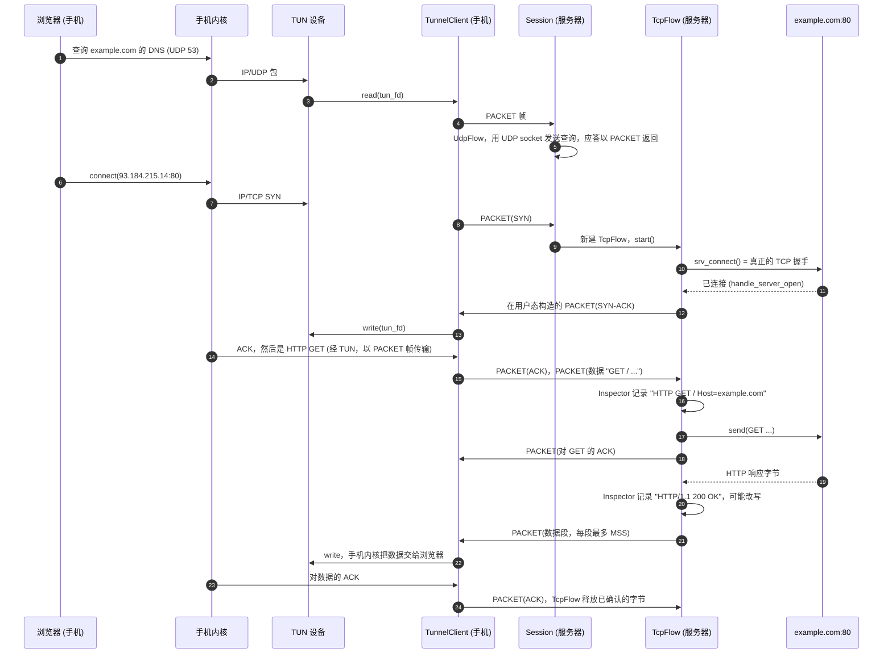

有两点值得注意：

* SYN-ACK **只有在**真实服务器接受连接之后才会发送。如果服务器拒绝，手机会收到 RST——
  和不用 VPN 时看到的完全一样。
* 两个方向上的每个包都会同时写入会话的 pcap 文件并发给实时 Wireshark 客户端，
  这样你可以对比手机看到的内容和服务器日志记录的内容。

## 4. 基于 reactor 引擎的服务器插件

VPN 服务器是 reactor 引擎的一个插件（`libvpnproxy.so`）。引擎拥有 socket 和线程；
插件只负责响应回调。

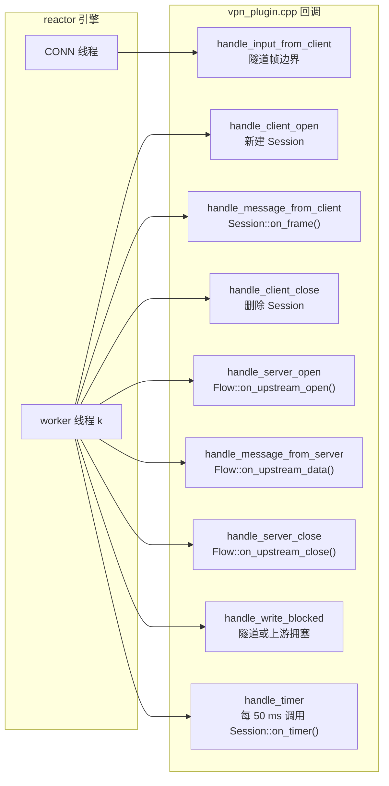

| 引擎回调 | 调用线程 | 插件动作 |
|---|---|---|
| `handle_input_from_client` | CONN 线程 | `tunnel::parse_header()` → 一帧的长度（抓包客户端则是整块数据） |
| `handle_client_open` | worker | 抓包端口：添加一个实时抓包订阅者；隧道端口：`new Session` |
| `handle_message_from_client` | worker | `Session::on_frame(type, payload)`，然后 `reap()` |
| `handle_client_close` | worker | 删除 Session；它的析构函数会中止所有出站 socket |
| `handle_server_open/…_from_server/…_close` | worker | 通过 `si->user_tag`（= 流 id）找到 Flow 并转发事件 |
| `handle_write_blocked` | worker | 隧道 → `Session::on_tunnel_write_blocked`；上游 → `Flow::on_upstream_write_blocked` |
| `handle_timer` | worker | 对该 worker 的每个会话调用 `Session::on_timer()` |

### 为什么不需要锁

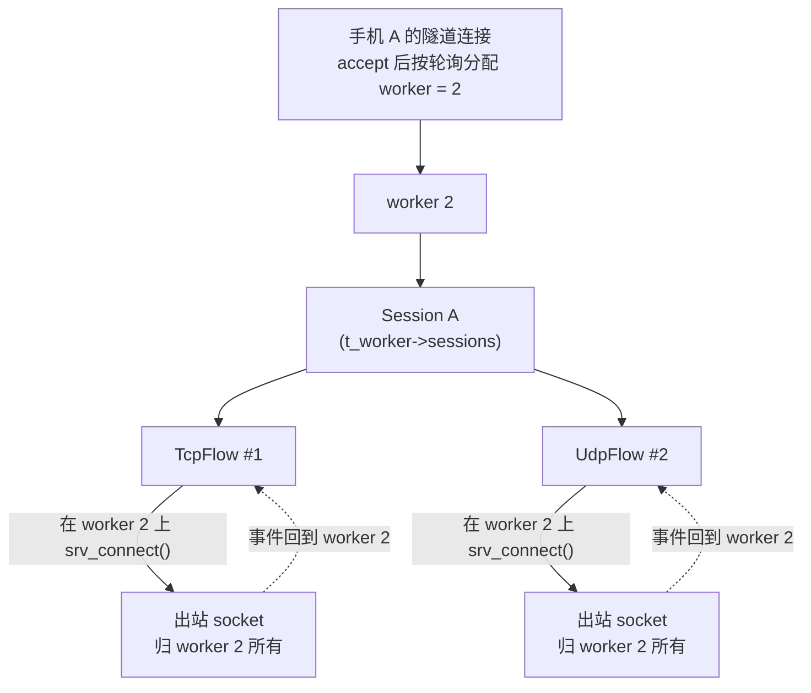

引擎把每条连接固定在一个 worker 上，而 `srv_connect()` 创建的 socket 属于创建它的 worker。
因此隧道、它的会话、所有的流以及这些流的所有出站 socket 都在**同一个**线程上。
所有状态都保存在 `thread_local WorkerState` 中（`sessions` 以隧道 `conn_id` 为键，
`flows` 以流 id 为键），不需要任何互斥锁。不同的手机会分散到不同的 worker 上。

唯一的进程级对象要么在启动后只读（`g_vpn_config`、`g_inspector`），要么由自己的互斥锁保护
（`g_live_capture`）。

## 5. 会话：一部手机，一条隧道

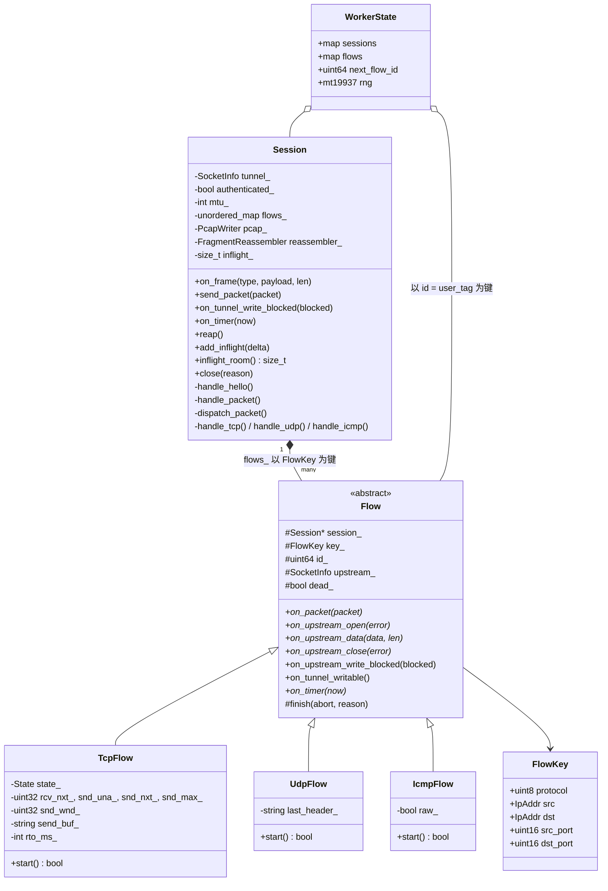

### 会话的生命周期

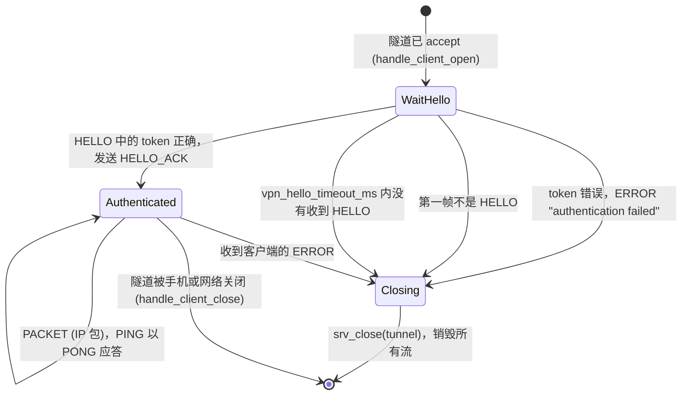

### 删除流：finish() 和 reap()

一个流可能在它自己的回调执行到一半时决定结束（例如在处理 RST 时）。
如果在那里直接 delete `this`，就会造成 use-after-free。因此：

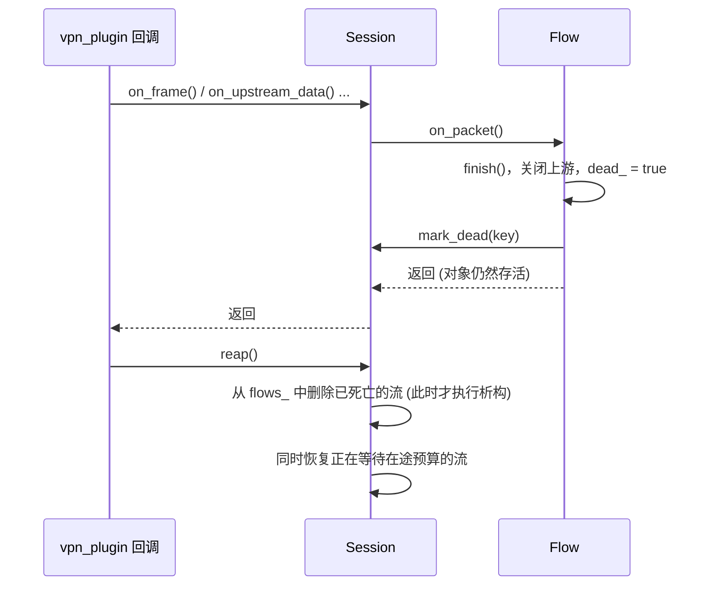

## 6. 从 IP 包到流

`Session::handle_packet()` 和 `dispatch_packet()`：

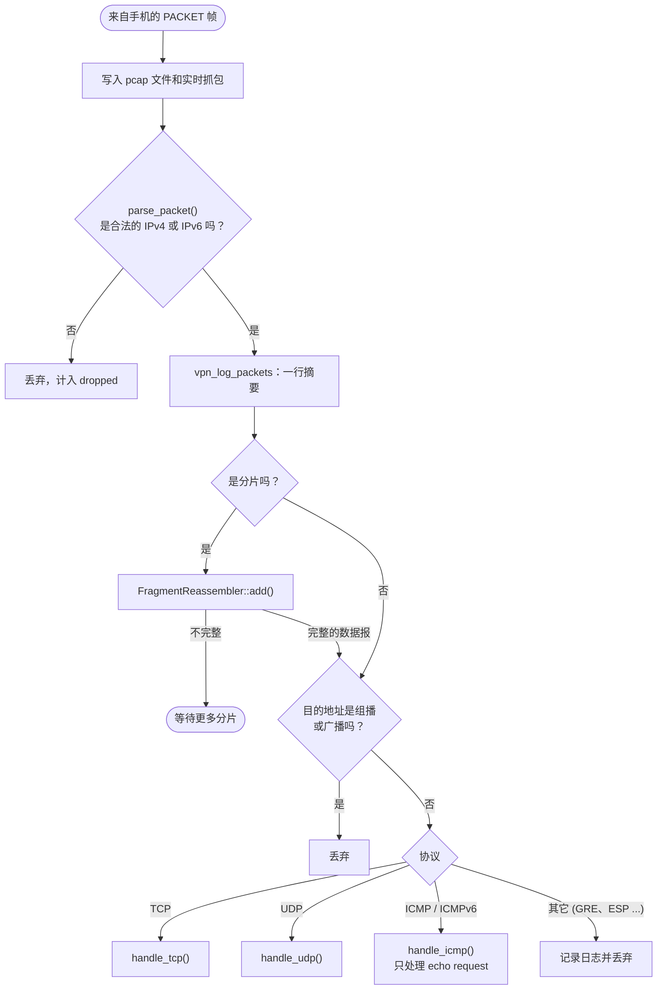

流通过一个**五元组键**查找：协议、手机地址和端口、目的地址和端口
（对 ICMP 来说，端口就是 echo 的 identifier）。

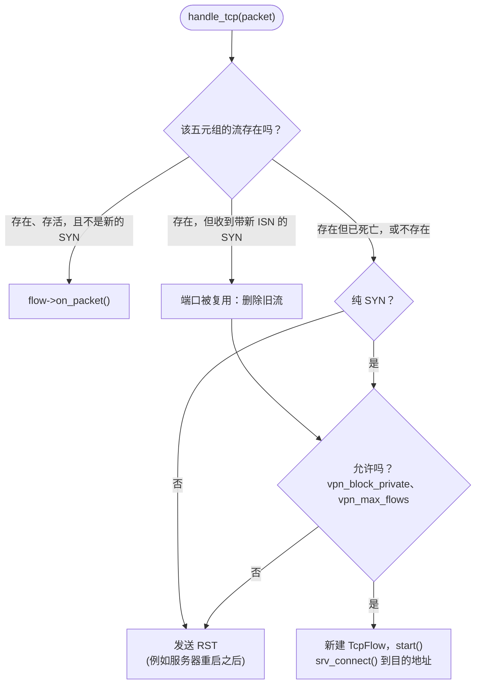

## 7. TCP：用户态 TCP 端点

`TcpFlow`（`flows.cpp`）面向手机实现了 TCP（RFC 9293）的服务器一侧，并在条件允许的地方做了简化。
它**没有**实现拥塞控制：手机和服务器之间是隧道，而隧道本身就是一条 TCP 连接，有自己的拥塞控制。

### 7.1 状态机

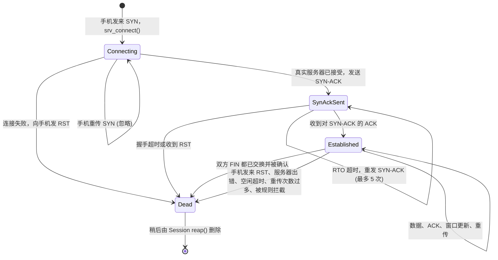

这里没有显式的 FIN_WAIT/CLOSE_WAIT/TIME_WAIT 状态：关闭过程由四个标志描述
（`phone_fin_`、`upstream_eof_`、`fin_sent_`、`fin_acked_`）。TIME_WAIT 是不需要的，因为流的键会被移除，
带有不同 ISN 的新 SYN 会创建一个全新的流。

### 7.2 握手和选项

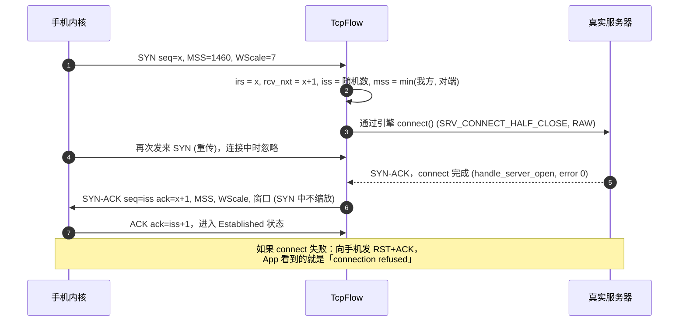

* **MSS**（最大报文段长度）：`min(我方 MTU - 40 (IPv4) / 60 (IPv6), 手机的 MSS)`；手机没有提供时
  默认为 536 / 1220。
* **窗口扩大**：只有手机提供了这个选项才使用。我们选取最小的移位数，使 `vpn_tcp_window`
  （512 KB）能放进 16 位。SYN 中的窗口字段永远不缩放。

### 7.3 序号空间的记账

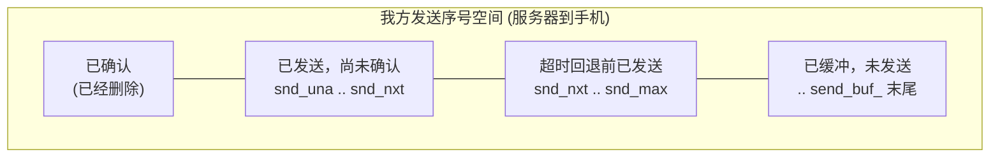

| 变量 | 含义 |
|---|---|
| `snd_una_` | 手机尚未确认的最早字节；`send_buf_` 从这里开始 |
| `snd_nxt_` | 下一个要发送的字节；重传超时时回退到 `snd_una_`（go-back-N） |
| `snd_max_` | 曾经发送过的最高字节 + 1；即使回退之后，确认到这里的 ACK 仍然有效 |
| `snd_wnd_` | 手机的接收窗口（已缩放） |
| `rcv_nxt_` | 期望从手机收到的下一个字节（也就是我们确认的位置） |

### 7.4 下载：服务器 → 手机

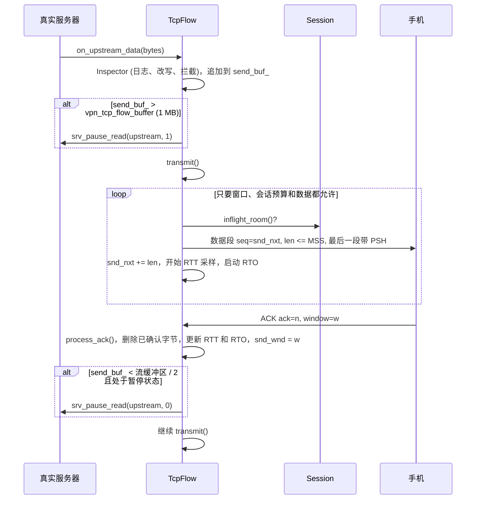

`transmit()` 发送的数据量取下面这些限制中最小的一个：

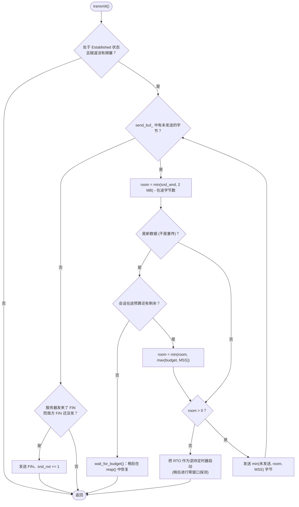

### 7.5 上传：手机 → 服务器

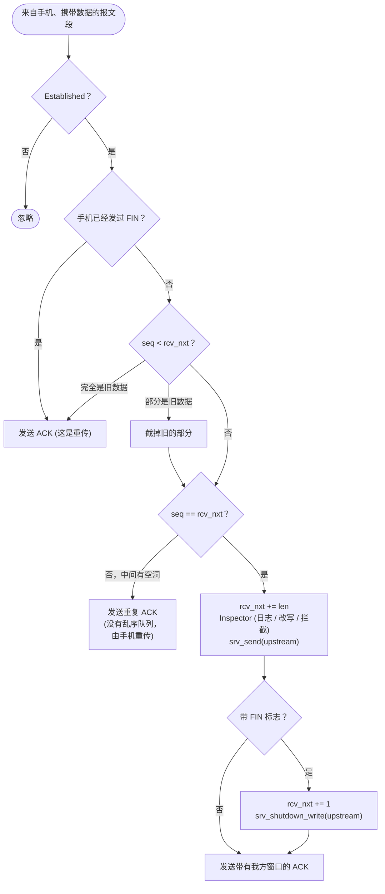

如果出站 socket 写不进更多数据，引擎会报告 `handle_write_blocked(1)`；流随即向手机通告**零窗口**，
手机就会停止发送。socket 中的数据排空后，会立即发送一个重新打开窗口的 ACK（`on_upstream_write_blocked`）。

### 7.6 重传

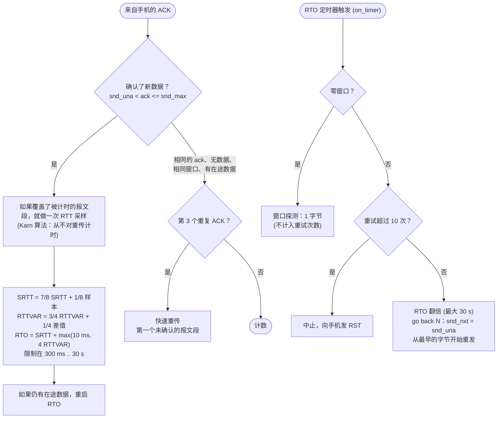

RTO 估计遵循 RFC 6298；快速重传使用 RFC 5681 中对重复 ACK 的定义。

### 7.7 关闭

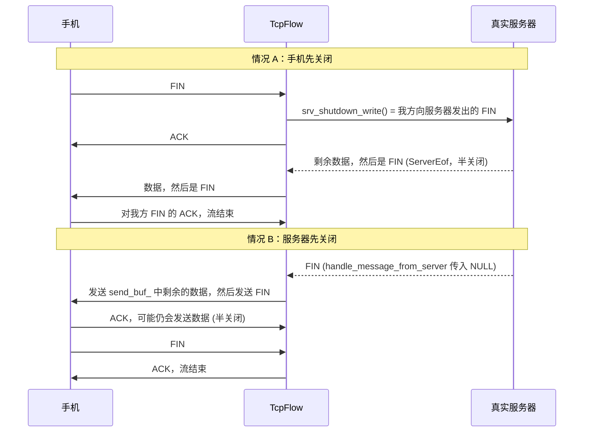

这一切靠的是 `SRV_CONNECT_HALF_CLOSE`：没有它，引擎会在收到服务器的 FIN 时关闭出站 socket，
依赖半关闭的协议（例如用 shutdown 的 `nc`）就会出错。

以下情况会生成 RST：手机为一个未知连接发来非 SYN 报文段（例如服务器重启之后）、
目标拒绝连接或不可达、命中拦截规则、重传次数过多，或者流的空闲时间超过 `vpn_tcp_idle_timeout`。

## 8. UDP：基于 connected socket 的 NAT

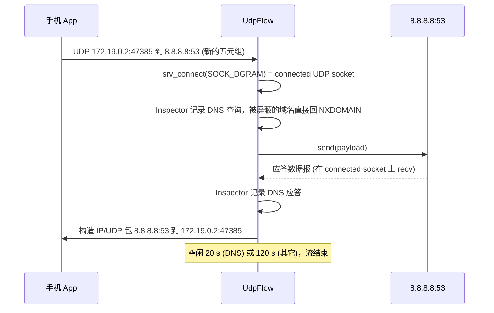

* 每个 (手机地址:端口, 目的地址:端口) 一个 socket，也就是使用服务器地址的一种类似 full-cone 的 NAT。
* socket 是 **connected** 的，所以内核只会交付来自该目的地址的数据报——和有状态防火墙做的过滤一样。
* 如果目的端口没有开放，内核会报告 `ECONNREFUSED`；流会像路由器一样，向手机发回一个
  **ICMP destination unreachable**。
* `vpn_block_quic = 1` 时，对发往 443 端口的新 UDP 流回 ICMP port unreachable，让浏览器回退到
  TCP + TLS（参见 [Inspector 与抓包](inspector-and-capture.md)）。
* 隧道拥塞时，下行的数据报会被丢弃：UDP 协议本身能应对丢包，缓存它们只会增加延迟。
* 空数据报（负载为 0 字节）也是真正的 UDP 消息，两个方向都会被转发；引擎不会把它误认为流结束信号。

## 9. ICMP echo（ping）

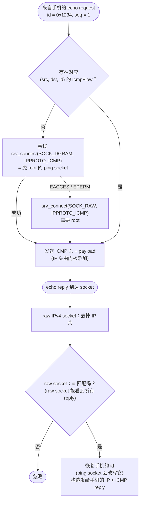

Linux 的 ping socket 通过 `sysctl net.ipv4.ping_group_range` 开启。在 macOS 上，ICMP 数据报 socket
的行为和 raw socket 一样（包含 IP 头，identifier 不会被改写），代码对此做了处理。

## 10. IP 分片

```mermaid
flowchart LR
    subgraph UP["手机到服务器"]
        F1["分片 1<br/>offset 0, MF=1"] --> RA["FragmentReassembler<br/>键：src, dst, protocol, id<br/>30 s 后过期"]
        F2["分片 2<br/>offset 1480, MF=1"] --> RA
        F3["分片 3<br/>offset 2960, MF=0"] --> RA
        RA --> WHOLE["完整的数据报<br/>重新解析并分发"]
    end
    subgraph DOWN["服务器到手机"]
        BIG["大于手机 MTU 的包<br/>(例如 6000 字节的 ping reply、<br/>大的 UDP 数据报)"] --> FP["fragment_packet(packet, mtu)"]
        FP --> P1["分片，每片 <= MTU，<br/>offset 以 8 字节为单位"]
    end
```

TCP 在这里永远不需要分片，因为报文段是按协商好的 MSS 构造的。UDP 和 ICMP 可能比 MTU 大，
所以会话会像路由器（IPv4）或发送主机（IPv6 分片头）那样对它们进行分片。

## 11. 端到端的流控与背压

真实服务器和手机 App 之间的每一个缓冲区都有上限，而每一个满了的缓冲区都会让它前面的生产者慢下来：

```mermaid
flowchart RL
    subgraph PH["手机"]
        APPR["App 读得慢"] --> RWIN["手机通告<br/>一个很小的窗口"]
    end
    subgraph SV["服务器"]
        RWIN --> SNDWND["TcpFlow：snd_wnd 限制<br/>在途字节数"]
        SNDWND --> SBUF["send_buf_ 增长"]
        SBUF -->|"> vpn_tcp_flow_buffer"| PAUSE["srv_pause_read(upstream)"]
        TUNQ["隧道发送缓冲区<br/>> send_high_watermark"] -->|"handle_write_blocked(1)"| TB["Session：tunnel_blocked<br/>各个流停止 transmit()，<br/>丢弃下行 UDP"]
        BUDGET["会话在途预算<br/>vpn_session_inflight (4 MB)"] --> SNDWND
    end
    subgraph RS["真实服务器"]
        PAUSE --> KWIN["服务器内核接收缓冲区被填满，<br/>其 TCP 窗口关闭，<br/>真实服务器放慢速度"]
    end
```

| 限制 | 位置 | 原因 |
|---|---|---|
| 手机的 TCP 窗口 | `TcpFlow::snd_wnd_` | 标准的 TCP 流控 |
| 每个流 2 MB（`kMaxInFlight`） | `transmit()` | 即使窗口很大，也限制单个流 |
| `vpn_session_inflight`（4 MB） | `Session::inflight_room()` | 一条隧道的所有流共享它，这样一个下载不会占满隧道而拖慢其它所有流量（延迟） |
| `vpn_tcp_flow_buffer`（1 MB） | `on_upstream_data()` | 暂停读取真实服务器；降到一半以下时恢复（迟滞） |
| 隧道水位线 | 引擎的 `send_high_watermark` | 手机链路慢时，停止该会话的所有流 |
| 上游水位线 | `on_upstream_write_blocked()` | 真实服务器读得慢时，向手机通告零窗口 |
| 手机 TUN 队列 | `TunnelClient` | 最多读入 4 MB 未发送的帧，分批处理 |

被会话预算卡住的流会保存在一个 FIFO（`starved_flows_`）中，一旦 ACK 释放了预算，
`Session::reap()` 就会按顺序恢复它们，保证每个流都能轮到。

## 12. 定时器与超时

`handle_timer` 每隔 `timer_interval_ms`（`server.ini` 中为 50 ms）在每个 worker 上运行一次，
并调用 `Session::on_timer()`：

```mermaid
flowchart TD
    T(["Session::on_timer(now)"]) --> AUTH{"已认证？"}
    AUTH -->|"否"| HT{"超过 vpn_hello_timeout_ms？"}
    HT -->|"是"| CLOSE["关闭：没有收到 HELLO"]
    AUTH -->|"是"| FLOWS["每个流：on_timer(now)<br/>TCP：空闲和半关闭超时、RTO、SYN-ACK 重试<br/>UDP：空闲 120 s / DNS 20 s<br/>ICMP：空闲 30 s"]
    FLOWS --> REAP["reap()：删除已结束的流"]
    REAP --> FRAG["reassembler.expire()：丢弃过期的分片"]
    FRAG --> PCAP["每秒一次：把 pcap 文件刷到磁盘"]
    PCAP --> STATS["每隔 vpn_stats_interval：记录统计信息"]
```

## 13. IPv6

上面的所有内容同样适用于 IPv6：TUN 接口获得 `fd00:5356::2/64` 地址和默认路由 `::/0`（可在 App 中开关），
`packet.cpp` 解析 IPv6 头并遍历扩展头（包括分片头），校验和使用 IPv6 伪首部，ICMPv6 echo 使用
类型 128/129，服务器用 IPv6 socket 连接 IPv6 目的地址。如果服务器本身没有 IPv6 连通性，
连接就会失败，手机收到 RST / unreachable，App 会回退到 IPv4（Happy Eyeballs）。
