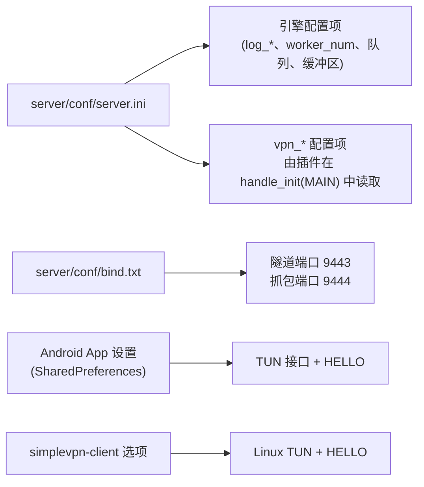
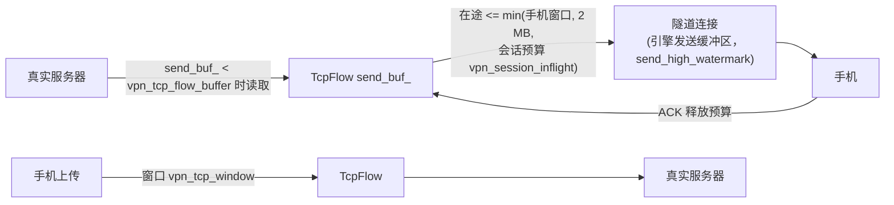

# 配置

[English](../en/configuration.md) | **简体中文** · [README](../../README.zh-CN.md) · [架构](architecture.md) · [隧道协议](tunnel-protocol.md) · [Android 客户端](android-client.md) · [Inspector 与抓包](inspector-and-capture.md) · [学习指南](learning-guide.md) · [测试](testing.md) · [源码导读](source-tour.md)



在 `server/` 目录下用 `mulserver conf/server.ini [path/to/libvpnproxy.so]` 启动服务器
（配置中的路径相对于当前目录）。

## 1. 引擎配置项（server.ini 中的设置）

所有引擎配置项都记录在 reactor 的
[配置参考](https://github.com/kingo132/simple-cplusplus-multithread-reactor-server/blob/main/docs/zh-CN/configuration.md)中。VPN 使用以下取值：

| 配置项 | server.ini | 为什么取这个值 |
|---|---|---|
| `worker_num` | 4 | 手机分散到 4 个 worker 上 |
| `max_packet_size` | 131072 | 一个隧道帧 = 一个 IP 包（最大 64 KB）+ 帧头 |
| `ringqueue_length` / `send_queue_length` | 16 MB / 32 MB | 为突发的满尺寸数据包留出空间 |
| `send_buffer_max` | 32 MB | 每条连接在触发溢出策略之前可以积压的未发送数据 |
| `send_overflow_policy` | `drop` | 远远落后的手机会丢帧（隧道内的 TCP 会重传），而不是整条隧道被关闭；同时也让实时抓包流保持有效 |
| `send_high_watermark` | 1 MB | 超过它就认为隧道拥塞（`handle_write_blocked`） |
| `timer_interval_ms` | 50 | TCP 重传定时器的精度 |
| `connect_timeout_ms` | 10000 | 连接真实服务器的超时时间 |

## 2. VPN 插件配置项

| 配置项 | 默认值（代码中） | 含义 |
|---|---|---|
| `vpn_token` | 空 | 共享密钥；必须与 App 中的 token 一致。空 = 不认证（不要在公网服务器上这样用） |
| `vpn_hello_timeout_ms` | 10000 | 关闭没有及时发送 HELLO 的隧道 |
| `vpn_log_packets` | 0 | 1 = 两个方向上每个 IP 包输出一行日志 |
| `vpn_log_payload_bytes` | 0 | 以十六进制 dump 每个 TCP 数据块 / UDP 数据报的前 N 个字节 |
| `vpn_pcap_dir` | 空（server.ini：`./pcap`） | 每个会话写一个 `session-<id>-<time>.pcap` |
| `vpn_pcap_max_mb` | 100 | 单个 pcap 文件的大小上限 |
| `vpn_capture_port` | 0（server.ini：9444） | 实时 pcap 流的端口；也必须写在 `bind.txt` 中 |
| `vpn_capture_allow_remote` | 0 | 1 = 接受不在 loopback 上的抓包客户端（它们能看到一切！） |
| `vpn_block_domains` | 空 | 逗号分隔；DNS → NXDOMAIN，TLS SNI / HTTP Host → RST；包含子域名 |
| `vpn_rewrite_1` … `vpn_rewrite_16` | 空 | `up\|from\|to` 或 `down\|from\|to`；转义 `\r \n \t \| \\` |
| `vpn_rewrite_ports` | 80 | 逗号分隔的服务器端口，改写规则只在这些端口上生效 |
| `vpn_block_private` | 0 | 1 = 拒绝 loopback / 私有 / link-local / CGNAT 目标地址 |
| `vpn_block_quic` | 0 | 1 = 对 UDP 443 回 ICMP port unreachable（浏览器会回退到 TCP + TLS） |
| `vpn_tcp_idle_timeout` | 3600 | TCP 流无活动多少秒后被重置 |
| `vpn_tcp_half_close_timeout` | 120 | 同上，适用于一方已经发送 FIN 之后 |
| `vpn_udp_idle_timeout` | 120 | UDP 流的空闲超时 |
| `vpn_dns_idle_timeout` | 20 | 发往 53 端口的 UDP 流的空闲超时 |
| `vpn_icmp_idle_timeout` | 30 | ICMP echo 流的空闲超时 |
| `vpn_max_flows` | 4096 | 每个会话的流数量上限；超出后新连接会被拒绝 |
| `vpn_tcp_window` | 524288 | 向手机通告的接收窗口（4 KB … 16 MB） |
| `vpn_tcp_flow_buffer` | 1048576 | 每个流的下载缓冲区；超过它就暂停读取真实服务器（最小 64 KB） |
| `vpn_session_inflight` | 4194304 | 一条隧道所有流已发给手机但尚未被确认的字节数（最小 64 KB） |
| `vpn_stats_interval` | 60 | 统计日志的输出间隔秒数（0 = 关闭） |

### 各缓冲区设置之间的关系



取值越小 → 在有下载进行时，交互式流量的延迟越低；取值越大 → 在带宽时延积很大的链路上吞吐量越高。

## 3. bind 文件

```text
#ip          #port    #type    #idle timeout (seconds, 0 = never)
0.0.0.0      9443     tcp      300      # 供手机连接的隧道端口 (IPv6 请加 "::")
127.0.0.1    9444     tcp      0        # 实时抓包，仅限 loopback
```

隧道端口的空闲超时会关闭 300 s 内什么都没发送的隧道；客户端每 15 s 发送一次 PING，
让健康的隧道保持打开。

## 4. Android App 设置

| 设置 | 默认值 | 用途 |
|---|---|---|
| Server | 空 | 服务器的主机名或 IP（在 VPN 启动之前解析） |
| Port | 9443 | 隧道端口 |
| Token | `change-me` | 在 HELLO 中发送，必须与 `vpn_token` 相同 |
| DNS | `8.8.8.8` | 配置在 VPN 接口上的 DNS 服务器 |
| MTU | 1500（576 … 9000） | TUN 的 MTU，也会在 HELLO 中发送 |
| IPv6 | 开 | 添加 `fd00:5356::2/64` 和 `::/0` 路由 |
| Only these apps | 空 | 逗号分隔的包名；空 = 除 SimpleVPN 以外的所有 App |

## 5. Linux 测试客户端

```text
simplevpn-client -s SERVER [-p PORT] [-t TOKEN] [-d DEVICE] [-m MTU]
                 [--ipv4 ADDR/PREFIX] [--ipv6 ADDR/PREFIX] [-v]
```

它会创建 TUN 设备（需要 root）、分配地址，并运行与 App 相同的 `TunnelClient`。
为你想经过它发送的流量添加路由，但千万不要把到服务器本身的路由也指进去。

## 6. 服务器主机设置

| 设置 | 命令 | 原因 |
|---|---|---|
| 免 root ping | `sysctl -w net.ipv4.ping_group_range="0 2147483647"` | 不用 root 也能做 ICMP echo |
| 防火墙 | 放行入站 TCP 9443 | 手机必须能连到隧道端口 |
| 文件描述符 | `ulimit -n 65535` | 每个流占用一个 socket |
