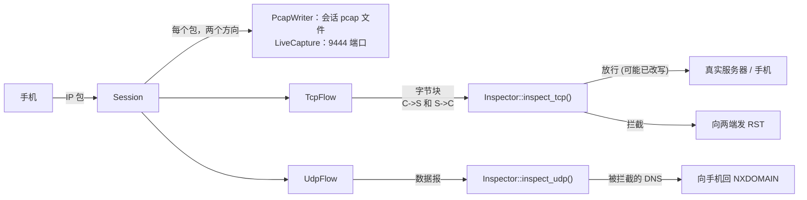
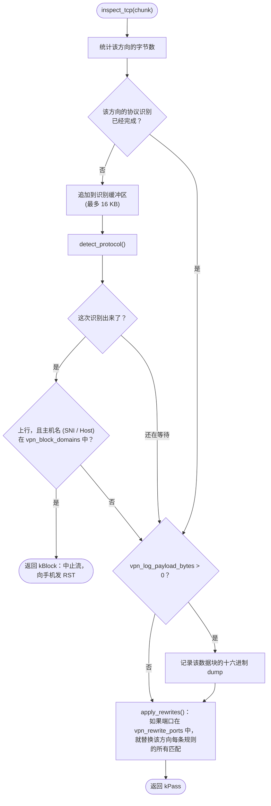
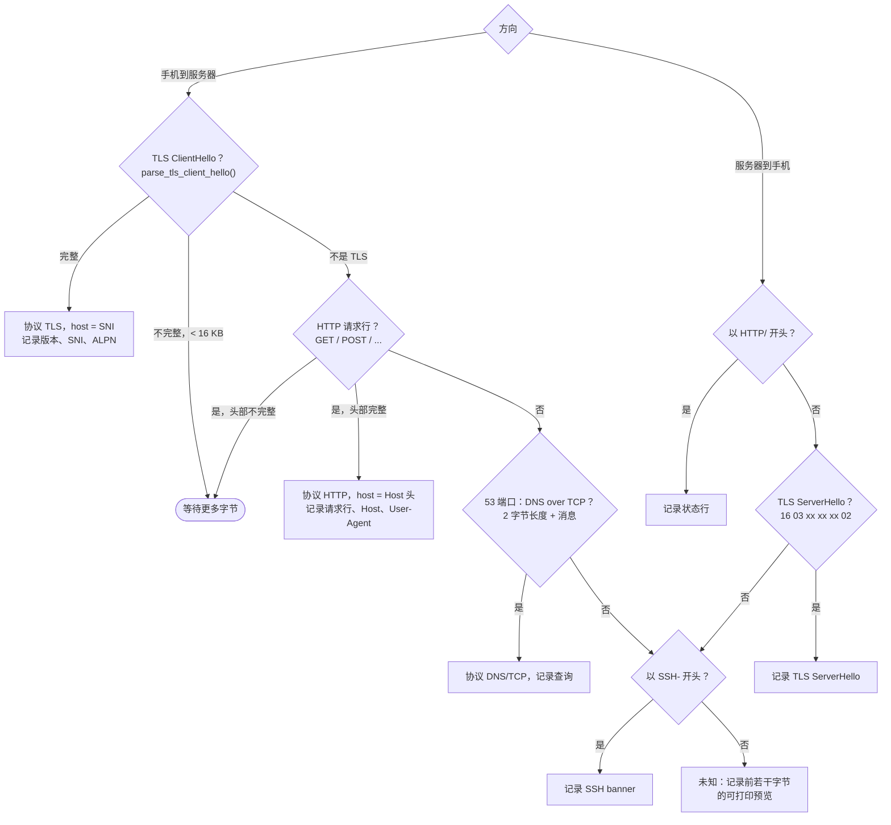
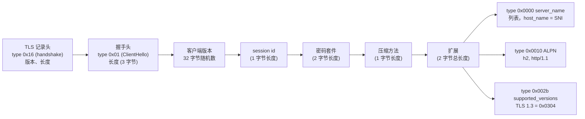
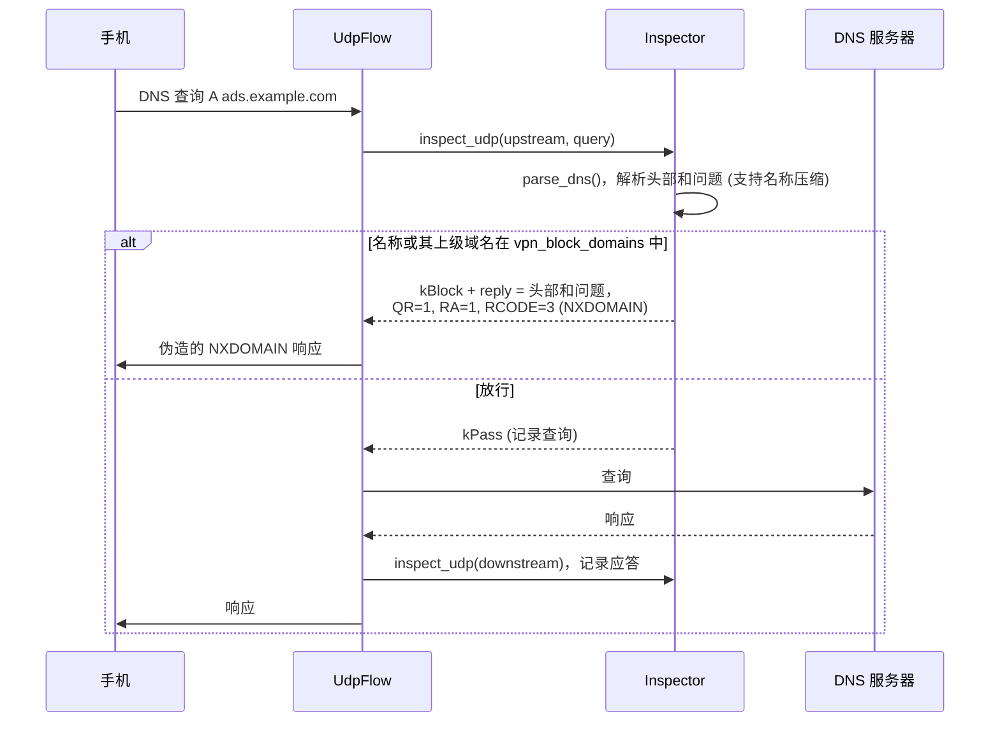
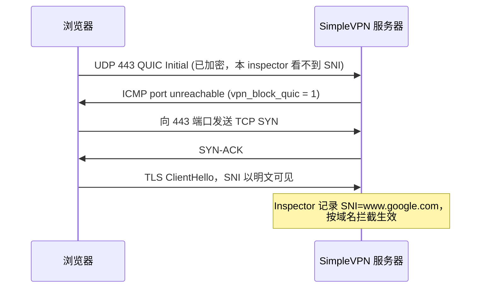
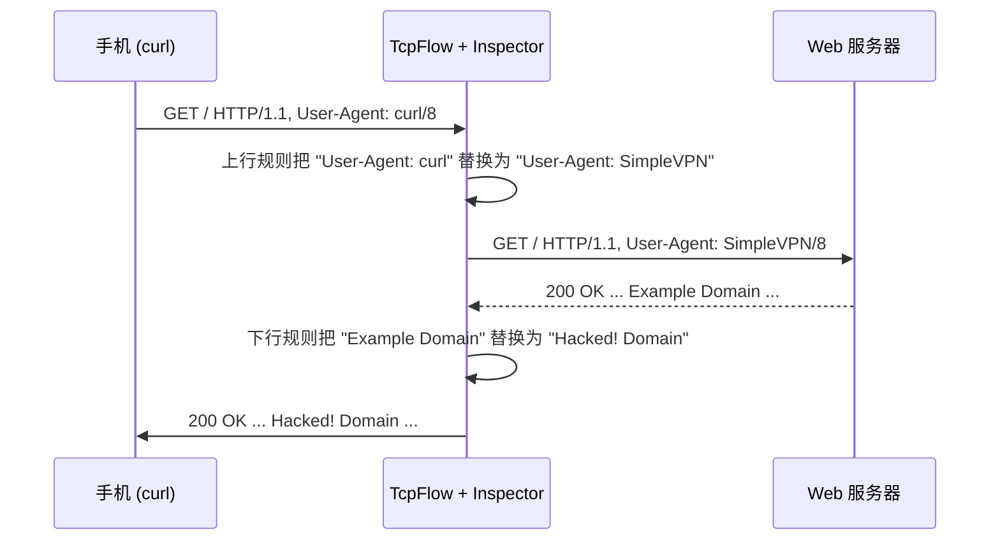
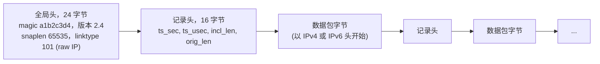
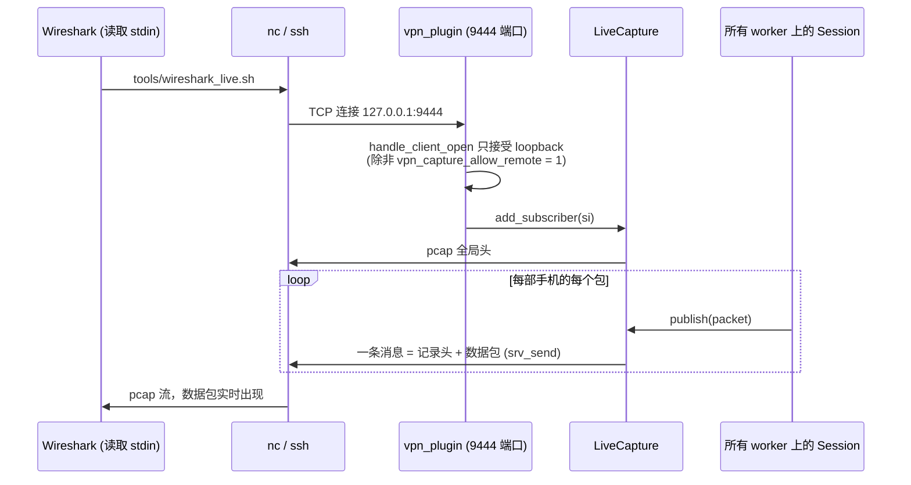

# Inspector 与抓包

[English](../en/inspector-and-capture.md) | **简体中文** · [README](../../README.zh-CN.md) · [架构](architecture.md) · [隧道协议](tunnel-protocol.md) · [Android 客户端](android-client.md) · [学习指南](learning-guide.md) · [配置](configuration.md) · [测试](testing.md) · [源码导读](source-tour.md)

有两个地方可以让你观察流量：

* **Inspector**（`server/src/inspector.cpp`）能看到每条 TCP 连接和每个 UDP 数据报中的*应用层数据*，
  并可以记录、改写或拦截它们；
* **抓包**（`server/src/pcap_writer.cpp`）把手机收发的原始 *IP 包*原样记录下来，供 Wireshark 使用。



## 1. Inspector 在哪里被调用

| 调用 | 方向 | 调用位置 |
|---|---|---|
| `inspect_tcp(name, port, upstream=true, state, data)` | 手机 → 服务器 | `TcpFlow::deliver_upstream()`，每个按序到达的数据段 |
| `inspect_tcp(name, port, upstream=false, state, data)` | 服务器 → 手机 | `TcpFlow::on_upstream_data()`，每次从真实服务器读到的数据块 |
| `inspect_udp(name, port, upstream=true, data, len, &reply)` | 手机 → 服务器 | `UdpFlow::on_packet()` |
| `inspect_udp(name, port, upstream=false, data, len, nullptr)` | 服务器 → 手机 | `UdpFlow::on_upstream_data()` |

`inspect_tcp` 中的 `data` 是一个 `std::string&`：**你可以直接修改它，包括改变它的长度**。
之所以可行，是因为两条 TCP 连接是相互独立的（参见
[架构 § 1](architecture.md#1-一图看懂整体思路)）：`TcpFlow` 维护自己面向手机的序号，
而面向真实服务器的字节则由服务器内核编号。

## 2. TCP 检查流水线



### 协议识别



### 如何找到 TLS SNI

ClientHello 是 TLS 连接的第一条消息，并且是以**明文**发送的（Encrypted ClientHello 除外）。
客户端想访问的服务器名称就在 `server_name` 扩展中：



`parse_tls_client_hello()` 带边界检查地逐个遍历这些带长度前缀的字段，返回 1（完整）、
0（需要更多数据）或 -1（不是 ClientHello）。

## 3. UDP 和 DNS 检查



当一个域名与某个屏蔽条目相同，或者是它的子域名时，就算匹配（`ads.example.com` 匹配
`example.com`）。

## 4. 拦截一览

| 流量 | 识别位置 | 结果 |
|---|---|---|
| 查询被屏蔽名称的 DNS 请求 | `inspect_udp`，53 / 5353 端口 | 由服务器直接回 NXDOMAIN |
| 访问被屏蔽 SNI 的 TLS | `inspect_tcp` 中的 ClientHello | 中止流，向手机发 RST |
| 访问被屏蔽 Host 的 HTTP | `inspect_tcp` 中的请求头 | 中止流，向手机发 RST |
| `vpn_block_quic = 1` 时的 QUIC（UDP 443） | `Session::handle_udp` | 向手机回 ICMP port unreachable |
| `vpn_block_private = 1` 时的私有地址目标 | `Session::target_allowed` | RST（TCP）/ 丢弃（UDP、ICMP） |

### 为什么要拦截 QUIC？



QUIC（HTTP/3）运行在 UDP 之上，并用从连接 id 派生出的密钥加密它的 Initial 包，
所以这个 inspector 不解析它。QUIC 失败时浏览器会回退到 TCP，流量于是重新变得可见。

## 5. 改写

规则来自配置：`vpn_rewrite_N = up|from|to` 或 `down|from|to`，只作用于 `vpn_rewrite_ports`
中的端口（默认 80）。支持转义 `\r \n \t \| \\`。



需要记住的限制：

* 规则是**对每个数据块单独**应用的。跨越两个 TCP 数据段 / 两次读取的字符串匹配不到。
* 如果 HTTP body 的长度变了，`Content-Length` 也必须跟着改，否则客户端会一直等待缺失的字节 /
  忽略多出来的字节。等长替换是最省事的做法。
* 压缩过的（`Content-Encoding: gzip`）或 TLS 加密的内容无法按文本改写。做实验时请使用明文 HTTP，
  或者加一条在上行方向去掉 `Accept-Encoding` 的改写规则。

## 6. pcap 抓包

### 文件格式



链路类型 101（`LINKTYPE_RAW`）表示“数据包直接以 IP 头开始”，这正是 TUN 设备交付的格式——
不需要伪造以太网头。

### 每个会话的文件

设置 `vpn_pcap_dir = ./pcap` 后，每个通过认证的会话都会写入
`pcap/session-<id>-<YYYYmmdd-HHMMSS>.pcap`，包含两个方向，大小上限为 `vpn_pcap_max_mb`。
文件每秒刷盘一次，所以用 `tail -f` / 在 Wireshark 中重新加载都能看到最近的包。

### 实时抓包



* `LiveCapture` 由所有 worker 共享，并由一个互斥锁保护——这是插件中唯一共享的可变状态。
* 每条记录都作为**一条** `srv_send()` 消息发送。如果 Wireshark 读得太慢，引擎会整条丢弃消息
  （`send_overflow_policy = drop`），所以流中永远不会出现半条记录，始终可以被解析；
  手机的流量也永远不会因为查看者而变慢。
* 9444 端口也必须写在 `conf/bind.txt` 中；请让它只绑定在 `127.0.0.1` 上，从其它机器访问时使用 SSH
  （`tools/wireshark_live.sh user@server`）。

## 7. 添加你自己的分析

```cpp
// inspector.cpp，在 Inspector::inspect_tcp() 中、apply_rewrites() 之前：
if (upstream && server_port == 6379 && data.compare(0, 1, "*") == 0) {
    LOG_INFO("%s Redis command: %s", flow_name.c_str(),
             printable_preview(reinterpret_cast<const uint8_t*>(data.data()), data.size(), 120).c_str());
}
```

用 `cmake --build build` 重新编译，重启 `mulserver`，手机发出的每条 Redis 命令都会出现在日志里。
[学习指南](learning-guide.md)里还有更多想法。
