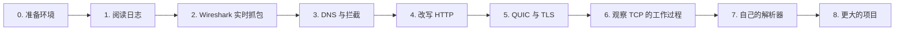
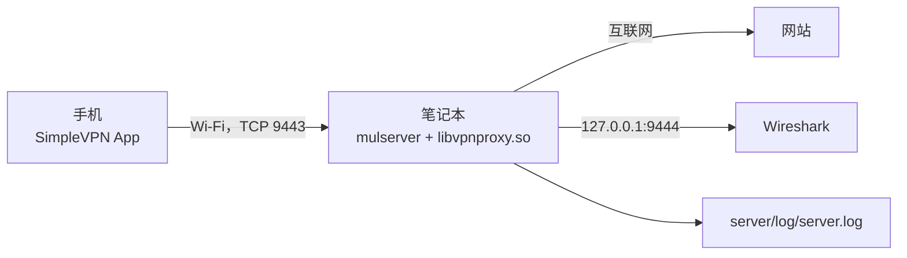
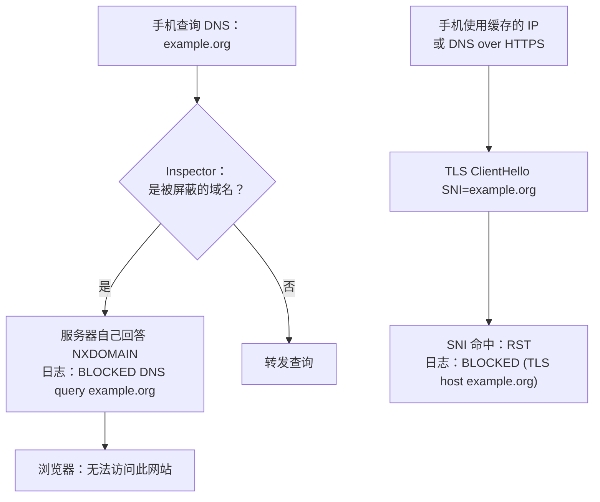
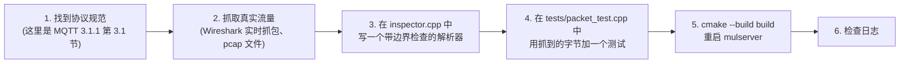

# 学习指南

[English](../en/learning-guide.md) | **简体中文** · [README](../../README.zh-CN.md) · [架构](architecture.md) · [隧道协议](tunnel-protocol.md) · [Android 客户端](android-client.md) · [Inspector 与抓包](inspector-and-capture.md) · [配置](configuration.md) · [测试](testing.md) · [源码导读](source-tour.md)

一组动手实验，从“看看我手机的流量”到“写一个自己的协议解析器”。
每个实验都会说明要改什么、在手机上做什么，以及你应该看到什么。



## 0. 准备环境

1. 编译并启动服务器（见 README 的*快速开始*）。放在和手机同一个 Wi-Fi 下的笔记本电脑上就可以；
   如果手机通过 USB 连接，`tests/device_test.sh` 能把一切自动化。
2. 安装 App，填入笔记本的 IP、端口 9443 和 token，点 **Start VPN**。
3. 开一个终端，运行 `tail -f server/log/server.log` 并保持打开。



## 1. 阅读日志

在手机上打开任意网站。每一行都以会话标签（`S2`）和流名称
（`TCP#12 172.19.0.2:40312 -> 142.250.74.36:443`）开头：

| 日志行 | 含义 | 代码 |
|---|---|---|
| `tunnel connection from ...`、`authenticated: ...` | 手机已连接并发送了有效的 HELLO | `Session::Session`、`handle_hello` |
| `TCP#n ... connected (server side local address ...)` | 真实服务器接受了连接，已向手机发送 SYN-ACK | `TcpFlow::on_upstream_open` |
| `C->S TLS ClientHello TLS1.3 SNI=... ALPN=...` | 手机发来的第一批字节是 TLS ClientHello | `Inspector::detect_protocol` |
| `C->S HTTP GET /path Host=... UA=...` | 明文 HTTP 请求 | 同上 |
| `S->C HTTP/1.1 200 OK` | 明文 HTTP 响应 | 同上 |
| `UDP#n ... C->S DNS query id=... q=A name` | DNS 查询 | `Inspector::inspect_udp` |
| `closed (up X bytes, down Y bytes, N ms, R retransmits, TLS host)` | TCP 流正常结束 | `TcpFlow::maybe_finish` |
| `stats: ... packets / bytes, dropped, flows` | 定期输出的会话统计 | `Session::log_stats` |

**试一试：** 设置 `log_level = 7` 并重启：你还能看到 SYN、FIN、窗口变化和重传超时。
设置 `vpn_log_packets = 1` 可以为每个 IP 包输出一行（`>` 表示来自手机，`<` 表示发往手机）。

## 2. Wireshark 实时抓包

```bash
tools/wireshark_live.sh            # 服务端在本机
tools/wireshark_live.sh me@server  # 服务端在别处，通过 SSH
```

常用的显示过滤器：

| 过滤器 | 显示内容 |
|---|---|
| `dns` | 手机的每个 DNS 查询和应答 |
| `tls.handshake.extensions_server_name` | 带 SNI 的 TLS ClientHello |
| `tcp.flags.syn == 1 && tcp.flags.ack == 0` | 手机发起的每条新 TCP 连接 |
| `tcp.analysis.retransmission` | 重传（来自手机或我们的 `TcpFlow`） |
| `icmp or icmpv6` | ping 和不可达消息 |
| `udp.port == 443` | QUIC |

**练习：** 把 Wireshark 中的一次握手与 `TcpFlow` 的代码对照起来看。你看到的 SYN-ACK 是由
`TcpFlow::send_syn_ack()` → `build_tcp_packet()` 一个字节一个字节构造出来的；检查它的 MSS
和窗口扩大选项是否与 `TcpFlow` 构造函数中的一致。

## 3. DNS 与拦截

```ini
# server.ini
vpn_block_domains = doubleclick.net,example.org
```

重启，然后在手机上打开 `http://example.org` 和一个带广告的 App。



**值得探究的问题：**

* 为什么手机缓存了 IP 地址时拦截依然有效？（提示：SNI / Host 检查。）
* 如果手机开启了*私人 DNS*（DNS over TLS，853 端口）会怎样？在日志里找一条到 853 端口的 TLS 流；
  此时 DNS 查询已经看不到了，但对网站的 SNI 检查仍然有效。

## 4. 改写 HTTP

```ini
vpn_rewrite_ports = 80
vpn_rewrite_1 = down|Example Domain|Hacked! Domain
vpn_rewrite_2 = up|Accept-Encoding: gzip|Accept-Encoding: none
```

在手机上打开 `http://example.com`（注意是明文 HTTP！）：页面标题变成了 *Hacked! Domain*。日志显示
`rewrote 1 occurrence(s) of "Example Domain" (downstream)`。

* `Hacked! Domain` 和 `Example Domain` 长度相同，所以 `Content-Length` 依然正确。
* 规则 2 阻止服务器返回 gzip 压缩的响应，因为压缩后的内容无法按文本改写。

**练习：** 写一条长度*不同*的规则，观察浏览器的表现；然后同时改写 `Content-Length` 头来修正它。

## 5. QUIC 与 TLS

1. 在 `vpn_block_quic = 0` 时用 Chrome 打开 `https://www.google.com`。在 Wireshark 中过滤
   `udp.port == 443`：页面通过 QUIC 加载；服务器日志中能看到到 443 端口的 UDP 流，但没有 SNI。
2. 设置 `vpn_block_quic = 1`，重启，重新加载页面。浏览器的 QUIC 收到 ICMP port unreachable，
   于是切换到 TCP：现在出现了 `C->S TLS ClientHello ... SNI=www.google.com ALPN=h2,http/1.1`。

## 6. 观察 TCP 的工作过程

用户态 TCP 实现是服务器中最有教学价值的部分。一些想法：

| 实验 | 做法 | 观察什么 |
|---|---|---|
| 握手时序 | `log_level = 7`，打开一个很慢的网站 | `SYN ... connecting to server` → `connected` → `established`：SYN-ACK 要等真实服务器 |
| 连接被拒绝 | 在手机上（Termux）执行 `curl http://<server-ip>:1/` | 连接失败，手机收到 RST：`connection refused` |
| 流控 | 在很慢的手机链路上下载大文件 | `send_buf_` 超过 `vpn_tcp_flow_buffer` 时调用 `srv_pause_read`（在那里加一行 `LOG_DEBUG`） |
| 重传 | 在服务器上执行 `tc qdisc add dev wlan0 root netem loss 5%` | `retransmission timeout` 日志行、`closed (... N retransmits)`、debug 日志中的 RTO 值 |
| 零窗口 | 让某个 App 暂停读取（例如卡住的视频） | `snd_wnd_ == 0`，坚持定时器发出的探测 |
| 半关闭 | 用类似 `nc -N` 的客户端关闭自己的发送方向 | `FIN from client`，服务器仍会发送它的应答，然后 `FIN to client` |

把[架构 § 7](architecture.md#7-tcp用户态-tcp-端点) 和 `flows.cpp` 对照着读；
那里的每个函数都注释了它所遵循的 RFC。

## 7. 编写你自己的解析器

所有应用层数据都会经过 `Inspector::inspect_tcp()` / `inspect_udp()`。下面是一个分步示例：
记录每个 MQTT CONNECT（1883 端口）及其 client id。

```cpp
// inspector.cpp，加在文件开头附近
static bool parse_mqtt_connect(const std::string& d, std::string* client_id) {
    // 固定头：高 4 位是类型 1 (CONNECT)，后面是变长的 "remaining length"
    if (d.size() < 2 || (static_cast<uint8_t>(d[0]) >> 4) != 1) return false;
    size_t pos = 1, multiplier = 1, remaining = 0;
    while (pos < d.size()) {                       // remaining length：1-4 字节，每字节 7 位
        uint8_t b = static_cast<uint8_t>(d[pos++]);
        remaining += (b & 0x7f) * multiplier;
        multiplier *= 128;
        if (!(b & 0x80)) break;
    }
    // 可变头：协议名 (2 字节长度 + "MQTT")、level、flags、keep alive
    if (pos + 2 > d.size()) return false;
    size_t name_len = (static_cast<uint8_t>(d[pos]) << 8) | static_cast<uint8_t>(d[pos + 1]);
    pos += 2 + name_len + 1 + 1 + 2;
    if (pos + 2 > d.size()) return false;
    size_t id_len = (static_cast<uint8_t>(d[pos]) << 8) | static_cast<uint8_t>(d[pos + 1]);
    if (pos + 2 + id_len > d.size()) return false;
    client_id->assign(d, pos + 2, id_len);
    return true;
}

// 在 Inspector::inspect_tcp() 中、apply_rewrites() 之前：
std::string id;
if (upstream && server_port == 1883 && parse_mqtt_connect(data, &id)) {
    LOG_INFO("%s MQTT CONNECT client_id=%s", flow_name.c_str(), id.c_str());
}
```



提示：

* 读取之前一定要先检查长度：数据来自网络，可能被截断，也可能是恶意的。
  `printable_preview()` 和 `hexdump()` 是用于记录日志的安全辅助函数。
* 一个数据块就是一次 `recv()` / 一个 TCP 数据段交付的内容——一条消息可能被拆分到多个数据块中。
  要做健壮的解析，请在 `FlowInspectState` 中保存每个流的状态（它已经为识别协议缓存了每个方向的前 16 KB）。
* 想要修改而不是记录，就改 `data`；想要拦截，就 `return kBlock`。

## 8. 更大的项目想法

| 项目 | 从哪里入手 |
|---|---|
| 用自己的 CA 做 TLS 中间人 | 在 `TcpFlow` 中用 OpenSSL 终结 TLS，为 SNI 签发证书，在手机上安装 CA |
| 加密隧道 | 在两端用 TLS 包装隧道 socket（`tunnel_client.cpp`、引擎插件） |
| UDP 隧道 | 替换 TCP 隧道，避免在丢包链路上出现 TCP-over-TCP 崩溃 |
| 在 `TcpFlow` 中实现 SACK 和拥塞控制 | RFC 2018、RFC 5681 / CUBIC |
| 按 App 统计 | 在手机上使用 Android 的 `ConnectivityManager.getConnectionOwnerUid()` API，用一个额外的帧发送 uid |
| Web 仪表盘 | 第二个插件端口，以 JSON 形式提供会话和流的统计 |
