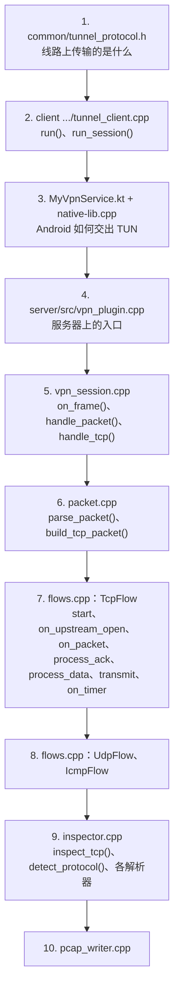
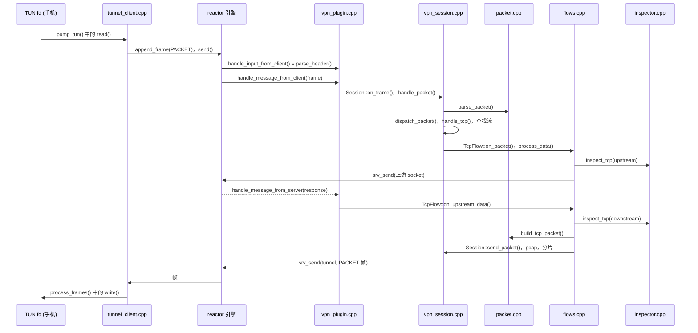

# 源码导读

[English](../en/source-tour.md) | **简体中文** · [README](../../README.zh-CN.md) · [架构](architecture.md) · [隧道协议](tunnel-protocol.md) · [Android 客户端](android-client.md) · [Inspector 与抓包](inspector-and-capture.md) · [学习指南](learning-guide.md) · [配置](configuration.md) · [测试](testing.md)

每个源文件都以一段头部注释开始（职责、概述、阅读指引），每个函数都有文档：
它做什么、为什么这样做、参数和返回值。本页就是一张地图。

## 文件

| 文件 | 值得关注的内容 |
|---|---|
| `common/tunnel_protocol.h` | 帧头、`append_frame()`、`parse_header()`、`key=value` 编码 |
| **服务器** | |
| `server/src/vpn_plugin.cpp` | 引擎回调（`handle_*`）、加载配置、初始化 worker 状态 |
| `server/src/vpn_session.h` | `VpnConfig`、`FlowKey`、`Flow` 基类、`Session`、`WorkerState` |
| `server/src/vpn_session.cpp` | HELLO、帧分发、从包查找流、对未知连接回 RST、拒绝 QUIC、在途预算、定时器、统计 |
| `server/src/flows.h` / `flows.cpp` | `TcpFlow`（用户态 TCP）、`UdpFlow`（NAT）、`IcmpFlow`（ping） |
| `server/src/packet.h` / `packet.cpp` | IPv4/IPv6/TCP/UDP/ICMP 解析和构造、校验和、分片、重组 |
| `server/src/inspector.h` / `inspector.cpp` | 协议识别、DNS/TLS/HTTP 解析器、拦截、改写 |
| `server/src/pcap_writer.h` / `pcap_writer.cpp` | pcap 文件和实时抓包流 |
| `server/conf/server.ini`、`bind.txt` | 带注释的示例配置 |
| `server/reactor/` | reactor 引擎（submodule，有单独的文档） |
| **客户端** | |
| `client/app/src/main/cpp/tunnel_client.h` / `.cpp` | 可移植的隧道核心：连接、握手、搬运数据包、心跳、重连 |
| `client/app/src/main/cpp/native-lib.cpp` | JNI：start/stop/reconnect/stats、线程 attach、`protect()` 和状态回调 |
| `client/app/src/main/java/.../MyVpnService.kt` | `VpnService`：TUN 接口、处理网络变化 |
| `client/app/src/main/java/.../MainActivity.kt` | 界面、VPN 权限、状态、调试自动化钩子 |
| `client/app/src/main/java/.../VpnSettings.kt` | 保存在 `SharedPreferences` 中的设置 |
| **工具和测试** | |
| `tools/linux_client/main.cpp` | Linux 命令行客户端（TUN 设备 + 同一个隧道核心） |
| `tools/wireshark_live.sh` | 把实时抓包通过管道送进 Wireshark，本地或经 SSH 均可 |
| `tests/packet_test.cpp` | 单元测试 |
| `tests/e2e_test.sh`、`e2e_services.py`、`e2e_client_tests.py` | 在 network namespace 中运行的端到端测试 |
| `tests/jni_test.sh`、`tests/jni/` | 在 Linux JVM 上运行的 JNI 测试 |
| `tests/device_test.sh` | 真机测试 |

## 推荐的阅读顺序

## 在代码中跟踪一个数据包

## 代码中的约定

| 约定 | 含义 |
|---|---|
| 日志中的 `S<n>` / `TCP#<n>` | 会话 id（隧道 `conn_id`）/ 流 id |
| `C->S`、`S->C` | 客户端（手机）到服务器的方向，以及反方向 |
| `upstream` | 朝向互联网；`downstream` 朝向手机 |
| `t_` 前缀 | `thread_local` 变量（每个 worker 一份） |
| `g_` 前缀 | 进程级全局变量，启动后只读，除非它有自己的互斥锁 |
| `snd_*`、`rcv_*` | TCP 序号变量，命名与 RFC 9293 一致 |
| 先 `finish()` 再 `reap()` | 延迟删除流 |
