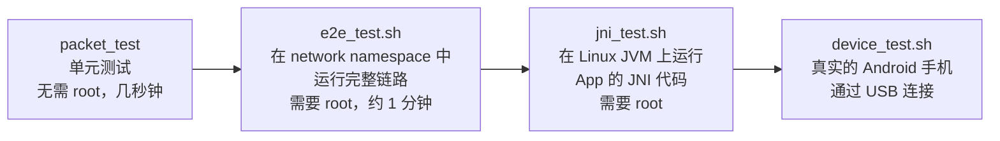
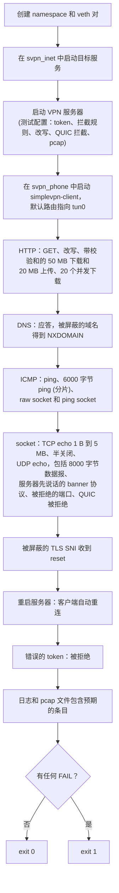
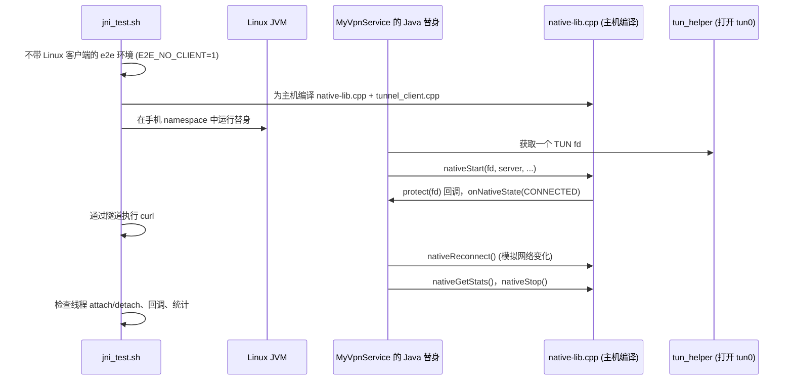
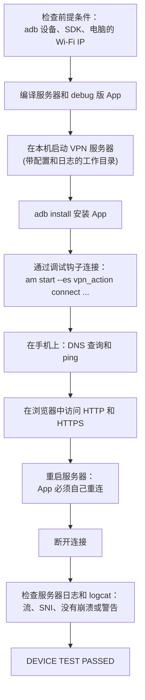

# 测试

[English](../en/testing.md) | **简体中文** · [README](../../README.zh-CN.md) · [架构](architecture.md) · [隧道协议](tunnel-protocol.md) · [Android 客户端](android-client.md) · [Inspector 与抓包](inspector-and-capture.md) · [学习指南](learning-guide.md) · [配置](configuration.md) · [源码导读](source-tour.md)

项目有四个层次的测试，从纯函数一直到真机：

| 测试 | 命令 | 需要 |
|---|---|---|
| 单元测试 | `./build/tests/packet_test` | 编译产物 |
| 端到端 | `sudo BUILD_DIR=build tests/e2e_test.sh` | Linux、root、python3、curl、dig、ping |
| JNI | `sudo tests/jni_test.sh` | 同端到端测试，另加一个 JDK |
| 真机 | `tests/device_test.sh` | macOS 或 Linux、Android SDK、一部开启 USB 调试且在同一 Wi-Fi 下的手机 |

## 1. 单元测试：`tests/packet_test.cpp`

用手工构造的数据包检查 `packet.cpp`、`inspector.cpp` 和 `tunnel_protocol.h` 中的纯函数
（每个主题一个函数）：

| 测试函数 | 检查内容 |
|---|---|
| `test_tcp_roundtrip` | 构造一个 IPv4 和一个 IPv6 TCP 包再解析回来：端口、seq/ack、标志位、窗口、MSS 和窗口扩大选项、payload、IP 和 TCP 校验和 |
| `test_udp_icmp` | UDP、ICMP echo（identifier、sequence）和 ICMPv6 的往返测试，包括校验和 |
| `test_malformed` | 截断的包、未知的 IP 版本和空输入都会被拒绝 |
| `test_dns` | DNS 查询和响应的解析，包括名称压缩 |
| `test_tls` | TLS ClientHello 解析（SNI、ALPN、TLS 1.3 版本），以及不完整和非法的输入 |
| `test_http` | HTTP 请求行、Host 和 User-Agent 的解析 |
| `test_tunnel_frames` | 帧头编码和 `parse_header()` 的检查 |
| `test_fragmentation` | 把大包分片，再把分片重组 |

## 2. 端到端测试：`tests/e2e_test.sh`

这个脚本用 network namespace 在一台 Linux 主机上搭出三台“机器”：

```mermaid
flowchart LR
    subgraph PHONE["namespace svpn_phone (手机)"]
        TOOLS["curl、dig、ping、<br/>e2e_client_tests.py"] --> TUN0["tun0<br/>172.19.0.2, fd00:5356::2<br/>默认路由"]
        TUN0 <--> CL["simplevpn-client<br/>(与 App 相同的 TunnelClient)"]
        P0["p0 172.30.0.2"]
        CL --- P0
    end
    subgraph ROOT["root namespace (VPN 服务器)"]
        S0["s0 172.30.0.1"]
        SRV["mulserver + libvpnproxy.so<br/>:9443 隧道，:9444 抓包"]
        R0["r0 198.51.100.1<br/>2001:db8:100::1"]
        S0 --- SRV --- R0
    end
    subgraph INET["namespace svpn_inet (互联网)"]
        I0["i0 198.51.100.10<br/>2001:db8:100::10"]
        SVC["e2e_services.py<br/>HTTP :8080、echo :7、<br/>DNS :53、banner :25"]
        I0 --- SVC
    end
    P0 <-->|"veth"| S0
    R0 <-->|"veth"| I0
```

除了经过 `tun0`，“手机” namespace **没有任何路由**能到达“互联网” namespace，所以每一项成功的检查
都证明流量确实经过了隧道和服务器。

有用的环境变量：`BUILD_DIR`、`WORK_DIR`（保留日志和 pcap 文件）、`LOG_LEVEL`、
`E2E_SETUP_ONLY=1`（把一切搭好后保持运行，方便手动实验，例如
`ip netns exec svpn_phone curl http://198.51.100.10:8080/`）。

## 3. JNI 测试：`tests/jni_test.sh`

它测试的正是在手机上运行的那份 JNI 代码——线程 attach、`protect()` 回调、状态回调、重连、统计和停止——
而不需要 Android 设备。

## 4. 真机测试：`tests/device_test.sh`

在通过 USB 连着手机的电脑上执行一条命令即可：

手机和电脑必须在同一个 Wi-Fi 下；在 macOS 上，防火墙询问时要允许 `mulserver` 接受传入连接。

## 5. 手动检查

| 检查什么 | 怎么做 |
|---|---|
| 实时流量 | `tools/wireshark_live.sh` |
| 隧道本身 | 在服务器上执行 `tcpdump -i any -w tunnel.pcap port 9443` |
| 服务器内部 | `log_level = 7` 或 `8`，`vpn_log_packets = 1` |
| 手机端 | `adb logcat -s SimpleVPN` |
