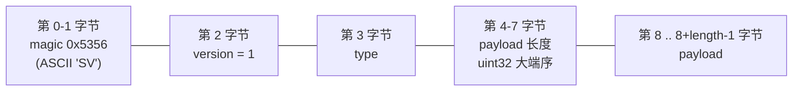
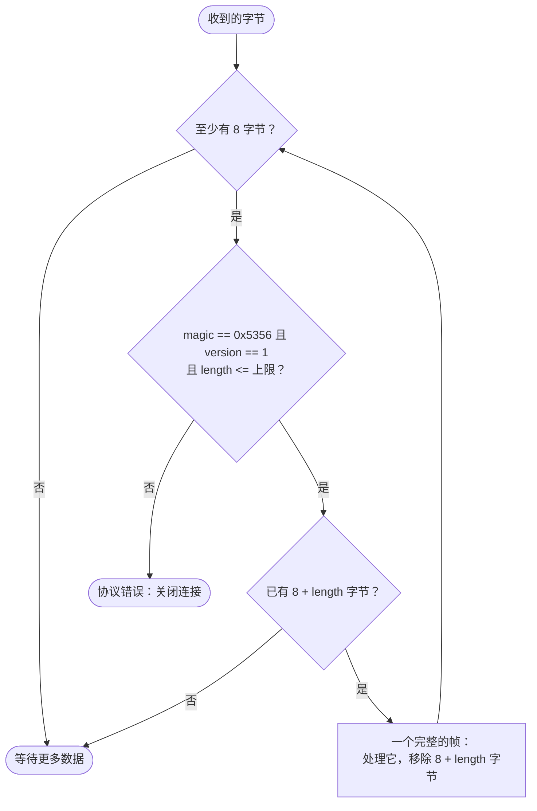
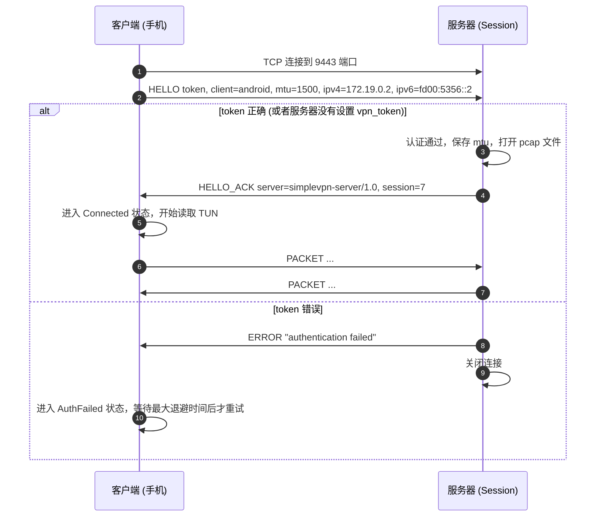
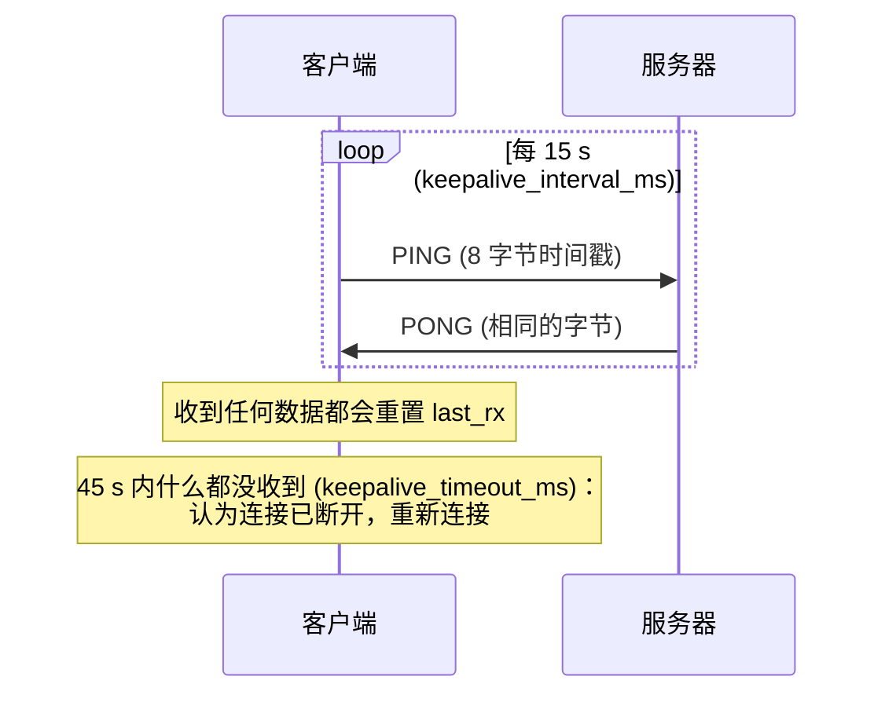
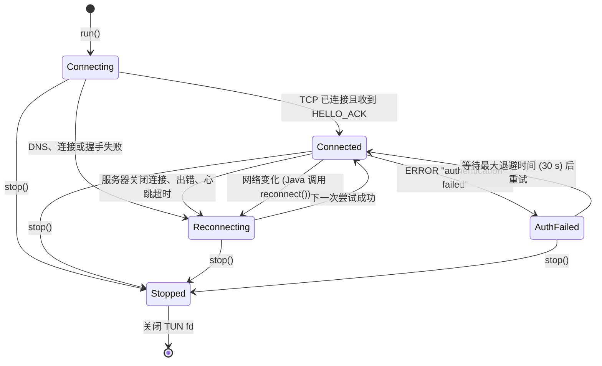
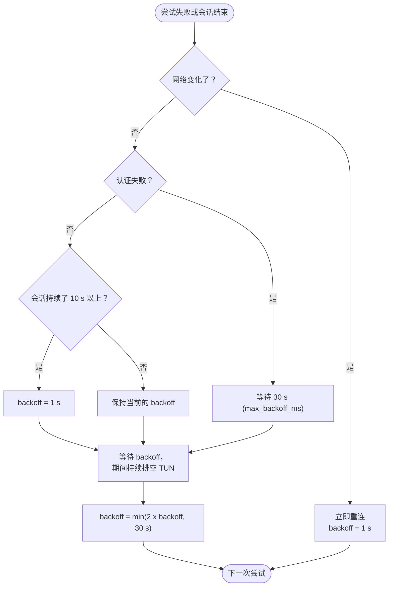

# 隧道协议

[English](../en/tunnel-protocol.md) | **简体中文** · [README](../../README.zh-CN.md) · [架构](architecture.md) · [Android 客户端](android-client.md) · [Inspector 与抓包](inspector-and-capture.md) · [学习指南](learning-guide.md) · [配置](configuration.md) · [测试](testing.md) · [源码导读](source-tour.md)

手机和服务器之间通过**一条 TCP 连接**通信（默认端口 9443）。格式定义在
[`common/tunnel_protocol.h`](../../common/tunnel_protocol.h) 中，这个头文件被 Android 客户端、
Linux 测试客户端和服务器插件原封不动地共用。

## 1. 为什么用 TCP，为什么要分帧

* TCP 提供有序、可靠的传输，几乎能穿过所有防火墙和 NAT；对学习来说它是最简单的传输方式。
  （代价是 “TCP over TCP”：隧道中丢失一个报文段，会拖慢隧道里的所有连接。UDP 隧道可以避免这个问题——
  参见 README 中的“以后可以做的”列表。）
* TCP 是**字节流**，而我们要传输的是一个个独立的 IP 包。所以每个 IP 包都被放进一个带长度头的**帧**里；
  接收方再把字节流切回成一个个包。

## 2. 帧格式



| 字段 | 大小 | 含义 |
|---|---|---|
| magic | 2 | `0x53 0x56`；用来识别不讲这个协议的对端（例如浏览器误连到这个端口） |
| version | 1 | `1`；将来不兼容的格式会使用别的数字 |
| type | 1 | 帧类型（见下表） |
| length | 4 | payload 长度，网络字节序，最大 65535 + 1024 |
| payload | length | 取决于帧类型 |

| 类型 | 值 | 方向 | Payload |
|---|---|---|---|
| HELLO | 1 | 客户端 → 服务器 | 文本行 `key=value\n`：`version`、`token`、`client`、`mtu`、`ipv4`、`ipv6` |
| HELLO_ACK | 2 | 服务器 → 客户端 | 文本行：`server`（软件名称）、`session`（id） |
| PACKET | 3 | 双向 | 恰好一个 IPv4 或 IPv6 包，以 IP 头开始 |
| PING | 4 | 双向 | 任意字节（客户端发送一个 8 字节的时间戳） |
| PONG | 5 | 双向 | 原样返回的 PING payload |
| ERROR | 6 | 双向 | UTF-8 编码的原因文本；发送方随后关闭连接 |

### 把字节流切分成帧



`tunnel::parse_header()` 实现了这些检查。在服务器上，它由 `handle_input_from_client`
（reactor 引擎的分帧钩子）调用，所以插件看到的永远是完整的帧；在客户端，
`TunnelClient::run_session()` 自己执行同样的循环。

## 3. 握手



规则：

* 第一帧必须是 HELLO，否则服务器回 `ERROR "expected HELLO"` 并关闭连接。
* 服务器最多等待 `vpn_hello_timeout_ms`（10 s）来接收 HELLO；客户端最多等待
  `connect_timeout_ms`（10 s）来接收 HELLO_ACK。
* 客户端在收到 HELLO_ACK 之前不读取 TUN，所以不会有任何包在未认证的情况下发出。
* `mtu` 告诉服务器发往手机的包最大可以多大；更大的包会被分片
  （参见[架构 § 10](architecture.md#10-ip-分片)）。

## 4. 心跳



为什么客户端需要自己的心跳：当手机悄无声息地断网时（NAT 超时、走出 Wi-Fi 覆盖范围），
TCP 连接要过很多分钟才会察觉。定期的 PING 能让 NAT 映射保持有效，而收不到应答则能在 45 s 内
发现路径已断。另外，服务器会关闭空闲时间超过 bind 文件中空闲超时（300 s）的隧道。

## 5. 客户端状态机

这些状态会报告给 App（`tunnel_client.h` 中的 `TunnelState`，数值与 `MyVpnService.kt` 中的
`STATE_*` 常量相同）：



### 重连退避



断开期间，客户端会持续从 TUN 中**读取并丢弃**数据包。否则 TUN 队列会被填满，App 会卡在写满的
socket 缓冲区上，而不是快速失败然后重试。

## 6. 字节示例

一个带 8 字节 payload 的 PING：

```text
53 56 01 04 00 00 00 08   e8 03 00 00 00 00 00 00
\___/ \/ \/ \_________/   \_____________________/
magic v  t  length = 8     payload (时间戳，示例)
```

一个携带 60 字节 TCP SYN 的 PACKET：

```text
53 56 01 03 00 00 00 3c   45 00 00 3c ...   (IPv4 头以 0x45 开始)
```

你可以自己观察这些字节：在服务器上用
`tcpdump -i any -w tunnel.pcap port 9443` 抓取隧道端口，然后用 Wireshark 打开（*Follow TCP stream*）。

## 7. 安全方面的考虑

| 属性 | 现状 |
|---|---|
| 认证 | HELLO 中的共享 token（明文） |
| 机密性 | **无**：隧道没有加密 |
| 完整性 | 只有 TCP 校验和 |
| 防重放 | 无 |

在实验环境之外使用时，请把隧道放在 SSH 端口转发、WireGuard 或 TLS 代理（stunnel）之中。
自己实现一个 TLS 隧道会是个不错的练习。
